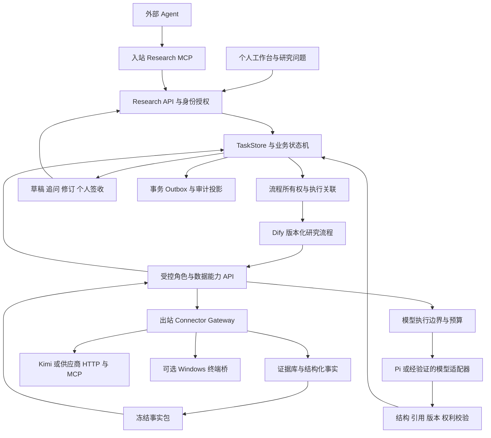

# A 股个人投研系统 Docker 与工作流重构蓝图

日期：2026-10-20，Asia/Shanghai。项目：`E:\stock agent`。审查基线：`004e4da3b698f1029c9d74f42813fbe772397fc6`。

本方案供 GLM 实施。用户本轮明确：先供自己日常投研，之后扩展多人协作；股票软件尚未确定；允许参考 `F:\GitHub项目` 中收藏的项目；希望容器化，并重新比较 n8n 与 Dify，开放 MCP 和外部 Agent 接入。

建议继续使用 **Dify 作为研究编排平台，Python 作为业务和数据权威，Docker Compose 作为部署方式**。入站 Research MCP 面向外部 Agent，出站 Connector Gateway 面向金融数据和工具。先交付一个可靠的个人研究产品，再增加连接器和并行研究角色。

这是重新审查后的建议，不把 10 月 13 日的 Dify 决定当作禁止比较 n8n 的理由。本轮只新增交接文档，不安装平台、不修改业务代码、不启用供应商或真实模型。

配套文件：

- [当前审查与证据](implementation/CODEX_REAUDIT_20261020.md)
- [GLM 文件级任务书](GLM_REFACTOR_TASKBOOK_20261020.md)
- [外部项目复用矩阵](REFERENCE_REUSE_MATRIX_20261020.md)
- [GLM 开工入口](GLM_START_HERE_20261020.md)

## 1. 应当做成什么产品

### 1.1 个人阶段的目标

一个围绕自选股、主题和研究问题工作的 A 股研究工作台。它每天告诉你有哪些值得关注的新事实，解释这些事实与原有判断有什么关系，指出证据缺口，并保留你追问、修订和最终判断的过程。

最小价值闭环：

```text
自选股或研究问题
  → 获准公告、财报、行情和新闻线索
  → 去重、归一化、原件和事实核验
  → 持久研究案件
  → 有引用的研究草稿与反证
  → 你追问、补证或否定
  → 新版本研究
  → 个人签收与后续观察
```

个人签收只表示“我看过并接受作为自己的研究材料”。它不产生机构质量批准、合规放行、发布批准、交易指令或生产 GO。

模型生成草稿完成与用户签收是两个状态。即使模型没有提出补充问题，用户仍能主动追问、否定或发起新一轮研究。已签收后的新公告形成新意图/关联任务，保留旧终态；“重试上次提交”与“使用最新资料重新研究”是两个明确操作。

### 1.2 首发范围

优先建设三类研究：

1. **公告与事件点评**：业绩预告、财报、重大合同、回购分红、监管和治理事件。
2. **单公司研究卡**：业务、收入结构、关键财务变化、估值假设、风险、待核实问题及其证据。
3. **自选池持续跟踪**：与上次判断相比新增了什么、哪些假设被支持或削弱、需要何时复查。

行业横向比较、宏观主题、研报阅读、技术指标背景依次扩展。全市场实时扫描、Tick 大规模存储、策略回测和账户连接都不进入首发关键路径。

行情和财务计算用确定性代码，模型负责归纳、解释、提出假设和反证。估值结果显示输入、公式、单位、时间与敏感性，模型不能自行补齐缺失数字。

### 1.3 每天的使用方式

| 时点 | 用户看到什么 | 系统做什么 |
| --- | --- | --- |
| 开始研究时 | 自选池、上次研究、待处理事项 | 增量读取获准源，显示数据时间及缺口 |
| 出现重要事件 | 一张事件卡，附原件、变化、重要程度和原因 | 去重、事件版本化、按规则入案件 |
| 打开案件 | 原文与事实、分析草稿、反证、未知项 | 有限多轮研究，每个结论绑定引用 |
| 追问或补资料 | 本轮新增输入、预计需要的数据和额度 | 建新输入快照，旧结果保留，不覆盖历史 |
| 完成阅读 | 接受、否定、继续补证、稍后复查 | 记录真实个人反馈和待观察项 |
| 收盘后 | 自选池变化、今日新增研究、仍缺证据的项目 | 基于已完成案件生成摘要，避免重复模型调用 |
| 每周复盘 | 哪些提醒有用、哪些研究错误、花了多少时间和额度 | 形成规则和提示词变更候选，经确认后再发布 |

时间均为建议使用节奏，不代表本轮创建了任何定时任务。交易日由明确的交易日历和数据源决定，不能简单按周一至周五推断全部交易日。

### 1.4 界面只保留六个主要入口

| 入口 | 主要信息 |
| --- | --- |
| 今日 | 重要变化、待你处理、数据异常、预算余量 |
| 自选与主题 | 股票代码与交易所、主题、关注问题、跟踪频率 |
| 研究案件 | 事件、问题、状态、版本、草稿、追问、个人签收 |
| 证据与数据 | 官方原件、结构化事实、来源时间、口径、冲突与缺失 |
| 研究库 | 已完成研究、公司时间线、相似历史事件 |
| 运行与设置 | 数据连接、模型、流程版本、额度、失败原因、恢复入口 |

保留既有案件/证据/摘要页面，先改善导航和闭环。当前内嵌页面可以逐页提取模板与静态资源，不把前端框架重写设为容器化前置。机构控制详情放入独立入口，个人首页仍清楚显示真正影响研究的缺证据、来源权限和模型外发问题。

## 2. 当前资产与改造重点

当前代码已具备：

- 104 个 Python 源文件、120 个 Python 测试文件；本轮按文件内容统计约 47,319 行源代码、26,644 行测试代码。
- SQLite TaskStore、事务 outbox、任务消费登记、租约、取消、输入版本和个人反馈。
- 官方原件库、结构化底稿、引用校验、来源登记、行情与 LLM 治理。
- 受限 Pi 推理、有限多轮研究、模型预算预留。
- Kimi 客户端、候选契约、查询缓存与账本、查询页面。
- Dify 服务凭据、受控 API 和候选结果收件能力。

这些是静态代码资产，不是已完成 Docker 部署、真实 Kimi 接入或 Dify 研究流程的证明。当前 Kimi 查询未完整接入主供给链，Dify 候选结果尚无完整的分派绑定与原子采纳。

本轮还确认了直接影响研究价值的缺口：`research_worker.py` 当前主要投递 `title_metadata_only_not_body_analysis`；`evidence_parsing` 与 `evidence_facts` 的核心函数尚未接入生产调用，文本层 PDF 仍未实现。个人面板缺创建研究/导入原件/取消的完整入口，反馈表单仍要求 actor 与 JSON patch。后续必须先把“读到什么”和“用户能做什么”做实。

优先修复的交界问题：

| 类别 | 必须补齐的行为 |
| --- | --- |
| 输入版本 | 数据库列与 payload 不再各自表示版本；补证后旧事实包失效 |
| 正文与用户闭环 | 原件解析到可引用事实；主动追问不依赖模型提问，完整阅读与新研究入口可用 |
| 请求结果未知 | 超时可能已收费时，不自动重发；保留预算占用并对账 |
| 幂等 | 平台新 run 不产生新的业务意图；同业务重试复用任务 |
| 并发 | HTTP 线程、SQLite 连接、凭证核销和查询预算有明确事务边界 |
| 租约 | 调用中续租、容器退出排空、旧 worker 结果拒收 |
| 数据权利 | 原始产物、缓存、日志、事实包均遵守留存和外发权限 |
| Dify 结果 | 只有后端签发的当前 attempt 和冻结输入才能被采纳 |
| 跨平台 | 数据根、身份、Host/Origin、进程生命周期和依赖锁适配 Linux |

不能只添加 Dockerfile 后把这些问题交给 Docker restart policy。

## 3. Dify 与 n8n 的选择

### 3.1 任务适配比较

以下为针对本项目的工程判断，不是平台性能排名。

| 判断维度 | Dify | n8n | 本项目选择 |
| --- | --- | --- | --- |
| 研究步骤、提示词、模型输出与交互 | 工作流/Chatflow 直接围绕 AI 应用 | 可组合 AI 节点与通用流程 | Dify 更贴近研究产品当前重心 |
| 外部业务系统、定时、Webhook、消息流转 | 能用 Trigger/HTTP/工具，但需核版本 | 通用集成与任务自动化是主要使用场景 | 若以后跨系统运营增加，再评估 n8n |
| MCP | 支持相关工具与发布能力，须核版本/传输 | 有 MCP Client Tool 与 Server Trigger | MCP 不是必须选某个平台的理由 |
| 现有投入 | DF-01/DF-02 已有代码和离线测试 | 本项目没有等价接入资产 | 复用 Dify 接口，抽出中性业务服务 |
| 持久任务与计费治理 | 仍需本项目后端承担 | 仍需本项目后端承担 | 两者均不替代 TaskStore |
| 人工审批 | Human Input 可收集反馈，身份需额外绑定 | 表单/等待/审批工作流也需身份与后端授权 | 受保护决定在业务后端完成 |
| 运维 | 官方 Compose 包含多种服务及依赖 | 可单实例起步，queue 扩展另需 DB/Redis 等 | 实测资源后选部署规格 |
| 产品许可 | 修改版 Apache 条款，存在多租户和前端标识条件 | Sustainable Use 与 Enterprise 部分分开 | 内部个人试用与未来商业产品分别审核 |

官方依据：[Dify Compose](https://docs.dify.ai/en/self-host/deploy/quick-start/docker-compose)、[Dify Human Input](https://docs.dify.ai/en/self-host/use-dify/nodes/human-input)、[n8n MCP](https://docs.n8n.io/integrations/builtin/core-nodes/n8n-nodes-langchain.mcptrigger)、[n8n queue mode](https://docs.n8n.io/deploy/host-n8n/configure-n8n/scaling/enable-queue-mode.md)。具体功能必须在固定部署版本实测，不能把最新文档等同于本地能力。

### 3.2 建议决策

主线选择 **Dify + Python**；首发不同时常驻 Dify 与 n8n。接口按平台无关形式设计，保留 Dify 兼容 façade。

允许以后切到 n8n 的明确条件：

- 用户重心变成大量跨系统采集、通知与运营自动化，研究步骤较简单；
- 固定 Dify 版本无法满足必要流程或在目标机器上的资源验收不通过；
- n8n 用同一后端契约完成对照样例，并显示实际维护或资源收益；
- 切换有单一调度者、任务对账和未知外发处理证据。

后续如果确有同时使用的需求：n8n 仅做外部事件接入/通知，Dify 做已登记的研究子流程；同一业务意图只能有一个推进者。两者不能互相循环触发，不能各自发起完整 daily 研究。首发没有必要承担这套复杂性。

### 3.3 两步接入 Dify

**过渡步骤：整链模式。** Dify 接受研究问题，调用后端创建任务，有限轮询并显示案件链接。Python worker 负责完整研究，Pi 是唯一推理适配器。Dify 不再额外调用模型润色结果。

**目标步骤：角色模式。** Dify 可视化组织事实分析、反证和综合草稿，每一步调用后端受控角色 API。后端持有输入快照、提示词版本、模型权限、预算和结果采纳权。此模式禁用同任务 Python 的整链自动推进。

Dify 原生 LLM/Agent 节点是后续选项。只有代理层能强制校验每次外发、预算、提示词/角色版本及结果引用，且平台没有可绕过的独立 provider key 时才可启用。仅把 API key 换成代理 key、或仅在工作流开始检查一次，都不足以验收。

过渡整链模式的退出标准是“一个角色流程完成等价负向测试和真实个人案例”，不能让 Dify 永久成为只有一个 HTTP 节点的空壳。

## 4. 目标架构



图描述目标角色模式；过渡整链模式由 Python worker 推进研究，不同时让 Dify 推进同一任务。

### 4.1 模块边界

| 层 | 权威职责 | 可替换部分 |
| --- | --- | --- |
| 产品入口 | 用户身份、范围、反馈、展示 | 现有页面可渐进整理 |
| 研究服务 | 案件、任务、版本、执行归属、结果采纳 | HTTP 与 MCP 共用服务层 |
| 数据服务 | 来源权利、契约、查询预算、缓存、归一化 | Kimi、直连厂商、文件导入、终端桥 |
| 证据服务 | 原件哈希、来源、事实、引用、撤销与缺口 | 先本地内容寻址，后对象存储 |
| 编排服务 | 固定流程版本、分支、受控步骤 | Dify 首选，n8n 为可替换适配器 |
| 推理服务 | 输入最小化、调用治理、预算、结果回执 | Pi 过渡，其他执行器须等价验收 |
| 运维 | 依赖锁、探针、日志、恢复、备份 | Docker Compose 起步 |

保持模块化单体。上述“服务”首先是逻辑边界，只有凭据隔离、网络隔离或独立生命周期需要时才拆成独立容器。

### 4.2 三类状态必须分开

| 状态对象 | 示例 | 权威 |
| --- | --- | --- |
| 业务案件/任务 | queued、running、awaiting_evidence、awaiting_human、completed、cancelled、blocked | Python TaskStore |
| 外发 attempt | prepared、dispatched、succeeded、failed_known、outcome_unknown、reconciled | 调用账本 |
| 平台 execution | submitted、running、waiting、succeeded、failed、stopped | Dify/n8n 状态映射 |

平台成功不能自动完成业务任务；任务取消不能证明已发出的供应商请求没有收费。网络 exactly-once 不作为承诺：本项目使用稳定幂等键、唯一分派、结果去重和未知结果对账处理不确定性。

### 4.3 共同标识与事件契约

每个命令/回执携带：

```text
business_intent_id
case_id / task_id / scope / subject_id
input_version / input_snapshot_sha256
workflow_owner / workflow_version_sha256 / execution_generation
dispatch_id / platform_execution_id
attempt_id / fencing_token
command_id / expected_version
evidence_bundle_id / evidence_bundle_sha256
result_artifact_id / result_artifact_sha256
trace_id / requested_at / observed_at
```

业务意图从前端或接入端首次持久化，平台重试沿用。`dify_run_id`、n8n `$execution.id`、容器 PID 和临时连接 ID 都不承担业务身份。

定时意图可按“已登记 schedule ID、计划时隙、交易日、研究范围版本”生成，恢复同一时隙沿用该意图。新资料刷新和用户明确重新研究生成新意图并关联旧任务。不能仅用问题文本永久去重，否则隔天问相同问题可能只得到旧结果。

task 的状态变更、一次性命令消费与 outbox 写入同事务；异步发布按 event_id 去重。迟到结果必须匹配当前 generation、版本、attempt、owner 和证据包。输入或流程换版会使旧候选失效。

## 5. Docker 迁移设计

### 5.1 本机条件与部署选项

本轮只读快照：16 逻辑核、15.7 GiB 内存；C 盘约 7.8 GiB、E 盘约 85.2 GiB 空闲。Windows PATH 和标准位置未发现 Docker CLI/Desktop；WSL Ubuntu 为 Stopped、版本 2。本轮没有启动 WSL，因此发行版内部 Docker 状态仍待查。

旧 DF-01 的磁盘数据已过时。Dify 官方文档给出的最低值不是完整项目常驻容量保证。当前机器先以一个编排器、一个研究 worker 和无本地大模型做资源验证。

推荐本机开发路线沿用已有候选：WSL2 Linux 环境内单一 Docker Engine；Docker Desktop 是可选替代，二者不要混装管理同一环境。长期无人值守时可移到专用 Linux 主机，应用层使用同一镜像和契约。

源码保留项目目录，运行数据使用 Linux 文件系统上的 volume。若选择本机 E 盘存储，应使 WSL 虚拟磁盘、Docker data-root、构建缓存、镜像、临时文件和备份的实际底层位置都可核对。`F:\GitHub项目` 本轮作为只读参考库，不自动变成项目状态目录。

Docker 官方说明 Desktop 的 WSL 数据默认落在用户 C 盘目录；迁移前必须明确实际位置。[Docker WSL 文档](https://docs.docker.com/desktop/features/wsl/)

### 5.2 首批部署单元

| 单元 | 初期形态 | 挂载和网络 |
| --- | --- | --- |
| research-api | 业务镜像，单实例 | 只在内部网络监听，经 edge 暴露 |
| research-worker | 同一业务镜像，单实例 | 必要状态/证据目录、受限外发 |
| edge | 反向代理 | 宿主回环端口；SSE 禁缓冲 |
| Dify | 固定官方版本与依赖 | 独立 Compose project/DB/凭据；不挂业务数据卷 |
| data gateway | 先模块；凭据/出站隔离成熟后独立容器 | 仅供应商白名单出口 |
| Research MCP | API façade，初期可同应用部署 | 同授权服务，不能绕过业务入口 |
| Windows bridge | 仅明确需要时在宿主运行 | 精确只读能力；不与 Linux 共享 DB 写权限 |
| backup | 手动维护 profile | 一致快照及隔离恢复，不默认定时 |

初期 SQLite 放单机 Linux 本地 volume，不放网络共享盘；同一业务库不跨 Windows/Linux 两侧同时写。API 和 worker 每个请求/事务独立连接，所有关键复合动作事务化。JSONL 域账本写入必须序列化，进程边界清楚。

### 5.3 容器交付要求

- 业务代码只读；镜像内不含 `.env.local`、本地配置、名册、证据原件、历史数据、`.git`、宿主虚拟环境和个人凭据。
- Python 使用新建 Linux 3.12 锁定环境，不能复制 Windows `.venv312`。Windows 3.11/3.12 验收保留，Linux 增独立证据。
- Node/Pi 按现有 package lock 在构建期安装，运行时不得 npm/pip 安装。
- 基础镜像和第三方服务固定具体版本及 digest。当前 Dify 1.17.1 仅为已有候选锚，不宣称是永久最新版本。
- 现行 release-audit 依赖 Git，容器不带 `.git` 时必须增加可验证的构建来源链：镜像内保存源码/依赖/Pi/流程清单，构建后在外部制品证明中绑定镜像 digest 与清单哈希。运行侧只读验真；缺 Git 不能直接忽略，不把镜像自身 digest 填进会改变镜像的内部文件。
- 非 root、最小可写目录、临时目录配额、日志轮转、资源限制、无 Docker socket、无整个 HOME/磁盘挂载。
- 配置只给 secret 引用，秘密在受限文件或批准的秘密服务中提供；Docker Compose secrets 本身不等于加密存储。
- 数据库/Redis 不暴露宿主端口；Dify 与业务 DB 使用不同账号和数据库，不能共用应用表。
- 明确 `APP_CONFIG_ROOT / APP_STATE_ROOT / APP_EVIDENCE_ROOT / APP_REPORT_ROOT / APP_TEMP_ROOT`，由服务初始化后传递。
- 持久时间统一 UTC，业务日/预算日/交易时隙显式使用 Asia/Shanghai；跨午夜、休市与时钟偏差有单独规则，不能依赖镜像默认时区。
- 增加 `/livez`、`/readyz`；探针不采集、不调用模型、不修改业务。

### 5.4 生命周期与恢复

SIGTERM：停止接新任务 → 已发请求记录当前阶段 → 有界排空 → 持久化 checkpoint/outbox → 回收子进程 → 退出。若强制终止，下一实例先审视 lease 与 attempt，不盲目重发。

持久租约用实例 UUID 和 fencing，不能仅比较 PID。运行中的调用需要心跳；心跳丢失后禁止新增外发。预算必须预留后发出，未知结果不能立即退还额度。

技术 readiness 与业务 BLOCKED 分开。人员或供应商尚未批准时，服务仍可健康运行并清楚显示业务阻塞，不能因此反复重启。

### 5.5 何时迁 PostgreSQL

不把全量数据库迁移和首次 Docker 化捆绑。先修复单机 SQLite 的事务和连接用法，跑通一条容器闭环。

出现以下任一需求时进入独立 PostgreSQL 工作包：

- 多主机或多个业务写实例；
- 并发任务/查询预留显著争用，单写者成为已测瓶颈；
- 多人远程协作需要可靠事务授权消费与运维恢复；
- 本地文件事实源无法满足新的部署故障域。

先定义 repository 接口和迁移 manifest，再迁 TaskStore、调用预算、query intent、dispatch 与 outbox。历史 JSONL 原件/底稿事件不为了数据库统一而重写；通过事件索引和投影逐步关联。

## 6. 信息获取与 Kimi 接入

### 6.1 数据优先级

| 优先级 | 数据 | 用途与接入规则 |
| --- | --- | --- |
| 1 | 官方公告与财报原件 | P0/P1 证据基础；精确获准 URL、原件留存及哈希 |
| 1 | 日线与基础财务观测 | 公司背景和财务比较；先日线，不冒充盘中 |
| 2 | 财经新闻、事件线索 | 提醒与检索入口；不能替代官方原件 |
| 2 | 行业分类、成分、公司资料 | 股票归一化、横向比较、行业背景 |
| 3 | 宏观、产业、工商、法律数据 | 明确研究问题触发后按需查询 |
| 4 | 盘中行情与订阅 | 真实需要、账号权限和吞吐验证完成后接入 |

### 6.2 三条 Kimi 路线分开评估

1. **现有受控 Python 适配器**：复用类型化契约、目的地控制和宿主命名；补事务预算、缓存权利、生产接线。
2. **官方支持的 Kimi Datasource 能力**：优先确认可用于自建服务的认证、服务端调用方式和数据使用条款；不能从“官方产品内可用”推导“任意程序可复制凭据调用”。
3. **供应商直接接口**：若 iFinD/Wind 等有独立合法权限，直接 HTTP/SDK 可降低对特定 Kimi 网关的耦合。

Kimi 官方资料确认 Datasource 属于只读查询，并消耗 Kimi Code 账号额度。它支持的产品内数据能力不能单独证明本项目拥有无人值守调用、长期存储或向其他模型外发的权利。[官方插件说明](https://www.kimi.com/code/docs/kimi-code-cli/customization/plugins)

外部收藏的 `kimi-datasources` 是待核的代码资产，不是自动获批的官方 SDK。不得自动扫描桌面凭据、读取共享 OAuth token、整包导入 `.mcp.json` 或借用其他项目的账号。

### 6.3 第一个 Kimi 实施切片

从已有四类候选中按权限选择：iFinD 日行情、公告元数据、财务三表、东方财富新闻。

实施次序：

```text
真实契约与账户可用性核对
 → 来源用途/留存/外发/预算分别登记
 → query intent 原子创建及额度预留
 → 固定目的地执行
 → 响应大小与文件路径检查
 → 结构化标准化
 → 官方原件补全
 → 可引用事实包
 → 研究任务消费回执
```

所有步骤记录 query_id、上游 provider、account quota group、契约版本、请求哈希、数据时间、返回状态与消耗。401、403、429、空数据、契约漂移、解析失败、结果未知分别处理。

### 6.4 金融数据规范

最少字段：

| 维度 | 字段及要求 |
| --- | --- |
| 标的 | security_id、交易所、原始代码、标准代码、名称有效期 |
| 时间 | published_at、effective_at、observed_at、as_of、交易日、时区、修订版本 |
| 行情 | 周期、前后复权/不复权、币种、单位、成交量口径、停牌和缺失标识 |
| 财务 | 报告期、公告日、合并/母公司、原始/更正、会计口径、单位和币种 |
| 来源 | upstream_id、connector_id、原文 URL、对象哈希、供应商请求 ID |
| 权利 | purpose、rights_revision、retention_policy、external_send_policy、expires_at |
| 质量 | freshness、冲突、缺字段、未来时间、异常值、解析置信与人工核查需要 |

数字优先保存精确十进制或原始文本加类型；不把缺失值填成零。模型不计算 CAGR、同比、估值或财务比率；公式由固定代码实现，保留分子分母和单位。

同上游通过 Kimi、HTTP 和 MCP 三条路返回，不算三个独立行情源。日线数据也不因为采集时间是现在就成为实时行情。

### 6.5 缓存、证据和向量检索

缓存只为减少重复查询，不是原件档案。读取时重新核对权利、用途、时间、撤销和契约；上游财报更正可触发新 refresh intent，不能永久复用旧 query。

本地原件库与结构化事实是权威；Dify 知识库或向量库只作为可重建索引。先使用已有结构化查询和全文检索，确有跨大量文档语义检索需求再加 RAG。撤权/撤销必须使索引结果不可再进入事实包。

文档解析器可复用成熟项目，但需对页码、表格、单位和原文定位做专项评测；OCR 置信度不能替代财务数值核验。上传到外部解析服务本身也是一次数据外发。

## 7. MCP 与外部 Agent

### 7.1 两种方向

| 方向 | 调用者 | 目的 |
| --- | --- | --- |
| 入站 Research MCP | 用户选择的外部 Agent/客户端 | 查询研究、提交研究意图、提交候选备注 |
| 出站 Connector Gateway | 本项目受控执行器 | 调用供应商 MCP/HTTP/终端桥取得数据 |

两者共享能力契约，但认证凭据、网络出口和审计主体分离。MCP 是传输与工具接口，不提供数据权益、研究正确性或自动批准。

首批入站工具建议：

```text
research.search_cases
research.get_case
research.get_evidence_summary
research.get_quote_snapshot
research.submit_intent
research.get_job_status
research.submit_candidate_note
```

`submit_*` 是写入研究任务/候选的能力，需要独立 scope、幂等和预算；不能因为业务“只研究”就把所有工具标为只读。审批、发布、provider 激活、任意 SQL/Shell/URL/文件访问和交易工具不在工具表。

### 7.2 连接器登记

每个 connector 的版本化登记包括：

- 标识、owner、来源仓库、commit/digest、许可证状态、维护联系人。
- 传输协议与协商版本、精确 endpoint、DNS/重定向策略、TLS/认证方式、secret 引用。
- 上游来源及共用额度组；工具白名单和输入/输出 schema hash。
- 读写副作用、收费属性、允许的数据分类/用途/留存/外发、字段级脱敏。
- 请求/响应上限、并发、RPM、日额度、超时、熔断和未知结果策略。
- 测试矩阵、契约最后核验时间、停用/撤销方式。

目录发现与运行授权分开。`tools/list` 返回新增工具只能形成待审变更，不能直接扩权。Tool annotations 仅作描述，不作为权限证据。

### 7.3 SDK 和网络策略

优先官方 MCP SDK 和已审阅的实现，避免继续手写不完整 JSON-RPC。固定 SDK/协议兼容矩阵；供应商旧 SSE、Streamable HTTP、stdio 的能力分别测试，不假定“都叫 MCP”就互通。

受信的本地 stdio 连接器用固定命令和构建产物，不能运行模型拼出的 shell。远端连接用受众绑定的认证和精确出口；不得透传客户端 token 作为供应商凭据。HTTP 元数据发现和重定向也需防 SSRF。[MCP 安全规范](https://modelcontextprotocol.io/docs/2026-07-28/tutorials/security/security_best_practices)

新接一类 MCP 的完整成本包括契约、权限、配额、留存、异常和撤销测试。能力目录可以容纳很多连接器，但日常每个研究角色只获得当次必要的少量工具。

### 7.4 多 Agent 分工

| 角色 | 输入 | 输出 | 首发方式 |
| --- | --- | --- | --- |
| 研究规划 | 问题、范围、已有事实 | 有限研究计划与补证意图 | 单角色，可规则辅助 |
| 事件/基本面分析 | 冻结事实包 | 声明、推断、假设、引用 | 受控角色 API |
| 数据核算 | 明确指标与原始观测 | 确定性计算及口径 | Python，不用 LLM 心算 |
| 反证 | 原结论和证据包 | 反例、冲突、证伪条件 | 模型辅助，不冒充独立人工 |
| 综合草稿 | 已校验各角色结果 | 研究卡与待核实项 | 最后一个必要模型步骤 |
| 质量检查 | 引用、数值、版本、权限 | 校验报告与拒收原因 | 规则优先，模型仅辅助文字 |

先 2—3 个必要推理角色，初期按串行或小规模并行。子任务提案进入持久 task graph 前校验父任务范围、依赖、重复、总预算、深度和 fan-out。初始建议上限为深度 1、每案 3 个子任务、每角色 2 轮修订；这是待评测参数，不自动写入生产配置。

GLM 在本任务中是开发实施者，不因此成为产品默认推理模型。保留现有模型配置，任何切换另走候选评测。

## 8. 股票软件如何接

股票软件未定不阻塞项目。先定义用户实际需要的能力，再挑软件。

| 需求 | 首选方式 | MCP 的位置 |
| --- | --- | --- |
| 导入自选股 | 官方导出 CSV/约定格式文件 | 可选包装为受控导入工具 |
| 查行情和财务 | 厂商官方 HTTP/SDK | 给同一能力增加 Agent 调用方式 |
| 打开软件查看标的 | 已支持的深链接/固定桥接动作 | 只执行明确动作，不远程操纵全部桌面 |
| 输出研究结果 | Markdown/HTML/PDF/研究链接 | 返回 artifact ID 和可访问链接 |
| 桌面 SDK 必须运行在 Windows | 独立最小 Windows bridge | 网关调用桥，不直接控制终端 |
| 账户、持仓、下单 | 不属于当前研究首发 | 不发布交易工具 |

已核官方信息：iFinD 提供 Windows/Linux SDK 与 HTTP 接口；部署不必天然绑定桌面 UI。[iFinD 下载与接口](https://quantapi.51ifind.cn/gwstatic/static/ds_web/quantapi-web/download.html)

迅投 xtdata 官方说明其行情交互经 MiniQMT 完成，因此应按客户端依赖设计桥接；具体 Python 版本、授权和券商发行版需要在选定安装包验收，不沿用网上泛化版本表。[迅投 xtdata](https://dict.thinktrader.net/nativeApi/xtdata.html)

不优先选择 UI 自动点击取数、读取未公开终端数据库或社区逆向行情协议。若用户只有文件导出权限，先把文件导入做可靠，研究核心照常建设。

Windows bridge 与 Linux 业务内核之间只传 schema 化数据、请求 ID、来源和时间；不共享任务数据库，不接受任意路径，不暴露宿主 shell。终端掉线时案件显示数据缺口。

## 9. 个人模式与多人模式

### 9.1 个人模式

新增或明确 `scope=personal_research`，与机构案件状态隔离。一个真实用户可以创建、追问和签收自己的个人研究；所有个人动作显示真实身份来源与时间。

个人模式仍执行来源许可、外发、证据、预算和输入版本检查。它不允许以个人账号替代机构风险复核人、质量人或批准人，也不自动修改已有 `BLOCKED/NO_GO`。

个人原件导入需要一个明确的新作用域契约：真实 owner 登录、personal_research namespace、来源/留存/外发策略与导入事件。首版个人证据目录和索引与机构档案隔离，可复用对象验证代码；它不能直接产生机构已批准原件。现有 `evidence-vault-import` 的名册/角色校验保持有效。在新契约与隔离验收完成前，手工首案使用现有获准原件或经现有真实 actor 入口导入，不能虚构 information_analyst 或关闭 roster。

现有 Windows SID 身份不直接适用于 Linux。过渡时保留 Windows 身份入口；实现容器网页登录时使用成熟认证组件，服务 token 与真人会话严格分开。不能把 Dify `user` 字段或表单中的姓名当登录证明。

Dify 官方明确邮件 Human Input 链接可由持链接者响应，因此正式身份仍由本项目验证。[Human Input 说明](https://docs.dify.ai/en/self-host/use-dify/nodes/human-input)

### 9.2 多人扩展

个人闭环稳定后再接入成员、任务分派、研究空间、角色、容量、独立挑战和机构发布流程。个人结果可以申请转入机构案件，但必须重新验证证据权限、人员和审批链，不能直接提升状态。

先单团队、单实例；只有真实多个组织需求才考虑多租户及相关许可。Dify 与 n8n 的许可审核依据分别见 [Dify LICENSE](https://github.com/langgenius/dify/blob/1.17.1/LICENSE) 与 [n8n LICENSE](https://github.com/n8n-io/n8n/blob/master/LICENSE.md)。本方案不代替项目要求的法律/合规审查。

## 10. 实施路线与投入

最快有价值的纵向切片是：共同安全修复 → 一份获准的真实 HTML/文本公告手工导入 → 正文定位与事实 → 单角色研究 → 真实用户主动追问 → 新版本个人签收。它可以先在现有受控本机入口完成，不必等待全部 Kimi 权限、PDF/OCR、股票终端或 MCP 接入。容器迁移准备与此切片并行，不能把安装所有平台作为“开始使用”的条件。

| 阶段 | 结果 | 主要工作包 | 阶段出口 |
| --- | --- | --- | --- |
| P0 修复基线 | 状态、幂等、预算、证据问题可重现并修复 | R00—R06 | 离线关键负向场景通过，原生阻断独立列出 |
| P1 可迁移内核 | 明确路径、锁、身份和运行入口 | R07—R10 | Linux 候选镜像与隔离生命周期验收 |
| P2 个人闭环 | 自选事件到草稿、追问、修订、签收 | R11—R15 | 一个真实公开事件留齐证据 |
| P3 编排与接入 | Dify 角色模式、Research MCP、数据网关 | R16—R19 | 单 owner、受控角色、工具越权测试通过 |
| P4 数据和体验扩展 | 文件/终端桥、检索、个人复盘 | R20—R22 | 有明确场景收益与成本证据 |
| P5 稳定部署 | 恢复、切换、观测、长期运行 | R23—R25 | 隔离恢复和受控切换通过 |
| P6 团队化 | PostgreSQL/多人身份/正式业务流程 | R26—R28 | 真实团队与业务门禁另行验收 |

工作包依赖以任务书为准，编号不代表必须串行全部执行。P2 的个人页面和 P1 的镜像准备可在稳定接口之后并行；共享 TaskStore/治理模块由一个负责人串行合并。

以一名主要实施者、独立审查、真实凭据及时可用为假设：可靠个人闭环约 4—8 周，容器与 Dify 角色模式约再 2—4 周，MCP 和第二数据源按单个连接器增量交付。它是预算安排范围，不是工期承诺；源码规模、现有缺陷和账户条件会改变时间。

不设“接入 50 个 MCP”“创建 20 个 Agent”作为完成目标。

## 11. 验收与价值指标

### 11.1 五层证据

| 层 | 可证明什么 | 不能代替什么 |
| --- | --- | --- |
| 静态审查 | 代码路径、状态和风险 | 实际执行 |
| 离线 fixture | 确定性逻辑与负向拒绝 | 真实供应商、真实模型 |
| 隔离容器/浏览器 | 生命周期、网络、UI、SSE | 数据权利和真人研究效果 |
| 真实个人案例 | 一次获准数据/模型/个人反馈闭环 | 持续稳定和机构批准 |
| 多案价值验证 | 时间、质量、成本和有用性 | 未经验证的投资收益 |

任务书列有具体验收矩阵。所有报告分别写 VERIFIED、UNVERIFIED、BLOCKED、NOT_RUN；错误、跳过和后台线程异常不合并成“全绿”。

### 11.2 个人试用建议指标

- 关键事实可追溯率：P0/P1 必须符合现行官方原件要求。
- 财务数字口径完整率、引用可打开率、错误结论及漏报记录。
- 单次研究的真实人工分钟数、模型/查询次数、实际或估算费用及差额。
- 有用提醒比例、重复提醒比例、接受/否定/补证比例。
- 创建到草稿的时延、异常任务等待时间、未知外发数量。
- 同意图重复收费、越权外发、旧版本覆盖新版本：验收期目标为零。

先做一案，不伪造样本；随后积累 5—10 个不同类型个人案例，冻结方案后再按既有价值验证 SOP 做 20—30 个真实历史 P0/P1 案例与独立盲评。个人试用结果不冒充该正式盲评已完成。

## 12. 切换、回退与停止条件

切换顺序：

1. 固定源码、依赖、流程、配置 schema 与制品哈希。
2. 禁止新接单，停唯一旧调度，等待已知任务排空。
3. 对 dispatched/outcome_unknown 逐笔登记；未解决时不重放。
4. 取得应用一致快照：SQLite backup、JSONL 事件边界、对象哈希、配置引用和路径映射。
5. 在隔离目录恢复并验证 DB、引用、链、权限及任务计数。
6. 新实例先只读对照，再切唯一写者，记录 cutover generation。
7. 完成真实个人案例与失败恢复，再决定是否启用定时。

新系统尚未写入时可回到冻结旧环境；新系统已有业务写入后必须保留增量并对账，不能直接覆盖为旧备份。旧执行器不自动重做新平台未完成任务。

停止扩容/接入的条件：出现重复计费、无法解释的任务终态、跨版本证据采纳、未经许可留存/外发、身份混淆、无法恢复的账本损坏、磁盘/内存持续不足、流程平台可绕过受控边界。出现这些问题时先保全证据、禁新增外发，按具体问题修复；不删除历史让状态变绿。

## 13. 本轮授权边界与待定项

已完成的是审查与实施设计，GLM 的普通离线修复不应反复询问已明确的架构细节。当前仍需在相应阶段具备真实条件的事项只有：

- 选择本机 WSL 路线或专用服务器，并确定运行数据实际位置与资源预算。
- Kimi/数据供应商支持的认证和查询、留存、外发范围。
- 真实模型/数据查询额度和一次真实案例的材料。
- 股票软件仅在 R21 实施前确认，前置阶段不被它阻塞。
- 团队/机构启用时的真实身份、供应商批准和现行人工门禁。

收藏仓库的学习权限允许只读审查与合理借鉴，不自动激活其中脚本、连接真实账户或改变其许可证义务。具体复用选择和证据放在配套矩阵中。
