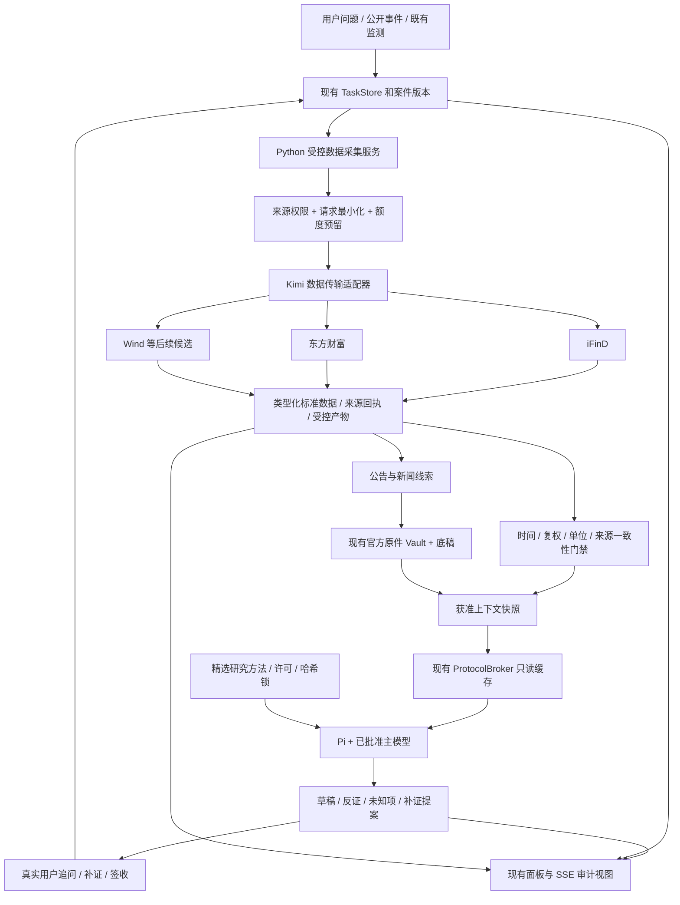

# Kimi 金融数据与 Skills 接入评估及 GLM 实施计划

日期：2026-10-12。工作区：`E:\stock agent`。

本文是设计与实施交接，不是上线证明，也不授予供应商、凭据、数据外发、生产方法或计划任务的批准。
本轮只读检查本地资产与项目接入口，并查阅官方文档；没有运行网关、读取密钥文件、安装依赖、修改业务代码或触发真实查询。

## 1. 结论与目标

**可以利用，而且对项目有价值；但不能把 222 个 skills 和 12 个 MCP 原样装入生产。**

最值得利用的是三类能力：

1. iFinD、东方财富等数据查询，补充现有行情、公告、新闻候选与财务数据。
2. 晨报、业绩点评、数据引用登记等研究方法，提高底稿和输出质量。
3. 结构化内容驱动的图表与报告渲染思路，作为后续展示改进，不替换研究事实源。

最终目标仍是：**一个可追溯、可中断、可补证的 A 股研究工作台，AI 承担有边界的研究工作，用户做关键决策。**
这不是新增一个自动交易终端，也不是改用 Kimi 取代 Pi/现有主模型。

首个交付目标：一个获准标的的一次真实公开事件，经过数据查询、来源核验、研究任务、Pi 研判、用户追问、修订和签收，在同一案件页面上看清每一步。
Kimi 接入是这个闭环的供给增强，不应成为推迟整个项目落地的另一个大重构。

本文补充 [GLM 总实施计划](GLM_PROJECT_IMPLEMENTATION_PLAN_20261011.md)，主要对应 GLM-02/03/05/06，最终汇入 GLM-07 的 W10 验收。
原总计划的身份、证据、隔离测试、许可、发布与业务启用边界继续有效。

## 2. 本轮核实与未核实范围

### 2.1 已核实的本地资产

资产根目录：

- `E:\GitHub上下载的\kimi-finance-skills`
- `E:\GitHub上下载的\kimi-datasources`

| 包 | 本地 SKILL.md 数 | manifest 版本 | 初步用途 |
| --- | ---: | --- | --- |
| institutional-finance-kit | 22 | 1.2.7 | 优先审阅晨报、业绩点评、数据引用方法 |
| xtt-public-markets-investing | 87 | 0.11.5 | 方法参考库，逐项选择，不整包加载 |
| xtt-investment-banking-private-equity | 57 | 0.8.4 | 当前 A 股公开市场 MVP 暂不纳入 |
| xtt-corporate-finance-accounting | 41 | 0.7.4 | 当前 MVP 暂不纳入 |
| dynamic-finance-charts | 1 | 1.0.17 | 后续隔离渲染候选 |
| financial-market-terminal | 14 | 1.4.0 | 数据契约和终端交互参考，不替换现有面板 |
| 合计 | 222 | 不适用 | 文件数不是独立能力数或审核通过数 |

已确认 `mcp.json` 有 12 个配置：wind、ifind、dongcai、sp、gildata、tianyancha、sec、imf、worldbank、yahoo、scholar、law。
所有配置使用裸 `python` 启动。不能直接复制到本项目，必须锁定解释器、进程边界、工作目录和环境。

已经看到一个 220 字节的 iFinD CSV，含 `600519.SH` 在 2026-10-09、2026-10-12 的两行日 OHLCV 数据。
这是现存样本文件，不是本轮独立复现的真实查询证据。文件未给出成交量单位、复权口径、查询回执或源更新时间，不能用于证明盘中实时监控已完成。

### 2.2 证据分级

| 项目 | 本轮结论 | 不能由此推出什么 |
| --- | --- | --- |
| 六个包、222 个 SKILL.md、12 个 MCP 配置 | VERIFIED：本地盘点 | 不等于 222 个技能均兼容、已审核或已授权 |
| 网关封装、拆分 MCP、Wind 原生脚本 | VERIFIED：静态代码检查 | 不等于可安全生产运行 |
| Wind describe、37 个工具列表 | 用户报告成功，本轮未重跑 | describe/list 不等于取数、权限完整或业务质量通过 |
| iFinD 真实取数 | 用户报告成功；本轮确认样本存在 | 不等于其他 11 个源成功、实时性达标或允许外发 |
| agent-gw wheel 已安装 | 用户报告，本轮未验证锁定环境 | 其他解释器能 import 不等于 `.venv312` 已锁定可用 |
| 部分源空契约是会员档位原因 | UNVERIFIED | 空契约还可能涉及认证、服务、名称、协议或权限变化 |
| 升级会员后自动可用 | UNVERIFIED | 必须重新核对实际权限、契约版本和调用结果 |
| 商业使用、正文存储、发送 DeepSeek 的权利 | 待权利与内部审核 | 查询成功、公开信息、会员购买均不能单独证明这些权利 |
| 真实模型、实时行情、生产上线验收 | NOT_RUN | 本文不新增任何完成声明 |

只核查了关键脚本、契约、清单与少量方法文件，并非对 222 个技能、自带脚本、widgets 和依赖逐行全面审计。

### 2.3 官方文档能支持的边界

Kimi 官方文档说明 Datasource 可查询金融等数据，使用前需 Kimi Code OAuth 登录，查询消耗套餐额度，插件为只读，不提供交易；实时行情与技术指标有交易时段限制。
它还说明插件安装是用户级、对所有项目生效。因此本项目不能直接在共享用户配置里整包安装。
这些说明不等于确认本地逆向网关包装的认证方式、外部自动化使用范围或所有上游数据的再利用权。[官方 Plugins 文档](https://www.kimi.com/code/docs/kimi-code-cli/customization/plugins.html)

**先核实受支持的连接方式，再确认账号可用性；先确认用途，再讨论落盘和模型外发。**
本地 `kimi_gateway.py` 自述来自桌面插件逆向，其可运行性与官方长期支持应分别登记。

## 3. 接入前必须处理的问题

以下是阻止“原样生产接入”的问题，不要求 GLM 修改外部提取目录。应在项目内建立受控适配层，保留原资产作为只读参考。

### F01 高优先级：远端文件名控制本地写入

位置：`kimi-datasources/kimi_gateway.py:157` 的 `write_envelope_files`，`mcp_source_server.py:145`。

当前直接使用响应中的 `files[].name`，绝对路径原样使用，相对路径拼接当前目录，随后创建目录并覆盖写入。
这允许返回值越出预期产物区；只读金融查询并不意味着本地没有写入副作用。
原生 `financial-market-terminal/.../mkt-datasource-wind/scripts/wind_tool.py` 的 `_print_saved_files` 也有同类问题。

要求：供应商返回名称只作不可信元数据；由宿主生成产物 ID 和文件名。拒绝绝对路径、父目录、UNC、驱动器相对路径、ADS、设备名等输入；不得覆盖已有文件。
使用专有临时目录、大小限制、哈希、受控原子提交。对 Windows junction/reparse point/符号链接和检查后替换竞争做原生验收；仅 `resolve()` 或字符串前缀比较不是完整隔离。
生产只执行项目审阅过的受控写入器，不执行原包落盘函数。远端要求的 `file_path` 仅由适配器产生虚拟名称，不发送 `E:\...` 等真实本地路径。

### F02 高优先级：凭据与出站目标边界不足

位置：`kimi_gateway.py:74` 的 `resolve_api_key`、`:106` 的 `resolve_base_url`、`:120` 的请求发送。

当前会自动回退读取 Kimi 桌面共享文件中的 key，base URL 可被环境变量任意覆盖；未看到跨域重定向凭据保护和受控目的地校验。

要求：项目只使用负责人明确提供的凭据引用，不自动扫描桌面、浏览器、其他项目或共享用户文件；不传 key 到命令行、提示词或日志。
建立 HTTPS 精确 origin/端口/路径范围白名单，拒绝意外重定向、HTTP 降级与未知目标。代理沿用获准网络策略，不设置全局 `NO_PROXY=*`，不关闭 TLS 校验。
读取凭据失败时明确阻断，不静默尝试另一账号。缺少受支持的第三方网关使用依据时，连接保持关闭；可继续离线开发或从官方客户端人工导出获准资料。

### F03 高优先级：契约解析不是可靠参数验证

位置：`mcp_source_server.py:35` 的 `TYPE_MAP` 与契约正则解析。

当前把 array/list/json/object 全部转为 string。天眼查契约明确有 `api_call_params (object)`，这是具体反例。
该契约的必填 `file_path` 位于空行之后；现有按空行切段的解析方式存在遗漏必填项风险。
枚举、嵌套字段、最大标的数和时间窗口等正文限制也不能由工具数量证明已正确实现。

要求：为首批明确 API 建立经过审阅的类型契约和版本快照，宿主调用前实际校验。Markdown 解析只能用于生成待审候选，不能在运行时自动扩张工具面。
保留 object/array 类型，不用模型修复参数；拒绝未知字段、超范围日期、非法证券和未批准 API。文档冲突时标记 `CONTRACT_AMBIGUOUS`，不得猜测。

### F04 高优先级：依赖、环境与运行时安装

Wind 原生脚本缺 SDK 时会执行 pip，从内部 SSH Git 地址安装；默认网关也是开发域名。当前用户配置可能覆盖默认值，但新机器或隔离环境未必如此。
README 所述公开 wheel 是候选制品，不等于锁文件、来源真实性、许可证及兼容性审核完成。

要求：运行时禁止安装、联网解析依赖、更新契约、改 lock 或拉取脚本。依赖只在构建阶段审核固定版本、来源、SHA-256、传递依赖、许可证和 SBOM。
不要为了复用一个 HTTP 请求而直接引入整个 agent-gw SDK；K02 用 ADR 比较受支持 SDK 与小型受控客户端。两者都不能绕过服务授权。

### F05 中高优先级：协议兼容与失败分类

`mcp_source_server.py` 的未知方法错误被包在 `result.error` 中，而 JSON-RPC 要求顶层 `error`；非法 JSON 被静默忽略，可能导致客户端只看到超时。
初始化固定回报旧协议版本本身不必然违法，但不能宣称已兼容所有客户端；必须验证版本与能力协商、不支持版本时断开、超时、取消和退出。
[JSON-RPC 响应规范](https://www.jsonrpc.org/specification)；[MCP 生命周期规范](https://modelcontextprotocol.io/specification/2025-11-25/basic/lifecycle)

要求：若需要 MCP 传输，优先审核并锁定 [官方 Python SDK](https://github.com/modelcontextprotocol/python-sdk)，不要继续扩展手写协议循环。
业务失败、协议失败、认证失败和空数据分别编码；禁止把所有错误都解释为会员档位问题或“假 401”。

### F06 中高优先级：资源、预算与共享故障域

当前 HTTP 响应完整读入内存，缺少响应字节上限；自动文件名只有秒级时间，存在碰撞风险。
12 个进程调用同一个网关并共享凭据，并不代表 12 套独立额度、独立上游或独立故障域。

要求：共享网关并发/额度控制 + 每数据源额度控制 + 每任务预算；限制响应、解压、文件数、行数、执行总时长。
401/403 停止并报告认证/授权问题；429 仅按 Retry-After 和预算做有上限退避。发送后结果未知时记录 `outcome_unknown`，不当作零费用自动重试。
套餐内调用也要计数；金额无法获知时保留 `cost_unknown`，不能显示免费或 0 元。

### F07 高优先级：数据类别与外发不可混同

东方财富契约既有数据/新闻查询，也有技术分析、新闻分析、研报生成等能力。供应商生成的分析不能登记成官方事实，更不能形成模型相互引用的伪证据。
查询问题本身也会外发：用户持仓、内部研究意图、名单、账户信息不能因为“只是取数”就发送给网关。

要求：查询前审查最小化请求；查询后再做数据权利、分类、时间、完整性与引用检查。原始供应商诊断和工具描述是非可信输入，不能覆盖本项目规则。
返回官方链接只意味着发现线索，不意味着官方原件已下载、已验真、已留存或允许交给模型。

## 4. 许可证与复用决策

不能沿用提取 README 的“全部 UNLICENSED”，也不能因顶层出现 MIT/Apache 就认为整包所有文件可用。

| 包 | manifest 标示 | 根 LICENSE 实际情况 | 本次处理 |
| --- | --- | --- | --- |
| institutional-finance-kit | MIT | MIT / Moonshot AI | 优先审阅少量方法；子目录与依赖另核 |
| xtt-public-markets-investing | MIT | Apache-2.0 / Moonshot AI | 声明冲突，REVIEW_REQUIRED |
| xtt-investment-banking-private-equity | UNLICENSED | Apache-2.0，并有第三方例外说明 | 当前不引入，逐文件核权 |
| xtt-corporate-finance-accounting | UNLICENSED | Apache-2.0，并声明部分数据源脚本/文档仍受原 UNLICENSED 条款约束 | 当前不引入，不能用顶层许可覆盖例外 |
| dynamic-finance-charts | MIT | 根目录未找到 LICENSE | 追溯原始分发与组件许可后再评估 |
| financial-market-terminal | MIT | 根目录未找到 LICENSE | 先参考契约，不整包复制 |

以上是本地文本盘点，不是法律结论；提取物与原始分发的完整一致性尚未独立核验。
代码许可、账号查询权、数据保存权、第三方模型处理权、展示/再分发权分别建项。GLM 只记录证据与缺口，不代替负责人作真实批准。
LICENSE 冲突、来源不明或第三方例外未解决的组件保持 `REVIEW_REQUIRED`，不通过改标识消除发布阻断。

## 5. 目标架构：两条接入线，一套事实与任务权威



### 5.1 数据线

使用现有 `sources/`、来源登记、行情治理、TaskStore、预算和供给模块；不再建立独立任务数据库或另一套审批系统。
项目内新增小型 Kimi 适配层。MCP 只是可选传输形式，不是新调度器，也不必让 12 个进程常驻。
默认首版使用受控 Python 数据客户端；若服务方只支持官方客户端，保留官方客户端导入路径，不以逆向调用可成功代替支持确认。

**Broker 保持缓存只读。** 当前 `ProtocolBroker` 的 `read_public_quote_snapshot`、`read_public_news_cluster`、`read_verified_evidence_summary` 不应悄悄变成收费网络调用。
模型发现缺数据时输出补证/数据刷新提案；由宿主按既有批准、预算和 TaskStore 派生受控采集任务，重新治理后生成新输入版本，再恢复研究。
首批仍由用户确认新增查询；以后可在获批范围内自动查询，不把每一次研究都变成手动工作。
缺少可持久化提案消费与授权机制时继续 `proposal_only`，不要只在内存中执行。

### 5.2 方法线

Pi 继续 `--no-tools --no-skills`；Python 通过现有 `compile_role_system_prompt` 编译经过审核的纯文本方法。
不加载提取包 systemPrompt、hooks、自动取数脚本、shell 命令、渲染器、凭据发现或自更新指令。
角色方法以最多 2-3 个改进为第一批，不向每个角色注入 222 个文件。

### 5.3 展示线

复用现有任务面板，先显示查询、证据、模型、人工决定的结构化记录。财务图表不成为第三个事实源。
后续图表只消费已批准的展示数据；不允许生成内容执行任意 JS 或通过图表回调调用数据源。
采用现有前端组件优先于整体嵌入第三方 terminal/widgets；如确需 iframe，使用独立隔离来源、最小 sandbox/CSP、无凭据和受控消息协议，并另做安全验收。

## 6. 第一批接哪些能力

### 6.1 数据源顺序

| 优先级 | 来源与 API | 用途 | 明确限制 |
| --- | --- | --- | --- |
| P0 | iFinD `ifind_get_price` | 日线、事件前后价格背景与复权口径验证 | 不是盘中实时流；首批 1 个标的、短日期窗口 |
| P0 | iFinD `ifind_get_stock_announcement` | 公告候选与原文入口 | 返回元数据不代替原件 Vault |
| P0 | iFinD `ifind_get_financial_statements` | 三表事实与财务口径核对 | 公告时间、报告期、单季/累计、重述版本必须分开 |
| P1 | 东方财富 `dongcai_mx_finance_search` | 新闻与事件线索发现 | 只纳入符合用途与权利的元数据/摘录；不默认抓全文 |
| P1 | Wind 一个获准的事实查询 API | 对照验证或补缺 | K01 按实读契约选择，不猜 API 名，不开全部 36 项 |
| P2 | IMF / 世界银行 | 低频宏观背景 | 区分观察期、发布时间、修订版本；非实时股票数据 |
| P2 | SEC | 涉美公司/同业官方披露线索 | 不能代替 A 股法定披露 |
| 暂缓 | S&P、聚源、Yahoo、天眼查、学术、法律 | 有具体案件再增量评估 | 不以可用工具数量作为接入目标 |
| 暂缓 | 财联社、新华财经、进门等未列出的源 | 保留候选 | 权限原因未核实；不是升级即自动启用 |

首个 live PoC 只查 iFinD 日线；随后逐个验证公告、三表、东方财富新闻。每个 API 的失败不由另一个成功掩盖。
数据服务只增加供给，不默认把项目主模型换成 Kimi；模型变更走原审批与评估。

### 6.2 对“实时”的现实处理

本地 iFinD 契约中 `ifind_get_price` 仅列 D/W/M/Q/Y 周期，默认 A 股前复权。因此必须显式指定 `adjust`，日线不得冒充即时成交价。
另一 `ifind_get_stock_realtime_price` 的本地说明有市场/品种限制，还描述了技术指标 1 分钟/5 分钟口径差异，需独立验证。
先建立 1 个标的、交易时段内的有限采样实验，记录源时间、接收时间、延迟、缺失与额度消耗。只有测得延迟和合同能力符合要求，才启用对应刷新策略。
UI 分别标注 `daily / delayed / intraday / unknown`；无时间的最新值不能补上本机当前时间伪装实时。
不把自然语言按次收费网关作为高频 Tick 主链。若秒级监测是硬需求，另选获准流式行情，Kimi 用于新闻/财务补证及低频对照。

### 6.3 Skills 的第一批具体映射

| 原方法 | 值得学习的部分 | 现有承接点 | 不迁移什么 |
| --- | --- | --- | --- |
| institutional-finance-kit / morning-briefing | 截止时间、重要事件、未知项、催化与风险的结构 | `research-synthesis` + 现有日报/报告 | 个人持仓配置、自动取数脚本、多路未批准回退 |
| institutional-finance-kit / earnings-review | 结论与事实分层、财务口径、结构化 JSON 驱动展示 | `financial-quality-review` + 底稿 + 报告 | 美股特定解析器套到 A 股、SEC 固定流程、HTML raw 逃生口 |
| institutional-finance-kit / data-registry | 数值、单位、报告期、坐标、原件哈希绑定 | `source-provenance-audit` + 现有证据引用 | 另建一个与 Vault/底稿冲突的权威登记簿 |

这些是待审改进，不是现成可直接拼接的纯文本技能。先比较项目已有方法，重复内容不引入。
原文件较大时不要提高全局提示词上限来容纳整包；保留核心方法，外部材料作为按需已审事实，而非系统指令。
在隔离 fixture 中比较“现有方法”和“新增候选方法”的引用正确率、单位错误、未知项表达、长度与调用成本；真实效果随后在既有价值验证中评估，不伪造提升比例。
任何方法来源、内容、角色映射或权限变更都要生成候选差异并使旧指纹失效；GLM 不自行覆盖生产 `pi_skills.lock.json`。

## 7. 数据契约与安全设计

本节字段是目标契约，GLM 先映射既有类型，避免重复实现；新增字段应版本化并向后兼容。

### 7.1 查询请求

`DataQuery` 至少包含：

| 字段 | 要求 |
| --- | --- |
| request_id / task_id / attempt_id / run_id | 宿主生成；绑定真实持久化任务与尝试，不信任模型伪造 ID |
| source_id / tool_id / contract_hash | 只能来自固定白名单与审阅契约，禁任意 URL/API 名 |
| purpose / data_kind | 查询用途与数据类别，决定权限和输出路径 |
| symbols / start / end / as_of | 标的、日期范围、研究时点；类型和规模校验 |
| adjustment / interval / statement | 按具体 API 枚举验证；不依赖含糊默认值 |
| request_payload_hash / policy_fingerprint | 绑定参数、来源权利、契约和生效配置版本 |
| budget_reservation_id | 请求前原子预留；模型与数据调用分别计量、共享总限额 |
| idempotency_key | 包含数据源、用途、规范化参数、时间窗口、版本；不是只用 ticker |

模型不决定 `file_path`、凭据、出站主机、落盘目录、审批主体或限额。
API 必须字符串传参时，由受控适配器从类型化输入序列化，不能把整个 schema 降为字符串以跳过验证。

### 7.2 查询结果

`DataResult` 至少包含下列信息；未知字段保留 null + reason，不填假值：

- `request_id`、`attempt_id`、源请求回执（若上游提供）、契约和解析器版本。
- `transport_provider`（Kimi 网关）、`data_provider`（如 iFinD）、`origin`（可验证原始来源）分别记录。
- `data_kind`：日行情、盘中行情、财务事实、公告元数据、新闻元数据、供应商分析，不混为一类。
- `source_time`、`observed_at`、`fetched_at`、时区、时间粒度与来源可验证性。
- 行情记录标的、币种、价格单位、量额单位、复权、频率；财务记录期间、单季/累计、合并口径、公告时间、重述版本。
- 宏观数据区分观察期与发布/修订期；无 point-in-time 数据不能声明可用于无前视回测。
- 查询结果行数、请求标的覆盖、缺失/冲突/格式异常、截断和分页状态。
- 原始响应/标准化数据各自哈希与受控 artifact_id；内容保留受权利限制，不把 JSON 哈希冒充官方文件哈希。
- `retention_allowed`、`external_send_allowed`、来源权限版本和当前有效判定，不能只复制缓存里的旧 true。
- `cost_status`、消耗次数、已知用量、错误类别、重试次数和网关共享预算归属。

新闻与公告增加源事件 ID、原始/转载关系、发布时间、更正关系、官方 URL 候选。URL 不自动抓取，不允许下游任意导航到其指向的内网或未知主机。

### 7.3 与现有治理的兼容点

1. `sources/registry.py` 已有 source_id、upstream、kind、用途、审批、保留权、外发权、额度和期限；优先复用，不新建另一张“已批准供应商表”。
2. 该 schema 当前拒绝未知字段，并限制同一 upstream+kind 重复注册。Kimi 路由与直连东财不能换名字冒充独立源；同一源不同 API 用能力配置区分。
3. `gateway_group`、契约哈希、凭据引用等连接信息用单独版本化 transport 配置按 source_id 关联，或明确迁移 schema，不能直接塞进旧 schema。
4. 行情批准与 LLM 外发批准继续取交集。登记里填 `approved_by` 字符串不是足够的真人授权证据，实际调用仍需现行权威审批/名册和范围核验。
5. 日行情不能按实时价格的陈旧阈值硬塞；新增明确的历史背景数据投递路径及测试，不能关闭既有行情门禁。未知量单位不能靠猜测换算。
6. P0/P1/财报类的原件要求不因供应商知名而下降。数据产物放受控供应商产物区，官方原件沿现有 Vault 生产者导入并验证。
7. 权限中途撤回时立即阻断后续上下文投递和缓存再用；留存处置由既有保留政策与人工处理，不由 Agent 删除历史账本。

### 7.4 外发与结果展示

查询请求和研究模型请求分别进行治理。查询仅发送必要标的、时期与公开事件主题，不发送整份工作底稿或用户研究问题原文。
结果到达后，正文/摘录可存、可看、可外发是三种权限，不互相推导。只有本轮安全上下文实际投递的引用才允许出现在模型结果中。
支持 HTML/CSV/PDF 的产物需要类型、大小、解析资源限制；CSV 展示/导出注意公式注入，HTML 必须转义，禁加载远程资源或脚本。
如果内容留存权未确认，默认不保存正文到报告、缓存、日志或错误堆栈；在获准范围内只记录最小运行元数据。

## 8. GLM 分批实施包

**执行次序：K01 -> K02 -> K03；K04 可在 K01 后离线并行；K05 接面板；K06 经真实条件放行后验收。K07 可选且后置。**
本文只允许在工作区内开发候选实现与隔离测试，不授权更改正式账号、批准记录、共享插件、计划任务或生产锁。

### K01：冻结资产、权利矩阵与设计选择

依赖：重新阅读 AGENTS.md 和 GLM-01 基线；读取最新工作树，不能覆盖正在进行的预算和页面修改。

工作：

- 只读枚举清单，计算方法、脚本、manifest、LICENSE、契约的 SHA-256；记录原始分发来源与提取日期，缺失就写 unknown。
- 选定 iFinD 首批 3 个 API 与东财新闻 1 个 API；为请求/返回字段、时间、单位、复权、分页和限额建立契约表。
- 将授权拆为访问、保留、外发、展示和预算五项；没有依据标 BLOCKED，不代填真实批准。
- 写 ADR：Python 客户端为默认宿主边界，MCP 是否需要、支持的认证方式、依赖是否必要；现有网关仅作为待确认传输。
- 保留现有源的启用状态。生成不含真实 key 的候选 example，默认 disabled，生产 source_registry 不变。

建议交付：`docs/implementation/KIMI_K01_INVENTORY_YYYYMMDD.md`、`docs/implementation/KIMI_TRANSPORT_ADR.md`、候选契约 JSON。

验收：资产与许可冲突可定位；不能把“查到了契约”写为“有调用权”。即使 live 被阻塞，也允许 K02/K03 的离线工作继续。

### K02：最小安全客户端和契约验证

依赖：K01 的候选设计与首批契约；不依赖真实 key。

建议新增范围：`stock_agent/integrations/kimi/` 下的 client/contracts/artifacts 模块及对应测试；如果已有同职责模块则扩展它，不强求目录形式。

工作：

- 用依赖注入的 transport 测试请求封装；不存在导入时读 key、联网、pip 或写盘副作用。
- 实现固定目标校验、显式凭据引用、请求参数验证、脱敏错误和资源上限。
- 将响应解析与写盘分开；只有宿主受控 artifact writer 能提交文件，不调用外包原落盘函数。
- 实现认证/授权/限流/空数据/契约失配/传输不确定的不同结果码。
- 记录每个请求尝试，不把方法调用与真实网络调用次数混为一谈。

候选 PoC 上限（只是保守工程上限，不是套餐权益）：单并发、每次实验最多 5 次网关请求含 describe 和重试、单请求总期限 60 秒、最大响应 5 MiB、最多 3 个产物/合计 5 MiB、最多 1000 行。具体 API 更严格时取更小值。
缺少人工认可的实际预算/额度证据时 live 仍关闭。不能自动加限额以通过测试或拿齐数据。

验收：F01-F06 的离线拒绝测试通过；越界/错误内容零业务写入；保留原实现参考，不修改外部下载包。
Windows 原生文件边界和进程安全需要单独在受控 VM 验收；未做就明确 NOT_RUN。

### K03：标准化、供给、缓存与持久化查询

依赖：K02 + GLM-02/03/04 的现行数据与任务契约。

建议范围：`sources/` 新适配器、`sources/registry.py` 的必要兼容变更、`source_health.py`、`task_supply.py`、`market_data_governance.py`、`evidence_context.py`、`research_worker.py` 的窄接线。
计费/查询尝试复用 `budget_guard.py` 与 `task_runtime/store.py` 的模式，但与模型调用分项计量，不把数据请求假装成 model call。

工作：

- iFinD 日行情、公告、三表与东财新闻分别标准化，未知单位、复权或时间显式保留缺口。
- 模板化查询限制公开范围；供应商返回分析与原始数据分开，拒绝未经允许的报告生成 API。
- 缓存键包含源、API、契约、标的、时期、口径和数据版本；读取时重验权限与用途。
- 请求意图/预算预留先持久化，发送/接收/标准化/消费各有回执；崩溃恢复不盲目补发，不重复建任务。
- 双 worker 并发不能穿透额度；TaskStore 与产物目录部分失败可对账；事务内不长时间等待网络。
- 只把满足已有门禁的数据交给供给层，原有 Broker 保持只读。数据刷新提案走持久化消费，不直接从模型回调发网络。
- 不重复运行旧 pipeline 与新 task 分支；关闭 Kimi 能恢复原来源路径，不清历史数据。

验收：同一公开事件重放不重复收费/建任务；更正事件形成新版本；权限撤销、缓存过期、上下游不一致阻断；日线不会进入实时报价位。

### K04：精选研究方法候选

依赖：K01 的许可和来源审阅；可以只做候选，不等真实取数。

建议范围：在单独候选文档/测试夹具中给现有 `research-synthesis`、`financial-quality-review`、`source-provenance-audit` 提出差异。
复用 `pi_skills.py` 的供给链与角色编译，不新增动态技能加载器。

工作：

- 每项方法写输入、输出、引用要求、停止条件、适用市场和示例失败；删除与项目权限不符的自动执行指令。
- 明确 A 股累计财报与美股单季/财政年度不同，不能把原包 NVDA/AMD/BABA 路径当通用解析器。
- 对候选方法做许可保留、来源哈希、角色映射、提示词大小和零执行权限检查。
- 用项目既有离线研究 fixture 比较方法前后差异，检查引用、口径、未知项与 action 边界。
- 提交生产 registry/lock 的候选变更，等待现有审核机制；禁止直接覆盖 lock 或沿用旧候选批准。

验收：技能被使用的名称、版本、哈希能关联至模型尝试；缺依赖材料时返回待补证，不编造完整研报。

### K05：面板、诊断和运维入口

依赖：K03；对接 GLM-06，复用既有 SSE 与任务详情，不新开一个金融终端项目。

用户在一个案件中至少能看到：

| 信息 | 展示要求 |
| --- | --- |
| 谁请求了什么 | task/attempt、固定角色或真实用户、查询目的、数据源/API、脱敏参数 |
| 数据是否可信 | 源时间、接收时间、日线/盘中状态、单位与复权、原件/供应商资料区别 |
| 为什么被拦 | 认证、授权、外发、额度、契约、陈旧、缺原件等分别显示，不统一叫失败 |
| AI 做了什么 | 实际使用方法、模型字段、证据引用、研究摘要、未知项和下一步提案 |
| 人做了什么 | 真实主体、追问/补证/接受/否定、版本；不冒充机构批准 |
| 费用与重试 | 调用次数、额度预留、已知费用或 unknown、缓存命中、未确定结果 |

拟新增 CLI（均是计划，尚未实现）：

- `kimi-data-status`：默认只读配置与既有证据，不能因“健康检查”自动联网或扣额度。
- `kimi-data-probe --live`：明确实验范围与输出根，经过启用/授权/预算检查；不得默认调用全部 12 源。
- 两者可沿现有命令框架实现；命令名冲突时先记录替代，不复制第二套 CLI。

健康状态分别报告 `configured / contract_valid / access_verified / data_valid / internally_approved / llm_eligible`，不以一个绿色连接徽标覆盖所有层次。
查询未发生为 NOT_RUN，无数据为 EMPTY，权限拒绝为 BLOCKED，传输成功且质量通过才是本次数据调用 PASS。

验收：真实 Chromium + 临时服务检查 SSE、重连、旧响应、dirty 表单、失败原因、长文本与中文标的；不把原始密钥、网关报错全文或内部路径显示给外部模型。
禁止增加自启动、计划任务、共享 `.mcp.json` 或用户级插件安装。日常自动化沿既有计划，后续单独放行。

### K06：受控真实查询与 W10 产品验收

依赖：K02/K03 技术与隔离安全验收；真实账号用途、来源权利、预算和身份条件成立；W10 还依赖 GLM-03/05/06。

操作顺序：

1. 核实负责人提供的受支持认证方式和独立项目凭据引用；只显示凭据是否可用，不输出内容。
2. 选一个获准 A 股标的和最近已完成交易日的短日线窗口，显式 period/adjust/format。最多 1 次首查，不遍历工具。
3. 保存脱敏请求身份、契约哈希、响应回执、获准产物与解析结果；核对字段、行数、价格关系、日期、单位、空值及源时间。
4. 与获准一手资料或独立源核对，记录容差与口径。相同上游两条路径不得计作独立共识；未拿到对照就写未核验，不伪通过。
5. 在同一公开事件上验证公告/财务/新闻所需 API，各自受次数预算限制；不足时拆成另一次获批实验，不悄悄超额。
6. 官方原件留存与摘要/事实授权通过后，生成非空安全上下文，进行一次受准 Pi 模型研究并核对引用。
7. 用户真实追问或补证，系统持久化新输入版本、再次研判；用户真实签收或否定。
8. 面板能对上来源、任务、模型尝试、数据调用、使用方法、人工记录与报告；没有重复收费、交易、身份冒用或未获准外发。

技术 PoC 成功不自动放行 W10，W10 成功也不自动放行机构生产。
遇到官方网关支持范围不明、权限未知、预算不明或无真实人工时，停在对应门禁并交付完整离线部分。
不重复索取已有可合法使用的材料，但不得自行推断缺失授权、替用户填签收或购买升级会员。

### K07：按收益扩展，可选后置

依赖：K06 的真实闭环与稳定性观察，不抢占首个产品里程碑。

- 有证据需要跨工具复用时，再提供基于已审核 SDK 的项目级 MCP façade；暴露经过治理的少量工具，不重新暴露全部原生 API。
- 仍由宿主执行、管理预算和产物；Pi 保持原安全设置。stdio 进程使用锁定绝对解释器路径、无 shell 字符串拼接、精简环境、隐藏窗口和可回收生命周期。
- Wind 对照、宏观背景、秒/分钟级监测分别做独立来源与延迟验收；不默认全市场扫描。
- 图表先接已有页面中的受控组件，最终呈现已验真数据与引用。动态渲染器及 widget 的依赖、网络和脚本权限需单独审计。
- 企业工商个人信息、付费研报、投行/会计/交易功能暂不并入默认工作流。

## 9. 必须覆盖的验收矩阵

以下都是待实施/待运行的验收，不是本轮测试结果。

| ID | 验收场景 | 通过条件 |
| --- | --- | --- |
| T01 | 模块导入、status、disabled | 不读共享凭据、不联网、不启动进程、不装包 |
| T02 | 缺 key / 错 key / 403 | 清晰分类，无跨账号回退，无密钥输出，无无穷重试 |
| T03 | 未批准源、过期、撤回、用途不符 | 查询/缓存读取/外发均按相应权限阻断 |
| T04 | 未知主机、HTTP、跨域 redirect | 请求或跳转被拒；Authorization 不离开获准 origin |
| T05 | 绝对路径、../、UNC、盘符相对、ADS | 远端名字不能决定本地路径，零越界、零覆盖 |
| T06 | symlink/junction/reparse/竞争替换 | 受控 Windows 原生验收，未做不得宣称安全沙箱完成 |
| T07 | 同秒同 API 并发产物 | 独立 ID，不碰撞，不用旧文件冒充新结果 |
| T08 | 超大响应、过多文件、坏编码、压缩膨胀 | 有界中止，预算和错误回执正确，无部分业务提交 |
| T09 | object/array、必填项、枚举、额外参数 | 精确 schema 验证，天眼查 object 反例能被正确处理或明确不支持 |
| T10 | 契约变动/空契约/未知 API | fail-closed，标原因，不自动启用或判断会员升级可解 |
| T11 | iFinD 超 3 标的、超 3 年、日期反序 | 按冻结契约拒绝；PoC 使用更小范围 |
| T12 | 日线/盘中、停牌/休市、未来/陈旧时间 | 类型区分、权威门禁生效，无本机时间伪造 |
| T13 | 复权/币种/量额/财务累计口径 | 明确映射，未知不猜；OHLC、空值和标的覆盖可验证 |
| T14 | 新闻转载、重复、修订、晚到事件 | 幂等消费，不丢更正，不重复建立同版研究 |
| T15 | 供应商报告/官方公告 | provider_analysis 与 original evidence 分离，不假官方来源 |
| T16 | 同上游不同路由 | 不计为独立共识；共享网关故障域可见 |
| T17 | 恶意工具文本/新闻/诊断/CSV/HTML | 不成为指令，不执行脚本，不泄露内部信息或公式攻击 |
| T18 | 双 worker、429、预算到顶 | 原子预算，共享限额，有限退避，所有尝试有记录 |
| T19 | 请求后崩溃、超时未知、取消晚到 | 不盲重发；unknown 费用保留；旧结果不能覆盖新版本 |
| T20 | 单源断开/禁用 Kimi | 原系统可降级继续，错误可见，不清历史和自动换未批准源 |
| T21 | 返回合法但缺数据/部分证券缺失 | 不把 isError=false 当完整成功，缺失与截断明确 |
| T22 | Skills 候选/哈希漂移/角色越权 | 不加载动态工具，不自行改 lock，旧候选批准失效 |
| T23 | 模型引用未投递内容/过期证据 | 引用绑定本轮安全集，缺原件保持待补证 |
| T24 | 页面 SSE/重连/乱序/长文本/双页冲突 | 临时真实服务浏览器验收，不污染正式任务 |
| T25 | MCP 可选传输 | initialize/capabilities、顶层协议错误、工具错误、超时/取消/退出均按协议实测 |
| T26 | 真查询与 W10 | 除技术日志外，有合法真实资料、独立核对、实际模型与真人反馈证据 |

默认测试入口：

```powershell
.\.venv312\Scripts\python.exe -B scripts/run_isolated_tests.py
```

此入口禁止外网和无保护子进程。守卫拒绝的原生测试另行受控验收，不移除守卫、不回到普通 discover 追求全绿。
真实查询不能混入离线测试；浏览器使用 `tests/browser_board_isolated.cjs` 的临时工作区模式。
fixture、本地历史样本、replay、live 四种来源分别标记，不能把现有茅台 CSV 登记成新 live 业务样本。

## 10. 时间、成功标准与停止条件

下面是工作量估计，不是承诺工期；不含真人授权/服务方确认等待时间。

| 阶段 | 估计 | 结束标志 |
| --- | --- | --- |
| K01 | 0.5-1 天 | 首批契约、权利缺口、架构决定可审 |
| K02 | 1-2 天 | 安全客户端离线测试通过，原生未测单列 |
| K03 | 1-2 天 | 供给、预算、幂等与治理端到端隔离测试通过 |
| K04 | 0.5-1 天，可并行 | 2-3 项方法差异及评测候选，不擅自激活 |
| K05 | 1 天 | 面板能追溯查询与研究，浏览器隔离验收 |
| K06 | 0.5-1 天，加外部条件等待 | 一条真实研究闭环留证；不满足条件即如实阻塞 |
| K07 | 另排 | 按真实需求决定，不计入首批完成条件 |

首批效果指标：

- 每项入模数据能追溯到真实来源、有效权限和本轮投递记录；无法追溯的拒绝或标未知。
- 真实用户可以理解 AI 依据何物、缺什么、为何等待自己；不是只看到绿灯和报告文件路径。
- 同事件同版本重复触发不重复查询收费或生成待办；网络结果未知不自动当失败重跑。
- 日行情不标实时，供应商生成分析不标一手事实，未知调用成本不标免费。
- 不新增自动交易，不改变正式审批，不影响其他项目凭据/插件，不恢复自启动。
- 工程进展、真人价值验证、机构可启用性分别报告。

停在当前批次并报告的情况：授权用途不明确、契约不能确认、许可证冲突、产物隔离失败、真实状态受污染、未知请求仍占预算、正式名册/身份未核实、源数据不能满足业务时间或口径要求。
可以继续互不依赖的离线工作，但不得“临时关门禁”完成演示。

## 11. 每批交付格式与回滚

GLM 每批提供：

1. 修改文件与相对基线差异；既有用户/其他代理修改保持不动。
2. 复用的现有接口、新增类型及迁移兼容策略。
3. 实际命令、退出码、测试数量和守卫阻断清单，不能引用历史绿灯作为本批结果。
4. 证据文件路径与类型：fixture/replay/live；真实数据、真实模型是否调用各自说明。
5. 当前许可/授权/预算/原生验收的 BLOCKED 或 NOT_RUN。
6. 回滚方式：停用新增 source/worker 接线，保留全部已有和新增审计记录；不删除业务账本或修改历史批准。
7. 下一批范围，尚需真实人工的最小事项与依据，不要求用户重新提供已存在的非敏感材料。

正式启用需通过项目原发布/业务接入门禁。不得把本文视为批准表，不自动提交/推送整个工作树。

## 12. 可直接发给 GLM 的指令

```text
你接手 E:\stock agent 的 Kimi 金融能力接入。

先读 AGENTS.md、docs/GLM_PROJECT_IMPLEMENTATION_PLAN_20261011.md、
docs/GLM_KIMI_INTEGRATION_PLAN_20261012.md，以及最新工作树和实施记录。
本计划是原 GLM-02/03/05/06 的增量，不是重构或更换 Pi/主模型。

参考资产只读：
E:\GitHub上下载的\kimi-finance-skills
E:\GitHub上下载的\kimi-datasources

先交付 K01，然后实现 K02/K03 的离线部分；K04 做方法候选，K05 接既有面板。
首批只考虑 iFinD 日行情/公告/三表和东方财富新闻，不开全部 12 源或 222 skills。
先处理远端文件名越界、桌面 key 自动发现、任意 base_url、object 被转 string、
运行时 pip 安装、共享额度和协议错误这些真实缺口。

Pi 始终 --no-tools --no-skills。现有 Broker 继续只读获准缓存。
数据刷新由宿主持久化调度并受来源权利、请求外发治理和原子预算约束。
不要直接复制 .mcp.json，不碰共享配置、真实凭据、生产批准、名册、自启动或历史账本。
不要修改外部提取包，不自行刷新生产 skills lock，不将供应商报告当官方原件。

锁定 .venv312；测试走 scripts/run_isolated_tests.py。
所有 fixture 写临时区。真实查询与浏览器/原生安全验收分开，缺条件如实 NOT_RUN/BLOCKED。
K06 仅在真实权限、受支持认证、预算、原生安全与人工身份条件满足后执行。
每批报告改动、命令/退出码、测试与证据、调用类型、未完成项及回滚方式。
第一目标是一条真实事件的研究闭环，不是工具数量或整包安装成功。
```

## 附录 A：本轮静态检查基准

以下均相对 `E:\GitHub上下载的\kimi-datasources`；未来修改后应重新核对，不把旧哈希当作新批准。

| 文件 | SHA-256 |
| --- | --- |
| kimi_gateway.py | `38A28685CD30345622851C254D48C797F63E6B918DC7CA08A768555449B3FF9A` |
| mcp_source_server.py | `2F4086C35F2D5043BD108533544F3F828CE2DA10338B51ED0C13B077EAED16A7` |
| docs/ifind.md | `6DA217A0BC878D846D3BA02FB652234E046FF17BB7378F0D977CD6F743B49F1D` |
| kimi_ds_files/ifind_ifind_get_price_20261012_210613.csv | `C12BCFE6E084868D3E7D00E397EF26E16177425038CEB9771EE1EC838C5D2AA2` |

本轮观察到 `budget_guard.py`、`research_worker.py`、`task_board.py`、`task_runtime/store.py` 已有未提交改动，以及 GLM 原子预算记录与相关测试。本文没有修改这些文件。GLM 开始前需再次核对当前状态。

## 附录 B：官方参考

- [Kimi Plugins / Datasource / 安装范围](https://www.kimi.com/code/docs/kimi-code-cli/customization/plugins.html)：产品能力与限制，不证明逆向网关或数据再利用权。
- [Kimi MCP 使用说明](https://www.kimi.com/help/kimi-code/cli-mcp)：客户端接入方式参考，不是供应商授权证明。
- [MCP 生命周期规范](https://modelcontextprotocol.io/specification/2025-11-25/basic/lifecycle)：协商、超时、关闭等协议边界。
- [JSON-RPC 2.0](https://www.jsonrpc.org/specification)：响应与错误格式。
- [MCP 官方 Python SDK](https://github.com/modelcontextprotocol/python-sdk)：若确需 MCP 时评估的协议实现，版本仍须按本项目环境锁定审核。

以上网页于 2026-10-12 查阅。服务、账号权益和协议支持可能变化，K01/K06 应以执行时的官方依据和真实回执重新核实。
