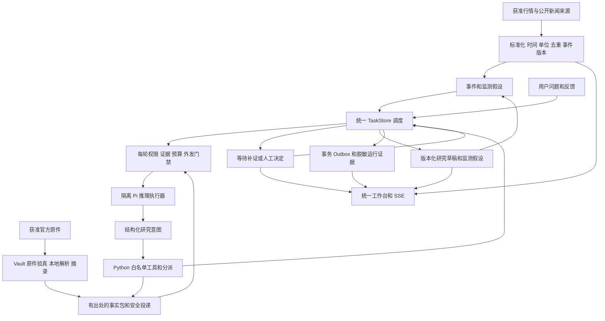

# A股智能研究工作台 GLM 项目实施计划

日期：2026-10-11。执行方：GLM。架构与独立验收：Codex。产品负责人和关键决定人：用户。

本计划把现有系统收敛为可日常使用的研究产品。先完成一个真实事件的研究、追问、修订和签收闭环，再扩大监测范围和多代理能力。不是重新建库、重写全项目、恢复 OpenClaw 或增加自动交易。

本计划的工作包均为待实施或待重新验收，不因相似模块已经存在就自动标记完成。当前仓库有大量暂存、未暂存和未跟踪内容，必须保留。本文和接手指令的新增不表示运行测试、启用服务或取得生产许可。

## 1 总目标与完成定义

### 1.1 产品目标

用户打开一个工作台，即可看到自选股走势、重要公开事件、AI 正在执行的研究任务、证据、分歧和需要自己处理的决定。AI 在已批准的范围、方法、数据和预算内选择研究路径；用户掌握关键方向和全部受保护决定。

首版范围：A 股，20-50 个自选标的，3-5 个主题，一名主要使用者。先从当前配置的少量标的验证，再按 10、20、50 标的分档扩容。没有验证到的容量不能对外宣称支持。

“近实时”指按获准来源能力持续更新，不承诺免费接口提供逐笔流、商业 SLA 或再分发权。每日生成报告不是最终产品，报告应当是研究过程的一个输出。

### 1.2 用户必须能够完成的操作

1. 查看标的行情、来源时间、获取时间、陈旧状态、事件和公告。
2. 从事件或明确问题创建研究，查看计划、任务树、责任角色和进展。
3. 查看事实、来源陈述、模型推断、假设和人工意见，不能混为同一种结论。
4. 展开结论对应的证据和版本，知道模型实际收到了哪些资料。
5. 追加问题、补证、退回、暂停、取消、接受或否定个人研究结果。
6. 看到失败、等待、额度不足、过期资料和未知成本，不把这些状态伪装成成功。
7. 查看谁做了什么、模型和方法版本、费用、采纳结果及后续复盘；不展示模型隐藏思维链。

### 1.3 三类状态必须分开

| 状态 | 通过意味着什么 | 不意味着什么 |
|---|---|---|
| 个人研究可用 | 真实用户可以使用获准资料研究并签收，反馈可以继续处理 | 机构质量或合规批准、公开发布许可 |
| 技术发布可用 | 源码基线、环境、测试、安全与恢复满足声明范围 | 来源权利、人员职责或商业启用已批准 |
| 机构业务启用 | 真实人员、来源授权、独立复核、档案及 Go/No-Go 满足现有门禁 | 获得自动交易权限 |

个人用途必须有清晰命名空间、用途标记和独立签收事件，不通过降低现有机构案件门槛实现。原有 institutional BLOCKED 保持可见。

### 1.4 不在本期范围

- 自动下单、调仓、券商登录、仓位执行、交易 SDK、实盘连接。
- 全市场逐笔数据、期货或加密资产、多租户 SaaS、对外研究发布。
- 任意 Shell、任意 URL、自由文件路径、模型自己安装插件或修改代码。
- 自动批准供应商、名册、技能锁、数据外发例外、模型变更或生产启用。
- 为证明“工业级”而提前迁移微服务、Kafka、Kubernetes 或新的 Agent 框架。

## 2 现状基线与旧文档关系

### 2.1 当前检查得到的事实

| 项目 | 当前代码或配置事实 | 尚不能据此声称 |
|---|---|---|
| 批次流程 | pipeline 已包含规则、增量 LLM、多角色结果、案件和报告，manifest 已接线 | 全部真实日常任务已可靠运行 |
| 持久任务 | TaskStore 已有任务、租约、fencing、幂等回执、outbox 和人工反馈 | daily 已统一经该任务系统调度 |
| 研究 worker | 安全上下文、Pi 调用、意图执行和人工等待已存在 | 工具结果已经反复送回模型形成完整研究循环 |
| 子任务 | 协议中的子任务接口目前输出 proposal_only | 已实际创建、执行、汇合子代理任务 |
| 多角色 | 部分角色研判在一次模型请求内生成多视角结果 | 角色彼此独立或等价于独立人工挑战 |
| 数据 | 本地启用 local_jsonl、eastmoney_filing、eastmoney；后两者各配置 3 个标的 | 已有稳定免费多源新闻和行情供给 |
| 模型 | local 配置使用 Pi，模型字段为 deepseek-flash；Pi 包固定 0.84.2 | 历史希望使用的 V4 Pro 已启用或当前调用成功 |
| 原件和正文 | 正式 vault 事件文件为 0 字节；新 worker 投递标题元数据；本地摘录不外发 | 已完成真实公告正文研究 |
| 界面 | 任务 SSE、工作台、静态 dashboard、短期摘要查看页并存 | 已有统一产品入口或完整浏览器真人认证 |
| 发布 | 当前 HEAD 不能解析，已有大量未冻结修改 | 存在可发布、可回滚的源码版本 |
| 回归 | 2026-09-23 记录 1035 项，errors=14、skipped=2、退出码 1 | 1035 项全绿，或者今天重新验收过 |

14 个错误记录在旧报告中被归为原生 PowerShell/进程/junction 操作遭守卫拒绝。GLM 必须重新核实当前集合，不能机械减去 14 或把新增错误归入已知范围。本轮规划未重跑测试、模型、计划任务或真实身份 UAT。

### 2.2 必须优先读的本地材料

- [AGENTS.md](../AGENTS.md)：当前安全边界与命令纪律。
- [既有总计划](INDUSTRIAL_RESEARCH_PLATFORM_PLAN_20260918.md)：产品范围和 W00-W15。
- [BASELINE](implementation/BASELINE.md)：逐批实现与事故后的验收记录。
- [原生验收手册](NATIVE_ACCEPTANCE_RUNBOOK.md)：仅在一次性 Windows VM 验收原生进程行为。
- [前端 ADR](implementation/ADR-001-web-frontend.md)：先复用任务板，满足条件后再升级前端。
- [正文摘录](EVIDENCE_EXCERPTS_LOCAL_V1.md)、[摘要审核](SUMMARY_REVIEW_LOCAL_V1.md)、[摘要查看](SUMMARY_VIEWER_LOCAL_V1.md)。
- [价值验证](VALUE_VALIDATION_V31.md)、[业务接入](BUSINESS_ONBOARDING_V29.md)、[灾备](BACKUP_RESTORE_V32.md)。

本计划是旧总计划的执行细化，不覆盖 AGENTS.md，也不重写历史验收结论。旧计划的 834 项测试、旧模型字段、manifest 未接入描述及旧交接里的无守卫测试命令均不得直接复用。统一以当前代码核实结果和当前 AGENTS.md 为准。

## 3 目标架构和迁移原则

以下是待逐步实现的目标图，不是现状完成证明。



### 3.1 权威状态归属

| 数据 | 权威归属 | 实施原则 |
|---|---|---|
| 入库信号与来源记录 | 现有 SignalStore 及来源记录 | 不从 latest 报告反推本轮事实 |
| 执行任务、尝试、租约和反馈 | TaskStore | 一个调度权威，CLI 和页面复用服务逻辑 |
| 案件阶段与机构批准 | research_runtime 及现有领域事件 | 不被任务 succeeded 或个人签收替代 |
| 官方文档、版本和留存 | evidence_vault | 复用权威验真，禁止自写弱化索引检查 |
| 工作底稿、审计历史 | 现有追加式领域账本 | 不为新 UI 或迁移删除、改写历史 |
| 页面、日报、统计 | 可重建投影 | 可以重建，不能反过来更改权威审批状态 |

多个领域有各自权威账本是合法设计；需要统一的是任务执行，不是把所有事实和审批合并成一个数据库。

### 3.2 迁移方法

1. 保留旧 run/agent-run 的兼容能力，先新增可隔离验证的任务接线。
2. 按研究用途和案件批次选择单一执行路径，禁止同一事件在旧、新路径分别调用模型。
3. 初期只对一条受控事件启用新路径；数据库采用可验证的增量迁移，不破坏旧记录。
4. task/outbox/执行回执在同一任务库事务中写入；跨 SignalStore 的消费用稳定身份、幂等键与可恢复消费记录，不假设跨库天然原子提交。
5. 日报逐步消费任务成果；不要把旧报告再次变成新任务，形成自激循环。
6. 正式配置切换、模型变更和来源启用仍需既有人工控制；测试只能在临时配置中演练。

## 4 必须先确定的共享契约

下列是设计要求，不要求机械新增同名字段。先映射现有 schema，缺失部分以小迁移补齐。

| 对象 | 必须可表达的信息 |
|---|---|
| 事件 | 稳定身份、来源身份和上游、标的、事件类型、发布/观察/获取时间、时区、内容版本、去重关系、live/replay/fixture 性质 |
| 研究任务 | task/case/run 身份、父任务、依赖、用途、输入版本、绑定信号、证据集指纹、角色、状态、预期版本、预算和截止时间 |
| 原件与事实 | document_id、原件 SHA-256、出处、解析器和版本、页码或字符范围、摘录哈希、事实类型、审核版本、外发许可和有效性 |
| 模型尝试 | attempt_id、供应商、请求和实际模型标识、输入/方法指纹、开始结束、token、费用依据、结果或未知状态、拒绝理由 |
| 工具意图 | intent_id、白名单名称、结构化参数、输入证据范围、幂等键、治理结果、执行结果引用和版本 |
| 人工决定 | 真实主体证明、决定用途、角色/权限、目标及版本、command_id、理由、时间、失效与撤销信息 |
| UI 事件 | 唯一序号、事件类型、实体身份、实体版本、脱敏最小 payload、产生时间；页面能识别需重新拉取快照 |

必须区分来源说法、数据观测、模型推断、人工判断；哈希只证明字节和绑定关系，不证明内容真实、许可有效或结论正确。

### 4.1 Agent 循环

Python 取得任务并续租 -> 构建本轮可外发上下文 -> 校验治理和预留预算 -> Pi 生成结构化结果/意图 -> 校验输出 -> 白名单执行 -> 持久化结果 -> 必要时重新治理并继续一轮，或等待人工/完成/阻断。

循环可以有补证、并行、退回和取消，但每一步必须有上限和审计；不会因为模型写了“批准”“发布”就产生受保护动作。工具执行结果也可能包含不可信文本，必须重做外发和注入检查。

### 4.2 试验预算建议

- W10 单案件最多 4 次模型尝试、并发 1；后续多代理试验最多 6 个子任务、深度 2、总尝试 8 次、并发 2、补证轮数 2。
- 上述次数包含 schema 修复和重试，不为失败调用额外开无限额度。
- 单案件执行时间建议上限 10 分钟，单次超时沿用受审配置；重试不能延长案件总截止时间。
- 日/月金额上限、允许模型、外发范围和运行窗口必须显式批准。没有金额预算或无法保守预估时不得启动新的 live 调用；不能把 unknown 成本当 0。
- 这些是待评审的限额，不是对生产配置的修改授权。模型实际能力不足时明确阻断，不静默换模型。

## 5 里程碑和依赖

| 里程碑 | 工作包 | 交付物 | 进入下一阶段的门槛 | 估计工程人日 |
|---|---|---|---|---|
| M0 可复现基线 | GLM-01 | 当前事实清单、基线候选、原生验收差距 | 首批范围冻结；无新安全退化；必要原生验证单列 | 2-4 |
| M1 真实资料准备 | GLM-02、03 | 来源合同、真实原件和可验证事实包链路 | 一条事件具有可靠出处；实际权利与技术校验分开 | 4-7 |
| M2 首个真实闭环 | GLM-04、05、06、07 | 单任务推理、反馈续研、同页签收 | W10 完整真实证据；不以 mock 替代 | 5-8 |
| M3 受控多代理 | GLM-08 | 实际分派、回传、汇合、独立模型挑战节点 | W10 通过；分支、取消、预算和失效测试通过 | 5-8 |
| M4 日常研究工作台 | GLM-09、10 | 增量监测、统一入口、Agent 状态和研究视图 | 来源限流可控；真实任务可操作；已测容量明确 | 5-9 |
| M5 可靠性验收 | GLM-11 | 故障、恢复、安全、发布和操作手册 | 指定技术范围验收完成，不把业务门禁改绿 | 4-7 |
| M6 价值验证与启用 | GLM-12 | 真实盲评、时间收益、试运行及最终决议 | G0.5 和适用业务门禁有真实人工证据 | 3-5 加观察等待 |

合计是约 28-48 个工程人日的初始估计，不是 GLM 连续运行的日历承诺。资料授权、真人身份验收、独立评分和试运行等待另计；GLM-01 后应按实测剩余工作重新估算。机构启用日期不能由代码完成日期推导。

WBS 对应：GLM-01 对应旧 W00-W02 缺口复核；02/03/09 对应 W04-W06；04/05 对应 W03/W07/W08；06/07 对应 W09/W10；08 对应 W11；10 对应 W12；11 对应 W14；12 对应 W15。旧 W13 skills 扩展不是关键路径。

## 6 GLM 工作包

### GLM-01 基线核实与实施准备

依赖：无。先做只读盘点，不改业务代码。

主要范围：AGENTS.md、锁文件、Git 状态、BASELINE、run_manifest、run_coordination、现有测试入口与原生验收包。

任务：

- 分别记录 staged/unstaged/untracked，复核 HEAD、解释器、Node、Pi 包、锁和所有实际入口。
- 只记录凭据配置方式和是否可用，不打印值、上下文、环境变量全集或其他项目配置。历史贴出过的凭据须由负责人确认轮换状态，开发者不复制旧聊天中的 key。
- 盘点实际模型选择优先级及请求/响应模型字段，明确当前 flash 与历史 Pro 目标差异；只提出修正方案，不直接切模型。
- 运行守卫入口并按测试名称归类当前结果；原生测试另按手册准备与验收。已知 14 不是永久豁免清单。
- 核实正式 vault 测试误写事故的独立人工复核状态；事件文件为空不等于事故已关闭。不再删除或重写事故账本、污染期快照与恢复记录。
- 对每个包列出复用/缺口/阻塞/建议改动文件。首个 Git 提交须先审查拟提交清单、密钥扫描、许可和用户已有改动；禁止 git add -A 后一把提交，禁止上传远端。
- 形成代码基线候选与提交方案；取得明确提交授权后再建立 Git 基线。本计划不要求替用户提交所有未提交文件。

交付：新增 `docs/implementation/GLM_BASELINE_YYYYMMDD.md`，不覆盖历史 BASELINE；给出 GLM-02/03 的最小实施清单。

通过：事实有文件/命令依据；未改业务状态；阻塞可定位。没有 VM 时可继续隔离技术工作，但原生验收保持 NOT_RUN，不能报告 M5 通过。

### GLM-02 真实来源与事件输入契约

依赖：GLM-01。先一条获准真实公开事件，不立即开全市场。

优先复用：`sources/`、`storage.py`、`source_health.py`、`market_data_governance.py`、`task_supply.py`。

- 按来源登记上游、用途、许可/内部批准、保留正文权、向 LLM 外发权、时效、调用限额、失效时间；GLM 不填写真实批准。
- 固定标的标识、人民币/万元/亿元等单位和正负号、价格是否复权；缺失不转成零，不由模型换算。
- 分开 source_time、observed_at、fetched_at；未来时间、无可靠来源时间、超时和交易时段沿用权威门禁。
- 保留新闻原始事件身份、内容版本和发布时间；重复转载聚类不删除原记录，更正公告必须有新版本。
- 明确何者是开发 fixture、历史 replay、当前 live；example/test 来源不得进入真实价值样本。
- 第一轮优先现有可获准来源和官方文档；若权利或连接不清楚，做适配器离线测试并报告阻塞，不自动批准免费源。

验收：重复、修订、无时间、单位错误、停牌/休市、来源断开、同上游伪多源均有测试；真实输入登记可追溯。价格门禁拒绝时事件仍可作为“不含有效行情的研究候选”，不得将被拒价格偷偷外发。

### GLM-03 有出处的正文与事实包

依赖：GLM-01；真实验收依赖 GLM-02 的合法资料。

优先复用：`evidence_vault.py`、`evidence_context.py`、`evidence_excerpts.py`、`summary_review.py`、`summary_viewer.py`、`research_worker.py`。

- 按现有手工导入或显式获准 fetch 留存官方原件，继续校验链、对象字节、大小、状态和案件绑定。
- 先完善已有 UTF-8 正文路径，再根据真实公告需要增加本地 HTML/PDF 提取。解析器必须版本锁定、无外网/脚本执行、有大小/页数/时间上限；扫描 PDF 无可靠文字时明确 NEEDS_OCR，不伪造提取。
- 每项事实绑定文档、页码或字符区间、原件和摘录哈希、解析器版本、事实类型；数值计算保留确定性公式和输入引用。
- 保留标题元数据路径，但必须显式说明它没有提供正文证据；不拿 human_note 当官方事实。
- 现有摘要审核结果仍 `external_eligible=false`。需要向模型投递正文事实时，先写出独立 ADR 和安全测试，新增明确的外发授权判定；本地 supported 不能自动变成允许外发。
- 原始 PDF/HTML 字节不发送 DeepSeek；只有被允许的最小公开事实包/摘录可在逐轮治理后进入模型。内容或审核版本、权限、限制名单变化后旧包失效。

验收：真实 producer 生成 vault 的集成测试；对象篡改、错误文档 ID、无关案件、替换摘要、过期/撤销审核、解析失败均 fail-closed。测试全部写临时区，不能补写正式 vault 来“满足前置条件”。

### GLM-04 统一任务入口和消费幂等

依赖：GLM-01；可在 GLM-02/03 尚待真人资料时用隔离 fixture 开发。

主要范围：`task_runtime/store.py`、`task_supply.py`、`pipeline.py`、`cli.py`、`scripts/run_daily_research.ps1`。

- 统一用户提问与事件触发的任务创建服务；现有 CLI 和新页面都调用该服务，不复制业务判断。
- 使用事件身份/版本、用途和研究输入版本定义去重键；同一事件重复投递返回已有任务，真正修订可产生可追溯的新研究版本。
- 处理 SignalStore 和任务库之间“源已读、任务未提交”的崩溃窗口；可重扫、可对账，不丢任务也不重复收费。
- 使用消费记录与幂等回执，不能用 source 时间单一高水位遗漏迟到事件。检查跨库部分失败。
- 任务状态、outbox 和执行回执在同事务更新。明确旧 batch 与新 task 模式的排他规则，计划脚本不能双重研判/重复 export-review。
- 不通过 production-pilot-sync 或修改 trigger_source 伪造 scheduled 运行；manifest 绑定仍先于对账副作用。

验收：同事件重复/不同版本、创建中崩溃、并发投递、部分提交、后到事件、错误 manifest 和路径空格/中文均有测试；旧 run 行为不退化。

### GLM-05 单 Agent 多轮研究执行

依赖：GLM-03/04 的技术契约；real live 仍需实际权限、凭据和预算。

主要范围：`research_worker.py`、`agent_protocol/`、`pi_runtime.py`、`llm_governance.py`、`model_operations.py`、TaskStore。

- 从一次调用改成有界的任务步进：模型意图 -> 工具结果 -> 再治理 -> 下一轮，直到完成、等待、取消、预算耗尽或失败。
- 保持 Pi 无工具/无动态资源发现。查询工具只读已获准缓存，参数不能指定任意 URL、文件或可执行代码。
- 每次调用前持久化尝试身份、预算预留和输入指纹；完成后记录实际模型和使用量。请求发出但结果未知时不自动当成未调用，不盲目重发。
- 每轮都校验证据/权限/输入版本，不能只在任务开始时检查一次。返回引用必须属于本轮实际投递安全集。
- 401/403 明确认证或授权失败，不无穷重试；429/暂时性错误只在总次数、总期限和金额预算内退避。
- 租约续期、fencing、取消和结果提交串联验证；旧 worker 的晚到结果不能覆盖新版本。记录简明研究理由，不记录隐藏思维链。
- 请求模型与实际返回模型分别显示；缺实际字段标 unknown，不伪填请求模型为实际模型。

验收：正常多轮、非法 JSON、越权意图、恶意材料、幻造引用、证据中途撤销、取消、旧结果、未知费用、网络不确定结果和预算上限的确定性测试。真实调用必须另外留证。

### GLM-06 最小研究页面和真实人工反馈

依赖：GLM-04/05；UI 离线开发可提前。

主要范围：`task_board.py`、`review_workbench.py`、`local_identity.py`、`summary_review.py`、`summary_viewer.py`、现有浏览器隔离测试。

- 先复用既有页面和接口，补一个案件详情：来源/证据、AI 输出、待回答问题、输入版本、当前任务状态和错误。
- 用户可以追问、补证、取消、接受或否定个人研究结果；真实权限和用途决定可见按钮，不能只做前端隐藏。
- 每次写入验证主体证明、权限、CSRF/Origin、command_id 和 expected_version。服务进程的 Windows SID、浏览器提交的 actor 字符串都不等于真人身份。
- 先形成个人操作身份绑定 ADR；浏览器可信写入未验收前，保留已校验的本地 CLI 决定入口与页面只读状态，不伪称浏览器审批已完成。
- 个人签收、摘要审核、机构质量/合规/发布批准保持不同动作和事件。用户接受摘要不能改变机构案件门禁。
- 保留 dirty 表单真实节点、焦点、选区和旧版本提示；提交成功后清理 dirty，SSE 不覆盖未提交输入。
- SSE 继续默认事件/onmessage，类型在 data 内；重连补发并重新拉取快照，旧响应或坏快照不能清空新页面。

验收：真实 Chromium 对临时服务完成 POST + SSE + 重连；覆盖双标签页冲突、快速事件、乱序响应、取消、到期/撤权、桌面/手机。真实身份验收必须由真实本人完成；没有它只报告技术流程通过。

### GLM-07 W10 真实案件端到端验收

依赖：GLM-02 至 06 的技术验证，及真实资料、身份、凭据、预算和适用审批条件。

这是第一个产品里程碑，未通过前不得开始 GLM-08 的生产多代理扩展。

验收顺序：

1. 选一条真实公开事件，核实来源许可、发生/发布时间、官方原件和绑定标的，排除开发样例。
2. 创建独立用途的真实研究案件和任务，保存版本、run_id、配置/模型/方法指纹。
3. 查看 actual delivered context，确认不是空内容或仅把标题当正文。
4. 经 Pi 真实调用受准模型，形成含证据引用、未知项、反证问题的草稿；记录尝试、时长、模型和费用状态。
5. 用户实际提出一个有意义的补充问题或材料；研究按新输入版本继续，不只修改页面文字。
6. 系统给出修订结果，标明新增依据与结论变化；用户真实签收或否定，完整留存旧版本。
7. 检查所有副作用均在授权范围，且没有交易、机构审批冒用、重复任务、凭据外发或未计量调用。

交付：`docs/implementation/W10_ACCEPTANCE_YYYYMMDD.md`，附脱敏 manifest、任务/事件引用、浏览器操作证据、模型尝试记录和真实用户反馈；公开/开发报告不得复制凭据、内部名册、原始身份材料。

结果分级：TECHNICAL_PASS、LIVE_RESEARCH_PASS、HUMAN_UAT_PASS、INSTITUTIONAL_GO 分开报告。任一前置缺失不得以 replay 或代理自报 actor 补齐。技术演示成功后可以继续修缺陷，不得宣布 W10 真实验收通过。

### GLM-08 受控多代理协作

依赖：W10 通过；不先建立一批只有名称的 Agent。

主要范围：复用 TaskStore、worker、协议和角色方法；新增 planner/join 的必要小模块，不引入第二套任务引擎。

- 初期只做 Planner、Analyst、Challenger、Synthesizer 四种逻辑职责，按需要调用；不是每个事件全部跑一遍。
- Planner 提交结构化任务图；Python 验证角色、上下文范围、依赖无环、深度、数量、预算和授权用途后持久分派。
- 子任务有实际独立输入、尝试、输出和成本记录；多个角色名出现在一个 JSON 里不能当作独立执行。
- 子结果经治理回传，join 等待明确依赖；部分失败时输出缺口和未完成范围，不把缺失任务当成功。
- 人工反馈或新证据只使受影响任务/汇总失效，不能保留旧汇总结论而显示全绿；取消传播至后代并防止晚到提交。
- 模型 Challenger 是独立研究节点，不替代机构已分派的真人 risk_reviewer 和独立挑战记录；同模型多次调用也不保证认识独立。

验收：两条并行路径、补证分支、父任务等待、失败子任务、循环提案、取消传播、版本失效、预算抢占、重复完成通知、进程重启汇合均有测试和可查看事件。

### GLM-09 近实时监测与事件触发

依赖：GLM-02；技术开发可与界面并行，正式接入任务须 W10 通过。

主要范围：行情缓存、来源适配器、事件分析、source_health、TaskStore 入口和运行协调。

- 按标的增量更新、交易日历和来源限制规划轮询；合法免费源不能保证所需频率时明确降级，不绕过限制。
- 价格显示和确定性指标不依赖 LLM；事件阈值、冷却窗口、迟滞和内容版本决定研究触发。
- 试验目标可设为交易时段行情 15-30 秒、新闻 2-5 分钟轮询，但先按获准配额估算和实测；轮询间隔不等于上游实时延迟。
- 展示来源年龄与本地到达延迟，避免旧缓存展示为最新；休市、停牌、缺源、冲突各有准确状态。
- 建立新闻聚类和更正版本、研究假设的重新打开机制，避免同一新闻多次调用模型；两个适配器同上游不能充当双源一致性。
- 记录请求数、限流、失败率、缓存命中、事件合并和模型触发次数。只在获准运行窗口运行，不安装开机启动。

验收：10/20/50 标的逐档记录 CPU、内存、请求和延迟；模拟断源/429/休市/迟到更正/突发行情；真实容量结果与合成压测明确区分。

### GLM-10 统一产品面板

依赖：GLM-06/07；最终 Agent Fleet 依赖 GLM-08。

优先复用已有 API/SSE 和服务层；确有组件化或并发需求时按 ADR 审查 FastAPI、React/TypeScript 和图表依赖，再精确锁定。不得先另造第二套状态库。

| 页面 | 必须显示 | 主要操作 |
|---|---|---|
| 市场 | 自选、走势、时间、数据质量、重要事件 | 切标的、进入事件，不下单 |
| 事件 | 去重事件、来源、修订、关联案件 | 发起研究、补充问题 |
| 研究 | 事实/推断/假设、证据、版本差异和分歧 | 追问、补证、退回、个人签收 |
| Agent | 实际任务树、状态、角色、模型、时间和费用 | 暂停/取消/查看失败；重试须保留尝试记录 |
| 待办 | 需要真实人工处理的事项和优先级 | 按权限处理，不批量自动批准 |
| 运行 | 来源健康、积压、额度、错误、技术与业务门禁 | 查看原因、进入受控恢复流程 |

同一入口导航，密集但清晰，优先表格和时间线；不做营销首页、不以假实时动画代替事件、不把报告文件链接堆成整个产品。关联操作保留当前位置与筛选；键盘和小屏可用。

验收：端到端覆盖事件 -> 研究 -> Agent -> 待办 -> 反馈 -> 修订结果；SSE 断线/权限变化/坏快照/脏输入不丢；真实截图检查桌面与手机，无遮挡和表单跳动。身份未就绪时明确只读。

### GLM-11 可靠运行、安全和发布

依赖：M2 以后持续进行；正式验收以当前冻结代码为准。

主要范围：run_coordination、TaskStore、manifest、预算计量、release_controls/audit、backup_restore、Windows 生命周期和脚本。

- 故障矩阵覆盖进程退出、磁盘满、数据库锁、损坏证据、网络中断、费用未知、SSE 慢消费者、时间漂移和取消竞态。
- 旧运行租约过期仍按 AGENTS.md 要求人工确认进程退出后恢复；不能拿 task worker 的 fencing 机制擅自放宽全局运行租约规则。
- 预算跨并发任务原子预留；重试和取消费用照实计入，未知调用保持待核对，不能把外部调用当可天然 exactly-once。
- 调用/证据/任务的审计能够按 run_id 和明确版本定位；latest 只是投影，不用于精确绑定。
- 备份只包含获准事实源，校验 manifest/哈希/SQLite；做隔离恢复演练。测试本机恢复不等于异地生产灾备。
- 无业务驱动器映射的一次性 Windows VM 验证原生进程和 junction；宿主守卫不关闭，测试进程生命周期只处理精确归属的进程。
- 版本、依赖、SBOM、许可证、秘密扫描、迁移和回滚说明齐全；copyleft/未知许可证保留 REVIEW_REQUIRED，不能由 GLM 批准。
- 发布环境按既有 Python 3.11/3.12 基线分别验证锁与测试，不能用单一环境替代双环境 PASS。测试仍遵守隔离规则，涉及原生子进程的范围在独立 VM 验收。
- 历史正式库误写事故需按既有记录由真实负责人独立复核；技术修复和空账本不自动关闭事故或补出缺失的事前备份证据。
- 常驻/计划运行须单独获批；后台窗口隐藏；停止入口幂等，不按通用进程名结束其他项目。

验收：每类故障具有状态、恢复条件和实测证据；必需用例的 skip/NOT_RUN 仍为开放项；源码提交和构建产物可对应。最终技术报告与业务 Go/No-Go 分开。

### GLM-12 价值验证和业务启用

依赖：适用的技术发布 READY、真实用户与资料条件；机构路线继续遵循既有完整门禁。

- 按 VALUE_VALIDATION_V31 使用 20-30 个真实 P0/P1 历史案件，冻结 READY release manifest，真实人工时间日志，独立 A/B 盲评与评分后揭盲。
- 不用 mock、fixture、重复案件、测试信号、模型自评分或伪造人工时间凑样本；一个人不足以满足独立角色时如实阻断相应范围。
- 试验前冻结评估标准：可核验事实比例、重大遗漏、引用正确性、人工用时、有效提醒率、每个有用案件成本。收益率不作为本期研究产品的替代验收。
- 可供负责人评审的价值目标：人工用时中位数减少 30%，关键事实零无依据结论，质量不劣于人工基线。它们是待预注册目标，不是承诺或已经批准的门槛；不能看完结果后改标准。
- 小样本只能支持初步价值判断，不声称长期盈利或统计上证明优越。对失败样本做分类，必要时回到证据/研究流程修订。
- 受控日常观察记录真实运行窗口与故障；计划任务数量不能通过手动改 trigger_source 或重复执行凑数。
- 机构接入顺序保持 governance_scope -> human_roster -> provider_authorization -> official_evidence_backfill -> governance_remediation -> production_archive -> shadow_readiness -> go_no_go。

交付：实验冻结记录、脱敏评价汇总、事故/失败分析、适用范围、真实签字/批准引用和最终 Go/No-Go。批准和启用由真实授权人员完成，GLM/Codex 只准备材料与解释结果。

## 7 测试与验收纪律

### 7.1 唯一默认离线入口

从项目根目录使用锁定解释器：

```powershell
.\.venv312\Scripts\python.exe -B scripts/run_isolated_tests.py
```

已有入口支持 `--pattern`。例如针对现有信号绑定专项：

```powershell
.\.venv312\Scripts\python.exe -B scripts/run_isolated_tests.py --pattern test_task_signal_binding.py
```

不得在宿主绕过入口运行全量 discover 来追求通过数量。测试用临时工作区和真实 producer 生成合成夹具；线程各自建立临时上下文。不要写正式 vault、SignalStore、任务库、名册、限制名单、配置或业务日志。

### 7.2 验收层次

| 层次 | 场所和材料 | 通过标准 |
|---|---|---|
| 单元/集成 | 守卫入口、临时配置、离线 mock | 新功能正负路径全部可重现，无真实工作区写入 |
| 回归 | 相同守卫和当前源码 | 报告 tests/failures/errors/skips/exit code；已知阻断逐项列出，不冒充全绿 |
| 浏览器 | `tests/browser_board_isolated.cjs` 等临时服务 | 真 HTTP/POST/SSE，断线恢复、版本冲突和截图检查 |
| 原生 Windows | 已复核当前源码包、一次性 VM | 解释器、锁、隔离、退出码、进程清理和路径归属留证 |
| 真实模型 | 单独授权的数据、预算和窗口 | Pi 实际调用、模型尝试、实际投递证据、费用/未知状态记录 |
| 真人 UAT | 真实本人及适用身份机制 | 操作针对明确版本，不能由测试 actor 或服务账号代填 |
| 业务启用 | 真实控制证据和独立审批 | 满足适用原有门禁，技术通过不能代替 |

run、agent-run、watch、live UAT、同步/导入命令可能产生业务副作用，不作为默认“只读检查”。即便名称带 status/audit，也先核对是否写报告或投影并声明范围。

### 7.3 建议服务指标

这些是个人试运行待冻结的验收目标，不是已实现 SLA：

- 本地用户操作的可见回执 p95 <= 1 秒；持久事件到页面 p95 <= 3 秒，不含上游数据和模型等待。
- 同一输入重复请求不产生第二个逻辑任务；旧 worker/旧版本结果不得覆写当前结果。
- 已确认提交的任务和反馈在受控进程重启后不丢失；至少测试任务和 outbox 的提交边界。
- 任何费用上限触发后不得开始下一次未获预算的调用；外部已在途调用如实报告。
- 行情新鲜度分别报告来源年龄和本地投递延迟，不能用缓存刷新时间伪装来源新鲜度。
- 50 标的合成容量与真实来源运行分开验收；先通过较小真实范围，再扩容。

## 8 运行顺序与职责

GLM 实施顺序：01 -> 02/03 的最小证据链 -> 04/05/06 -> 07 -> 08 -> 09/10 -> 11 -> 12。

允许 02/03/04/06 的离线契约开发部分并行；不允许在 07 真实验收前用大量角色、插件或 UI 重写绕开闭环。11 的可靠性要求贯穿各包，不等到最后才做。

首批只执行 GLM-01：交当前事实、阻塞分类和下一批文件清单。之后每次最多一个主工作包，或两个边界独立的小包；每批先写失败用例，再做最小改动，最后回归和交付。无需每改一行都询问，但关键授权与身份条件不能推定已有。

| 角色 | 负责 | 不能代替 |
|---|---|---|
| 用户/项目负责人 | 范围、预算、运行窗口、真实使用反馈、关键批准 | 独立制度要求中的其他真实角色 |
| GLM | 按包实现、隔离测试、迁移/回滚说明、事实交付 | 真实审批、来源授权、独立验收结论 |
| Codex | 架构和范围控制、代码复验、缺陷优先级、阶段建议 | 用户身份、法务合规或最终业务批准 |
| 真实独立角色 | 适用的资料、质量、合规、发布和评估动作 | AI 角色改名、service/bot 代签 |

GLM 是开发执行者，不意味着研究产品自动改用 GLM 模型。生产仍使用受审的 Pi/供应商配置；当前模型与目标不一致须单独决策。

## 9 每批交付模板

GLM 新增 `docs/implementation/GLM_工作包_日期.md`，历史文件只按既有约定追加交付记录，不覆写旧事故或失败证据。

```text
工作包与具体用户流程：
状态：IMPLEMENTED / VERIFIED / BLOCKED / NOT_RUN（逐范围，不给混合全绿）
基线和改动文件：
复用模块和新数据迁移：
新增依赖、版本和许可：
正负用例及修复前失败证据：
实际命令、解释器、退出码、测试数、错误和跳过：
浏览器/原生/live/真人分别是否执行：
真实来源与 replay/fixture 区分：
实际模型、尝试数、用量和费用未知项：
产物路径及精确 run/task/manifest 引用：
生产配置、权限、账本是否发生变化：
回滚步骤与数据兼容性：
未解决风险、需真实人工事项：
下一工作包及进入条件：
```

失败测试不是只看字符串存在，必须覆盖调用入口、事务和真实契约。浏览器交互不能由静态 HTML 断言替代。测试数量只作结果统计，不作为进度百分比。

## 10 停止条件与替代工作

| 阻塞或风险 | 必须停止的动作 | 可继续的工作 |
|---|---|---|
| 密钥、身份、使用权或预算不明确 | live 外发和付费请求 | 脱敏诊断、离线 mock、接入契约 |
| 原件损坏、无出处或证据被撤销 | 基于该证据的外发与批准链 | 修复工具、重新合法取证准备；保留事故证据 |
| 磁盘不足、写入量异常 | 业务写入和压力测试 | 只读定位并通知；不删除未知文件或杀未知进程 |
| 没有独立真人或可信身份 | 需要该角色的审核/批准 | 个人只读研究、临时隔离技术验证 |
| 原生环境不可用 | 宣称原生验收/可靠启动通过 | 生成受审包、离线专项与手册 |
| 模型响应不明或费用不明 | 无限制重试和预算释放 | 标记待核对、继续无模型读操作 |
| 来源拒绝、验证码、限流 | 绕过访问控制或提高抓取强度 | 合法降频、缓存、替代来源候选和明确降级 |
| 不明许可证或插件权限 | 复制整套源码、生产安装 | 阅读思路、独立设计、候选技术验证 |

不得静默取消安全门槛。阻塞报告要注明阻塞对象、具体条件、需要谁提供什么、如何验证解除；不要把一个机构门禁阻塞扩大成“所有离线开发都做不了”。

## 11 技术取舍和参考边界

现阶段保留 Python 模块化单体、SQLite 任务库和既有领域账本。SQLite 官方把设备本地、低写并发应用列为适用情形；多写入者/多主机需求出现后再按实测评估迁移，不能把存储迁移当业务闭环的前提。[SQLite 官方说明](https://sqlite.org/whentouse.html)

Pi 先保留当前隔离调用。官方 RPC 可以用长生命周期子进程通过 JSON 记录与其他语言集成，但文档 main 分支不是本项目 0.84.2 的兼容承诺。只有实测启动开销或流式交互需要时再做固定版本验证；接受请求不等于完成研究，不能把通用示例中的工具权限直接带入本项目。[Pi 官方 RPC](https://github.com/earendil-works/pi/blob/main/packages/coding-agent/docs/rpc.md)

SSE 继续服务端推送、HTTP 提交命令的模式。默认消息由 onmessage 处理；命名事件需要对应监听器，不能无测试地改变已经接好的事件格式。[MDN SSE](https://developer.mozilla.org/en-US/docs/Web/API/Server-sent_events/Using_server-sent_events)

可学习本地 OpenAlice 的事件、工具边界和可观测性设计，不引入交易执行或自我修改；任何代码复制先做许可证审查。已有 Pi 方法目录按固定来源、哈希和角色映射使用。新插件/skills 放在非关键路径，未获审查不安装、不更新生产锁。

最终衡量标准是：真实信息被可靠发现、结论可核验、研究能接受干预、失败能恢复、用户用得上。不是拥有多少 Agent、插件、报告或测试。
