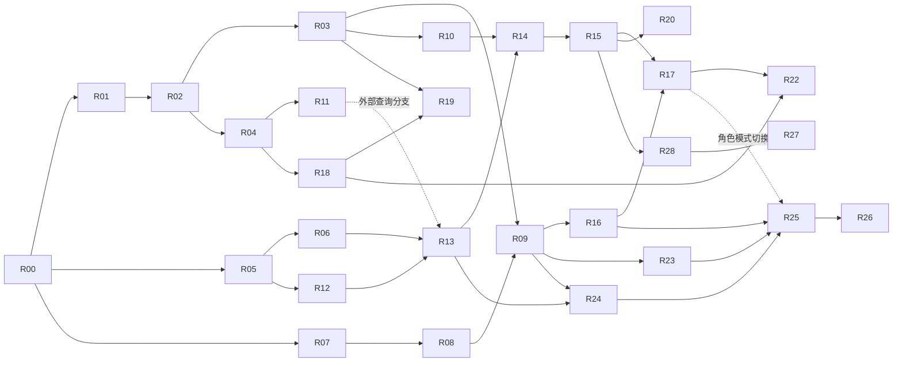

# GLM Docker 与研究工作流重构任务书

日期：2026-10-20。配套：[架构蓝图](GLM_DOCKER_RESEARCH_BLUEPRINT_20261020.md)、[审查证据](implementation/CODEX_REAUDIT_20261020.md)、[参考项目矩阵](REFERENCE_REUSE_MATRIX_20261020.md)。

目标：先交付用户个人可用的 A 股研究闭环，再进入容器化长期运行、Dify 角色编排、MCP 扩展和多人协作。本文是待实施任务；`新增` 路径都是建议落点，不表示文件已经存在。

## 1. 执行纪律

1. 先读根 `AGENTS.md`，核对 HEAD、dirty、实际启动入口和共享文件所有权。不要重做已存在的 Kimi K02/K03、Dify DF-01/DF-02。
2. 一批一个主工作包；确实无共享写文件的两个小包可以并行。`store.py`、`dify_api.py`、`research_worker.py`、`config.py` 每批只能由一个实施者负责。
3. 写代码前给本包的行为示例和文件清单；写完给命令、退出码、测试类型、证据、回退和未完成项。
4. 不批量 stage/reset/clean，不改其他项目、不运行收藏库脚本，不以删除历史/事故证据消除阻塞。
5. Python 离线测试使用锁定解释器和 `scripts/run_isolated_tests.py`。原生守卫阻断保持阻断，不能改成 skip 或去掉守卫来换绿。
6. 真实采集、模型、账户、供应商批准、身份、计划任务、部署切换沿用现行授权边界；普通离线修复和文档不反复索要相同确认。
7. 个人签收与机构审批分离；不通过关闭治理实现 personal mode。
8. 每次外部依赖采用都登记具体来源和许可证，不直接使用收藏库脏工作树构建。

## 2. 首批明确做什么

**第一批只做 R00 + R01。** R00 是短时增量基线，R01 修复输入版本、稳定业务意图和返回状态；不安装 Docker，不增加真实外发。

第二批 R02；第三批 R03；第四批 R04。这些包修复容器重启和并行前的基础风险。R05/R06 可以在明确接口后交给独立实施者，但不可同时抢改 `research_worker.py`。

个人首案采用合法手工导入时，R04/R11 的外部 Kimi 分支不是前置，可与首案并行准备。共同状态/外发/身份修复完成后，优先打通 R05/R06/R12 的 HTML/文本切片、R13/R14 和 R15；不等待全部 PDF/OCR、容器、股票终端和 MCP。

首批完成例子：

- `input_version=5` 创建后，数据库/API/事实包均为 5；用户补证后均为 6。
- 同一 `business_intent_id` 经两个不同 Dify run 重试只对应一个业务任务，分别保留执行关联。
- 模型运行中用户取消后，任务账本、worker 返回和页面均显示 cancelled。

## 3. 工作包

### R00 当前基线与迁移清单

- 依赖：无；复核本轮 HEAD，不能假定实施时仍未变化。
- 文件：新增 `docs/implementation/REFACTOR_R00_<date>.md`；新增候选 `config/candidates/refactor/runtime_inventory.json`。
- 工作：盘点源代码、配置 schema、SQLite/JSONL/对象目录、写入者、服务入口、计划任务、平台版本、可恢复源码和当前测试。只记录配置键/哈希/脱敏状态，不打印秘密、名册或历史内容。
- 证据：每项明确现有/候选/缺口；区分本机测试和历史报告；为迁移准备字段和路径类型清单。
- 验收：任何“已实现”都能定位源码；任何“已验收”都能定位命令与证据。
- 回退：新增文档不影响运行。
- 停止：未识别的数据目录、并行修改所有权或运行中写者，不进入迁移。

### R01 统一输入版本与业务幂等

- 依赖：R00。
- 文件：`stock_agent/task_runtime/store.py`、`dify_api.py`、`research_worker.py`、`task_intake.py`；相关 task/dify 测试。
- 工作：创建时写权威 input_version；补证生成不可变 input snapshot；payload 中同名字段作为兼容投影，不再独立读取。增加稳定 business_intent_id，平台 run 进独立关联记录。
- 工作：question intake 区分同意图重试与明确新研究；后者含新的 as-of/输入快照与前次任务关联，不能按问题文本永久去重。
- 行为：同业务重试不新建；不同业务内容误用同 key 返回冲突；业务新版本与网络重试明确区分。
- 迁移：先查历史列/payload 分歧，仅生成修复计划与映射；不得用猜测覆盖旧任务。新增 schema 兼容旧读路径。
- 验收：A01—A05；worker 返回使用 TaskStore 实际持久化状态。
- 回退：停新入口，保留关联记录和新版本；旧代码不能读新 schema 时使用兼容版本，不降级数据库硬覆盖。
- 停止：同 key 不同内容被静默接纳，或旧版本结果仍可覆盖。

### R02 外发 attempt 与未知结果对账

- 依赖：R01。
- 文件：`research_worker.py`、`pi_runtime.py`、`budget_guard.py`、`task_runtime/store.py`；新增 `stock_agent/invocation_runtime.py`。
- 工作：将 prepared/dispatched/known failure/outcome unknown 分开；预留、分派和回执持久化。超时、断流、进程死亡按是否已外发分类。
- 工作：本包同时完成平台无关的调用中持续心跳、调用 deadline 与 lease TTL 关系、续租失败禁止新外发；这些 live 前置不等待 Docker。R09 负责在容器下验证相同语义及退出。
- 行为：unknown 保留预算占用、禁止自动重发；支持供应商查询回执或真实人工带理由对账；对账不凭空认定未收费。
- 验收：A06—A10；关闭 worker 后有完整 attempt 链；只有明确未发出的请求才安全重试。
- 回退：停新分派、保留 unknown；不能恢复旧自动重试逻辑处理这批任务。
- 停止：错误分类不明、额度重复释放、重启导致新收费请求。

### R03 API 并发、授权核销与候选采纳

- 依赖：R01/R02。
- 文件：`dify_api.py`、`dify_api_server.py`、`dify_access.py`、`task_runtime/store.py`；新增中性 `stock_agent/workflow_service.py`。
- 工作：请求独立连接/事务，避免多 HTTP 线程共用一个可变连接；服务层与 Dify façade 分离。一次性授权核销、task CAS 与 outbox 同事务。
- 工作：后端签发 dispatch_id/attempt/fence/input hash/bundle/workflow digest；结果提交验证全部绑定。候选接收与最终采纳分开，不能接受 caller 自报 attempt 作为凭证。
- 工作：凭据撤销下一请求生效；真人动作回执绑定 task/action/version/payload hash/expiry。
- 验收：A11—A17，真实双连接/双进程竞争，非串行重复调用替代。
- 验收分层：O 只跑同进程双连接/线程竞争；跨进程只在 N/C 一次性隔离环境执行，不为 subprocess 增加守卫放行开关。
- 回退：禁新 Dify 写入口；候选和审计账本保留，可只读核对。
- 停止：同授权并发消费两次、旧 run 候选被采纳、越权 case 可读。

### R04 Kimi 查询事务与权利执行

- 依赖：R01/R02；可在 R03 接口冻结后并行。
- 文件：`sources/kimi_adapter.py`、`integrations/kimi/client.py`、`transport.py`、`artifacts.py`、`sources/registry.py`；新增 `stock_agent/connector_runtime/`。
- 工作：query intent、唯一 key、额度预留在数据库原子执行；JSONL 保留为审计输出。按 upstream/account/tool 共用配额。
- 工作：宿主决定 RetentionDecision，覆盖原始产物、缓存、日志和事实包；不接受外部 caller 指定落盘路径。
- 工作：缓存含 rights_revision/purpose/as_of/expiry，读时重新验权；允许明确 refresh 更正旧数据。目的地由获批 registry 创建，不能任意覆盖 HTTPS origin。
- 验收：A18—A25；所有合成负向测试零外网。
- 回退：停连接器新派发，不删除历史查询或缓存审计；撤权数据隔离而非继续使用。
- 停止：无留存权限仍产生正文文件、预算并发超限、来源被伪装为多源。

### R05 结构化事实与确定性计算

- 依赖：R00/R01。
- 文件：`evidence_facts.py`、`event_contract.py`；新增 `stock_agent/facts_service.py`、`fact_calculators.py`。
- 工作：事实必须绑定原件/数据观测、单位、期间、币种、来源和定位；公式从白名单执行，实际读取 input_fact_ids 并重算。
- 工作：Decimal/明确舍入；拒绝 NaN/Infinity；缺失不是 0。分开“计算声明”与“已验证计算回执”。
- 验收：A26—A29；同比、单位转换、不同报告期、缺失、除零和更正场景。
- 回退：新事实类型不进入研究上下文；已有原件不变。
- 停止：仅凭 formula 字符串就标确定性计算，或计算不保留输入。

### R06 研究输出与证据质量契约

- 依赖：R01/R05。
- 文件：`agent_protocol/__init__.py`、`research_worker.py`、`reports.py`、`task_detail.py`；新增候选 schema 与质量校验器。
- 工作：分开 evidence_gap 与 research_draft；具体事实/数字采用 claim→fact→原件 locator。推断单独标记，保留未知项和证伪条件。
- 行为：无引用可以保存“缺证据”说明，不能据此完成财报正文分析。
- 验收：A30—A33；删除引用、错配页码、改数字/日期、混淆来源声明与推断的扰动测试。
- 回退：保留旧报告只读，新的不合格结果留候选状态。
- 停止：空引用具体结论仍能作为完成研究的交付。

### R07 跨平台路径与配置

- 依赖：R00。
- 文件：`config.py`、`python_environment.py`、`cli.py`、`backup_restore.py`；新增 `stock_agent/runtime_layout.py`。
- 工作：配置、状态、证据、报告、临时根分别设置并冻结传入；禁止线程依赖测试 contextvar 推断生产路径。
- 工作：旧绝对路径保留原值，通过 artifact ID/path map 解析，不能改写历史事件哈希。
- 工作：持久时间统一 UTC，业务日期/预算日/交易时隙使用显式 Asia/Shanghai；未知时区拒绝，时钟偏差和跨午夜定义固定。
- 验收：A34—A36；中文/空格路径、只读源码根、线程写路径、路径逃逸、Linux 大小写。
- 回退：新布局配置默认候选，保留原入口；切换前后映射可核。
- 停止：新代码写回源码树或将正式状态挂入测试。

### R08 Linux 依赖与候选镜像

- 依赖：R07；正式运行需要 R01—R06 的相关修复。
- 文件：`pyproject.toml`、`python_environment.py`、`release_audit.py`、`release_controls.py`、新增 `requirements.linux-py312.lock.txt`、`.dockerignore`、`deploy/docker/Dockerfile`、`deploy/compose.yaml`。
- 工作：Python 支持声明与 3.11/3.12 基线一致；Linux 锁单独生成和审核；Node/Pi 从 lock 构建；非 root、只读 rootfs、固定 digest、SBOM。
- 工作：构建侧记录源码 commit/dirty、依赖/Pi/流程/源码树哈希；镜像内携带来源清单，构建后外部 provenance 绑定 image digest+清单哈希。运行侧只读验证可信证明链，不因没有 `.git` 自动放行；不得把自身 digest 递归写入镜像。
- 外部参考：Vibe-Trading 的构建分层和 Local Deep Research 的发布镜像验收；不照搬 Python 3.14/运行时安装。
- 验收：A37—A40；构建和运行不含秘密；运行时断网仍能启动离线状态页。
- 回退：前一镜像 digest；状态 schema 回退按兼容策略。
- 停止：浮动 latest、复制宿主 venv、镜像含 local 配置或运行时安装。

### R09 服务入口、租约与退出

- 依赖：R02/R03/R07/R08。
- 文件：`cli.py`、`task_intake.py`、`research_worker.py`、`pi_runtime.py`、`run_coordination.py`；新增 `worker_service.py`、容器入口与 probe。
- 工作：API/worker 可分别启动；调用中心跳、SIGTERM drain、子进程回收、截止时间、lease epoch；保留陈旧租约人工恢复边界。
- 工作：平台启动参数不隐式开启 scheduler；liveness/readiness 不外发、不写业务。
- 工作：验证跨午夜预算、休市与重启恢复同计划时隙；使用 R07 的显式业务时区。
- 验收：A41—A45；kill、重启、租约失效、迟到回执、磁盘满和 DB 锁竞争。
- 回退：停容器接新任务，保留 in-flight/unknown 对账后再决定旧入口。
- 停止：容器恢复自动删租约或重发外部请求。

### R10 个人身份与容器认证

- 依赖：R03/R07。
- 文件：`local_identity.py`、`task_board.py`、`task_detail.py`、`summary_viewer.py`；新增 `identity_providers/`。
- 工作：个人 owner 真实登录，服务端绑定 actor；服务 token 只能做服务动作。短期可保留 Windows 身份桥，中期用成熟认证组件实现容器网页登录。
- 工作：定义个人证据导入 policy 与 namespace：真实 owner、来源/留存/外发、导入审计，独立个人目录和索引。现有机构 Vault 命令的名册/角色门禁不变；个人对象转机构案件时重新准入。新契约验收前只使用已获准原件或现有真实 actor 导入，不伪造角色。
- 工作：Host/Origin/代理信任精确配置，cookie/CSRF/会话撤销；不把 `0.0.0.0` 当完整迁移。
- 验收：A46—A50；伪 actor、跨 task、过期/撤销会话、服务账号签收均拒绝；个人动作不改变机构批准。
- 回退：Windows 入口保持可用；新认证不可用时受保护写动作 fail closed。
- 停止：填写姓名即获得签收身份、Dify user 被当真人证明。

### R11 数据源与研究供给真正接线

- 依赖：R04/R05。
- 文件：`sources/__init__.py`、`task_supply.py`、`task_intake.py`、`queries_view.py`；Kimi adapter 与 source registry。
- 工作：把 governed query 接到受控 source/任务供给；先 Fake/file，再真实获准 provider。完成 query→result→consumed 绑定。
- 工作：公告元数据与原件分开；正常无数据、权限不足、停牌和陈旧数据有不同状态。
- 验收：A51—A54；同 intent 重放零重复查询，更正数据新版本；主流程展示 query receipts。
- 回退：停用新 source 路由，保留旧手工/文件入口。
- 停止：把候选契约当真实服务契约，或把查询成功当原件已留存。

### R12 正文解析与定位

- 依赖：R05/R07。
- 文件：`evidence_parsing.py`、`evidence_excerpts.py`、`evidence_vault.py`；新增统一 parsing artifact 契约及固定解析器 adapter。
- 子切片：R12a=HTML/plain text 与定位；R12b=文本层 PDF；R12c=可选 OCR。R13/R15 的首案仅依赖 R12a，R12b/c 未做时明确 NOT_RUN。
- 工作：先接 HTML/plain text 到生产路径，再文本层 PDF；每个片段带原件 SHA、parser/version、page/table/block、text hash。
- 工作：个人导入使用 R10 的真实 owner/scope 契约与隔离目录；共享解析/验证代码不意味着共享机构批准状态。
- 工作：扫描件明确 OCR_REQUIRED；解析失败不是空成功。OCR 作为后续可选能力，不阻止首个文本公告闭环。
- 参考：复用成熟解析库，评测后固定依赖；不把收藏库大模型 OCR 整包纳入基础镜像。
- 验收：R12a 做 A55 和适用的 A58/A59，R12b 做 A56，R12c 做 A57 的实际 OCR 扩展；未支持扫描件时 A57 只验明确 OCR_REQUIRED。负号、单位、期间和损坏文件始终有负向验证。
- 回退：新解析产物停用，原件保持不变，页面继续显示原件/缺口。
- 停止：无法定位数值来源，或提取失败仍声称读过正文。

### R13 获准事实包与模型上下文

- 依赖：R05/R06/R12a；PDF 路径另依赖 R12b，使用外部查询另依赖 R11，手工获准 HTML/文本路径可先完成。
- 文件：`evidence_context.py`、`research_worker.py`、`llm_governance.py`、`dify_api.py`；复用 facts service。
- 工作：供给链生成 immutable fact bundle，绑定输入/证据/rights/policy hash；分类来自宿主策略，不能信任 MCP payload 自报 public。
- 工作：每轮外发重新核查当前权利和撤销；原始文件字节不外发；Dify 和 Pi 使用同一最小化事实语义。
- 验收：A60—A63；撤销后旧 bundle 不可用；只标题仍显示受限范围；改输入使旧结果失效。
- 回退：禁新事实包外发，候选结果留存；不恢复未经核对的旧缓存。
- 停止：模型拿到内部路径/名册/禁止外发正文，或旧权限继续生效。

### R14 个人研究工作台闭环

- 依赖：R01/R06/R10/R13。
- 文件：`task_board.py`、`task_detail.py`、`overview.py`、`todo_view.py`、`events_view.py`；可新增模板/静态资源目录。
- 工作：案件页分事实/推断/人工判断；追问、补证、新版本差异、个人签收/否定、数据缺口明确。首页减少内部控制状态噪声。
- 工作：补齐输入标的与问题、从事件开始研究、导入/选择原件、取消、重新研究入口；反馈使用明确按钮和普通文字，不要求 actor/英文 decision/JSON patch。
- 工作：草稿生成完成与个人签收分开；即使模型没提问也能续研。已完成结果的后续研究创建新版本或关联任务，不任意重开旧终态。提供完整报告与可定位引用，不能只截取 400 字。
- 工作：SSE 断线续读、去重、终态和取消显示；Dify 链接回同一案件。
- 验收：A64—A67、A90—A94；隔离真实浏览器完整流程，empty/stale/failed 分开，刷新失败保留上次快照与时间。
- 回退：旧页面可读，新写入口关闭；保留用户反馈和版本。
- 停止：用户反馈丢失、UI 与后端状态矛盾、机构状态被个人签收提升。

### R15 第一条真实个人研究 W10

- 依赖：R01/R02/R03/R05/R06/R10/R12a/R13/R14；真实外部查询另需 R04/R11，PDF 另需 R12b。可先本机受控运行，容器技术验收另列。
- 文件：新增真实案例 manifest/验收记录；只通过已审查业务入口追加事实。
- 工作：一个真实公开事件，合法原件和数据，获准一次研究，用户真实追问/补证，版本更新，真实个人签收或否定。
- 证据：实际 model_requested/model_returned、查询/模型 attempt、预算、run/task/input、原件和报告哈希；用户真实反馈。
- 验收：A68—A70；fixture、模型和真人各自状态，不替用户填写。
- 回退：停止后续研究并保留案件；真实已收费不能用回滚抹掉。
- 停止：权限/额度/身份缺失；输出不支持正文结论；真实反馈未完成则不宣称 W10 完成。

### R16 Dify 整链接入与流程制品

- 依赖：R03/R09/R10；有意义的研究结果还依赖 R13/R14。
- 文件：`dify_deployment.py`、Dify façade；新增 `deploy/dify/`、`config/candidates/dify/flows/`、workflow manifest。
- 工作：使用干净固定 release，官方 Compose 的依赖和 digest 完整；单研究创建→有限查询→案件链接→反馈；不添加润色模型。
- 工作：区分 platform task_id 与 workflow_run_id，处理 SSE 业务终态，限制查询次数/总时长；HTTP 200/ping 不算完成。
- 验收：A71—A75；实例重启、回调重放、阻止绕过出口、DSL 无秘密。
- 回退：禁新 flow trigger，已有 task 留在 Python；不转成另一执行器重复研究。
- 停止：必须关闭全局 SSRF 才能接线、Dify 直连业务 DB 或重复模型调用。

### R17 Dify 受控角色编排

- 依赖：R15/R16。
- 文件：新增 `stock_agent/role_execution.py`、流程版本/提示词制品；`research_worker.py`、`execution_mode.py`、workflow service。
- 工作：先迁一类业绩/事件草稿的分析→反证→综合；Dify 调用受控角色 API。Python 整链与 Dify 角色模式互斥。
- 工作：模型边界校验角色、输入、预算、prompt digest、attempt 和引用；生产 prompt 不随画布未发布改动变化。
- 验收：A76—A79；同冻结输入对照质量、实际调用数和成本，全部负向治理等价。
- 回退：只对新业务任务切回整链，进行中任务先对账；保留两种流程制品。
- 停止：同任务双 owner、原生节点持独立供应商密钥、任意提示词绕过角色约束。

### R18 出站 MCP 与 HTTP Connector Gateway

- 依赖：R04/R11/R13。
- 文件：新增 `connectors/{registry,policy,mcp_client,http_client}.py` 和 connector manifest schema。
- 工作：固定官方 SDK，API/MCP 传输薄层；白名单工具、schema、版本、精确出口、DNS/重定向、响应上限、配额、撤销。
- 工作：未知工具描述当数据；目录漂移先隔离；不自动安装远端包。
- 验收：A80—A85；fake MCP server 覆盖协议、错误和断连；live 另需真实条件。
- 回退：停一个 connector，不影响其他来源或本地研究。
- 停止：token 透传、工具新增自动生效、SSRF 或任意文件/Shell。

### R19 入站 Research MCP

- 依赖：R03/R10/R18 的共用契约；不要求供应商 live。
- 文件：新增 `stock_agent/mcp_server/`；复用 workflow/facts/case 服务层。
- 工作：仅开放批准工具，服务主体、case/scope、command/intent、预算完整验证。候选备注不等于人工签收。
- 验收：A86—A89；REST/MCP 同语义、越权拒绝、工具列表不能泄漏私有案件、服务 token 无批准权。
- 回退：停 MCP façade，HTTP 业务不变。
- 停止：新建第二套任务库或通过 MCP 绕过治理。

### R20 检索与长期研究库

- 依赖：R13/R15。
- 文件：新增 research library index；复用 evidence/artifact IDs。
- 工作：先结构化/全文检索；证明语义检索收益后再选向量库和 embedding。索引可重建，原件/事实仍权威。
- 验收：撤销、版本、时间窗口过滤；评估检索命中和错误引用；无 embedding 时可用。
- 回退：丢弃可重建索引不影响事实和案件；禁止删除原件。
- 停止：检索结果越权、旧索引继续传播撤销数据，或新增复杂性无实际收益。

### R21 股票软件只读桥与文件互通

- 依赖：用户选定软件与权限；不阻塞 R00—R20。
- 文件：新增 `imports/watchlist.py` 和可选 `bridges/windows_terminal/`。
- 工作：先自选文件/公开数据导入；之后官方 HTTP/SDK；必要时 Windows 最小桥。股票代码前导零、交易所和名称变更完整。
- 验收：断线、过期、缺字段、不支持市场、文件编码/单位；桥不提供下单/撤单。
- 回退：停桥，保留文件导入和案件；删除临时缓存须遵守留存策略。
- 停止：需要绕过终端访问控制或运行未审查清理脚本。

### R22 有限多 Agent 与个人复盘

- 依赖：R15/R17/R18。
- 文件：`agent_protocol`、TaskStore task graph、角色流程与复盘投影。
- 工作：将 proposal_only 子任务按父范围/预算/深度/依赖审查后创建；加入分析、反证、综合角色；规则变更只产候选。
- 验收：循环检测、重复子任务、父取消传播、预算耗尽、部分失败、结果来源独立性。
- 回退：新案件回到单角色/整链；不删除已产生子任务。
- 停止：多 Agent 只增加报告数量/费用，或模型角色冒充独立人工。

### R23 观测、SLO 与错误分层

- 依赖：R09/R16，持续随各包完善。
- 文件：ops/queries 视图、结构化日志、metrics、部署告警候选。
- 工作：trace 贯通 case/task/query/attempt/platform；记录真实用量、队列年龄、unknown、拒收、缺证据和资源。
- 验收：探针零副作用；技术健康和业务 BLOCKED 分开；日志无秘密/禁止正文。
- 回退：关闭新采样，不影响业务账本；不清理审计历史。
- 停止：健康检查触发模型/采集，或日志成为未授权外发渠道。

### R24 一致备份与隔离恢复

- 依赖：R07/R09/R13；生产切换前必须完成。
- 文件：`backup_restore.py`、新增迁移/恢复 manifest 和 runbook。
- 工作：应用全局静止窗口、SQLite backup、JSONL 边界、对象与引用哈希、schema/路径映射；秘密与原始敏感配置不进未加密包。
- 验收：隔离恢复任务状态、预算预留、unknown、outbox、原件、流程制品和引用；无生产 DSN/写入。
- 回退：保留源快照和新恢复目录；失败不覆盖源状态。
- 停止：只能逐文件复制却声称一致、ZIP 被当加密、无法证明恢复完整。

### R25 受控切换与定时增量运行

- 依赖：R15/R16/R23/R24，目标容器全生命周期验收通过。可以按已验收的整链模式先迁移；角色模式切换再依赖 R17，不把初次容器切换与角色改造捆绑。
- 文件：迁移脚本、cutover 记录、唯一调度者配置；旧 PowerShell 入口仅显式停用/恢复。
- 工作：排空→快照→隔离恢复→对照→唯一写者切换；启用定时需按现有授权与实际使用范围执行。
- 验收：跨重启无重复意图/计费、真实个人流程、恢复后 outbox 不重复交付。
- 回退：冻结新接单，保全增量，对账后切 owner；不直接覆盖回旧目录。
- 停止：存在未解释 unknown、双调度、无法回退的 schema 或容量不足。

### R26 PostgreSQL 与多实例存储

- 依赖：R25；仅在实测需求触发后执行。
- 文件：TaskStore repository 接口/PG 实现、迁移脚本、数据库权限与恢复说明。
- 工作：先迁事务状态/预算/dispatch/outbox；历史事实链保持追加语义。
- 验收：与 SQLite 共用 conformance suite；双连接/跨进程 claim、故障恢复、数据库身份守卫。
- 回退：兼容窗口和增量对账；不允许双向双写后凭感觉择一。
- 停止：测试 DSN 指向真实业务库、无 schema 回退策略或分布式 lease 缺失。

### R27 多人工作空间与机构流程

- 依赖：个人价值通过，真实团队/身份/数据权利；R26 按部署需求决定。
- 文件：身份/角色 provider、case scope、research_operations、业务页面。
- 工作：个人与机构案件明确转换过程；成员、分派、独立挑战、质量/合规/发布沿用现行 SOP。
- 验收：真实不同 actor、职责分离、撤销、范围隔离、跨项目数据不能访问。
- 回退：禁新增团队案件，个人空间保持独立；保留机构历史。
- 停止：虚构人员、以服务账号批准、自动改 GO/NO_GO。

### R28 价值验证与扩展决策

- 依赖：R15 后先个人观察；正式 G0.5 按现有 SOP 和冻结 READY manifest。
- 文件：value_validation 的现有流程及真实案例记录，不新造评分事实。
- 工作：先 5—10 个不同类型个人案例，后 20—30 个真实历史 P0/P1 与独立 A/B 盲评；评估时间、质量、成本。
- 验收：真实计时和人员、冻结输入、无未来信息、评分后揭盲；系统只建议继续/收窄/停止。
- 回退：暂停新增能力，保留研究资产与评测历史。
- 停止：案例重复/合成凑数、评分伪造、费用增长但价值无改善。

## 4. 验收场景矩阵

`O`：隔离 Python/fixture；`N`：一次性原生受控环境；`C`：隔离 Docker/网络；`B`：隔离真实浏览器；`L`：获准真实服务；`H`：真实用户。

| ID | 场景 | 必须观察到的结果 | 层 |
| --- | --- | --- | --- |
| A01 | version 5 建任务后补证 | DB/API/bundle 先 5 后 6 | O |
| A02 | 相同 intent、不同平台 run | 一个任务、两个关联回执 | O |
| A03 | 相同 key 不同输入 | 明确冲突，无静默覆盖 | O |
| A04 | 调用中取消 | worker/UI/DB 都为取消 | O |
| A05 | 旧输入候选迟到 | 拒绝，不覆盖新版本 | O |
| A06 | 请求明确未发送失败 | 有限安全重试 | O |
| A07 | 已发送后超时 | unknown，不再自动外发 | O/C |
| A08 | unknown 预算 | 仍占用，不自动归零 | O |
| A09 | 执行器崩溃恢复 | 读 attempt，不重发已发请求 | C |
| A10 | 对账确认 | 保留依据与责任，非伪造费用 | O/L/H |
| A11 | 两 HTTP 请求争用连接 | 无事务交错和脏回滚 | O 双连接；N/C 跨进程 |
| A12 | 同授权两个并发命令 | 仅一个消费成功 | O 双连接；N/C 跨进程 |
| A13 | 伪造 dispatch/attempt | 拒绝 | O |
| A14 | 错 bundle/workflow/fence | 拒绝 | O |
| A15 | 迟到旧 generation | 拒绝 | O/C |
| A16 | 撤销服务 credential | 下一请求拒绝 | O/C |
| A17 | 越权 task 查询 | 不泄漏是否存在 | O |
| A18 | 两 worker 同 query | 一次分派，一次预留 | O 双连接；N/C 跨进程 |
| A19 | 额度最后一单位并发 | 不超限 | O 双连接；N/C 跨进程 |
| A20 | 禁留存仍请求 artifact | 零正文持久文件 | O |
| A21 | 权利撤销后读缓存 | 拒绝/隔离 | O |
| A22 | TTL 过期和更正财报 | 明确 stale 或新 refresh | O |
| A23 | Kimi/HTTP 同上游 | 一份额度组，一个独立源 | O |
| A24 | 任意 origin/redirect | 出站拒绝 | O/C |
| A25 | 未登记用途/RPM 超额 | 拒绝/限流且不发请求 | O |
| A26 | 假 input_fact_id | 计算拒绝 | O |
| A27 | 元/万元/亿元转换 | 精确且保留口径 | O |
| A28 | NaN/Inf/除零/缺失 | 明确拒绝或缺失 | O |
| A29 | 不同期间混算 | 阻断或明确允许规则 | O |
| A30 | 具体结论空引用 | 不能成为完成草稿 | O |
| A31 | 缺证据说明空引用 | 可保存 gap 状态 | O |
| A32 | 引用存在但数字不符 | 规则/人工复核指出 | O/H |
| A33 | 扰动删除引用/改日期 | 质量评价下降或拒收 | O |
| A34 | 只读源码容器启动 | 写入只在声明目录 | C |
| A35 | 多线程路径覆盖 | 不写回正式根 | O |
| A36 | 中文/空格/大小写路径 | 映射正确，无逃逸 | O/C |
| A37 | 镜像内容审查 | 无秘密/正式数据/宿主 venv | C |
| A38 | 运行时断网 | 不尝试安装依赖 | C |
| A39 | 锁/digest 不一致 | 发布阻断 | O/C |
| A40 | 发布镜像配 Compose | 与源码构建都可验 | C |
| A41 | SIGTERM 正常退出 | 排空/持久化/子进程回收 | C/N |
| A42 | 长模型调用 | 调用中续租；续租失败不新增外发 | C |
| A43 | 强杀及 stale lease | 不自动删锁/重发 | C |
| A44 | 磁盘满/DB busy | 清楚失败，无半个完成状态 | C |
| A45 | 健康检查 | 零采集、零模型、零业务写 | O/C |
| A46 | 表单伪造 actor | 忽略或拒绝，主体来自会话 | O/B |
| A47 | 服务 token 签收 | 拒绝 | O |
| A48 | 退出/撤销登录 | 下一受保护动作拒绝 | B |
| A49 | Host/Origin/代理伪造 | 拒绝，合法内部服务可用 | C/B |
| A50 | 个人签收 | 机构批准状态不变 | O/B/H |
| A51 | Kimi fixture 进入主供给 | 有 query/result/consumed 链 | O |
| A52 | 无数据/停牌/权限不足 | 三者不混成空成功 | O |
| A53 | 同输入重放 | 不再查询和重复入库 | O |
| A54 | 公告只有元数据 | 原件仍为缺失 | O |
| A55 | HTML/plain text | 生产提取和定位闭合 | O |
| A56 | 文本 PDF | 页/表/片段正确 | O |
| A57 | 扫描 PDF | OCR_REQUIRED，不伪造正文 | O |
| A58 | 表格负号/单位/期间 | 保真或明确待核 | O/H |
| A59 | 损坏/超大/乱码文件 | 分类失败，无任意落盘 | O |
| A60 | 禁止外发正文 | fact bundle 排除且记录原因 | O |
| A61 | 工具自称 public | 不提升宿主权利 | O |
| A62 | 原件撤销或更正 | 旧 bundle 无效 | O |
| A63 | 模型实际上下文 | 与已批准 payload hash 一致 | O/L |
| A64 | 用户追问/补证 | 输入保留，新版本可见 | B |
| A65 | SSE 断线重连 | 无漏终态/重复显示 | B/C |
| A66 | 服务失败 | 显示缺口，可继续人工处理 | B |
| A67 | 历史版本和签收 | 可读且不覆盖 | B |
| A68 | 真实事件一案 | 原件→事实→模型→报告可回溯 | L |
| A69 | 真人追问与个人签收 | 真实记录，不由 Agent 代填 | H |
| A70 | 实际模型/消耗 | requested/returned/usage 独立记录 | L |
| A71 | Dify 创建与有限查询 | 超时回案件，不盲重提 | C |
| A72 | SSE ping/HTTP 200 后失败 | 案件不报成功 | C |
| A73 | Dify 重启 | 业务 task 持续可查 | C |
| A74 | DSL 秘密/未审插件 | 发布检查拒绝 | O/C |
| A75 | Dify 绕过模型/数据出口 | 网络或凭据层阻断 | C |
| A76 | 切角色模式 | Python 整链不再推进同任务 | O/C |
| A77 | prompt 画布改动 | 新候选 digest，旧批准不沿用 | O/C |
| A78 | 循环/自动重试 | 有限且完整计费 | O/C/L |
| A79 | 回退执行器 | 不重做进行中的已收费工作 | C |
| A80 | stdio/HTTP/SSE 支持矩阵 | 按实际实现逐项报告 | O/C |
| A81 | 工具清单变化 | 新工具默认不可用 | O |
| A82 | MCP token audience 错误 | 拒绝，不透传供应商 | O/C |
| A83 | DNS/重定向到私网 | 拒绝 | O/C |
| A84 | 响应超大/畸形 schema | 有界失败和隔离 | O |
| A85 | MCP 工具内容注入指令 | 只当数据，不扩权限 | O |
| A86 | REST 与 MCP 同意图 | 同一任务和审计语义 | O/C |
| A87 | MCP 跨 scope/case | 拒绝 | O |
| A88 | 候选备注冒充批准 | 不改变受保护状态 | O |
| A89 | MCP 服务停用 | HTTP/已有任务仍可用 | C |
| A90 | 模型无 human_questions | 用户仍可主动追问和签收 | O/B |
| A91 | 已签收后新公告 | 新意图/关联任务，旧结果不改 | O/B |
| A92 | 隔日问相同问题 | 明确新研究成功，网络重试仍去重 | O/B |
| A93 | 仅使用个人网页 | 创建/导入/研究/取消/追问/签收无需 CLI | B |
| A94 | 区域接口空数据/503/旧缓存 | empty/failed/stale 正确区分 | B |

R20—R28 另增加本包专项用例；上表不是用测试数量替代行为验收，也不要求第一次提交一次性完成全部测试。

基础设施专项还须覆盖：不带 `.git` 的镜像如何验证 release provenance；来源清单被篡改拒绝；UTC/上海时区跨午夜的预算归属；休市与恢复同计划时隙；个人 evidence namespace 不能绕过机构 Vault 身份/准入。它们随 R07/R08/R10 交付，不以增加 Axx 数量替代实际证据。

## 5. 安全测试命令与证据模板

现有默认命令：

```powershell
.\.venv312\Scripts\python.exe -B scripts/run_isolated_tests.py
```

局部回归先按实际修改的测试选择，例如：

```powershell
.\.venv312\Scripts\python.exe -B scripts/run_isolated_tests.py --pattern test_dify_api_v1.py
.\.venv312\Scripts\python.exe -B scripts/run_isolated_tests.py --pattern test_research_worker_rounds.py
.\.venv312\Scripts\python.exe -B scripts/run_isolated_tests.py --pattern test_kimi_sources_v1.py
```

本轮当前基线为 1347 tests，errors=14，skipped=2，exit 1；存在原生子进程守卫拒绝和后台 socket 生命周期异常，详见审查报告。它不是全绿基线，不能以“旧错误”跳过必要原生验收。

容器、浏览器、Windows 原生、真实供应商/模型、真人 UAT 使用各自隔离方案。不能为了跑容器/子进程而关闭现有 Python 守卫，也不能用生产 local 配置执行浏览器创建任务。

每批报告最少包括：

```text
包 ID 与用户行为:
起始/结束 HEAD 与 dirty:
改动文件与负责人:
数据库/schema/配置兼容性:
采用的第三方来源/commit/license:
命令、退出码、断言失败、错误、跳过、后台异常:
证据类型: static / fixture / replay / container / browser / live / human
数据查询次数、模型次数、真实费用状态:
task/run/intent/attempt/version/bundle/artifact 关联:
通过的 Axx 与未通过原因:
回退演练和停止条件:
VERIFIED:
UNVERIFIED:
BLOCKED:
NOT_RUN:
下一包及前置:
```

## 6. 依赖图与并行边界



图为主要依赖，任务正文中的前置全部有效。R21 股票终端在用户选定后独立排入；不进入个人首案的关键路径。

允许的并行方式：解析器与容器构建在契约固定后分别实施；参考项目/许可证核查与界面草图可以并行。TaskStore、预算、Dify 采纳与 worker 修改由同一个集成负责人排顺序，避免各自引入相似状态机。
