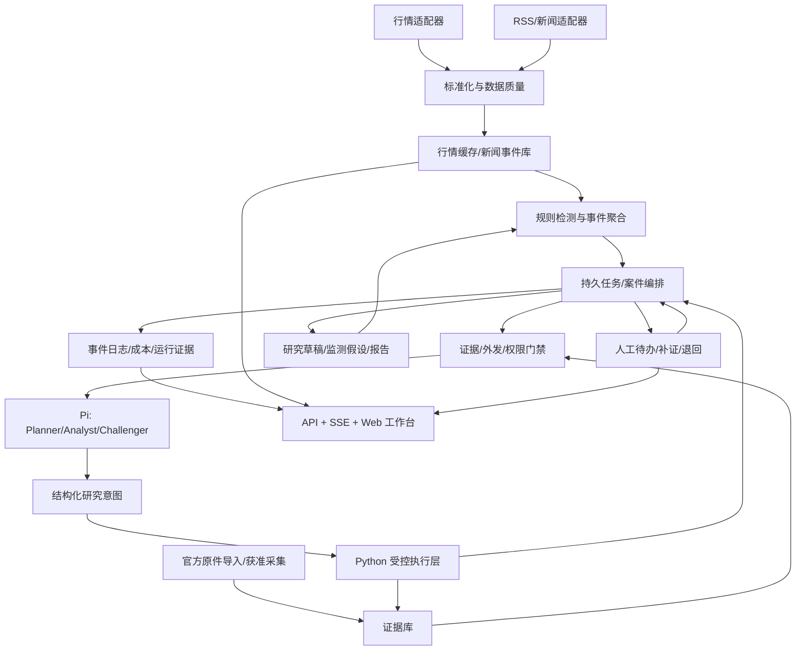

# A 股智能研究工作台：工业化落地总计划

版本：2026-09-18。交付对象：项目负责人、Zcode 实施代理、独立验收人员。

本文是规划，不是上线证明、供应商授权、生产配置变更或交易授权。本次只检查代码、已有报告和参考项目，不启动采集、不调用付费模型、不改变业务门禁。

## 1. 产品决策与总目标

做成一套可日常使用的「持续市场监测 + 事件驱动研究 + 人工决策工作台」，不是自动炒股机器人，也不是不停生成 Markdown 的脚本集合。

用户每天能够：

1. 打开一个面板，看到自选股票的走势、最新行情时间、重要新闻和公告。
2. 看到 AI 正在研究什么、由哪个子代理处理、依据是什么、哪里有分歧、花了多少时间和模型额度。
3. 让 AI 自主决定研究优先级、拆分问题、提出补证任务、分析事件、提出反证、更新研究假设。
4. 在需要时暂停任务、追加问题、退回补证、接受或否定研究结论。
5. 对投资方向、资金风险、任何真实交易、发布和受保护审批保留最终决定权。
6. 遇到数据或模型故障时仍能查看已有资料，明确知道哪些信息已过期，而不是看到伪装成功的页面。

首版工作范围：A 股，20-50 个自选标的，3-5 个主题，一名主要使用者；先覆盖行情、新闻、公告、事件研判。容量验收按 50 标的设计，具体数据可用性以供应商验证为准。暂不扩张到全市场逐笔行情、期货、加密资产、自动下单、多租户 SaaS。

“工业级”定义为：有可复现发布基线、可验证数据、可靠任务执行、权限控制、可恢复故障、可追溯决策、可观测运营，以及真实用户验收。测试数多和 Agent 数多都不是工业级证明。

## 2. 本次检查与现状

检查日期为 2026-09-18。以下报告来自磁盘已有产物，不表示本次重新执行了相应测试或联网探测。

| 范围 | 核实到的情况 | 判断 |
|---|---|---|
| 主流程 | `stock_agent/pipeline.py` 以 run/agent-run 调用串联采集、分析、持久化及投影 | 有基础能力，仍以批次为主 |
| 存储 | `stock_agent/storage.py` 使用 SQLite signals 表，已有多角色、LLM、证据字段 | 可保留，不能直接充当完整任务队列 |
| Pi | `pi_runtime.py` 单轮隔离执行，禁用 tools/extensions/skills/session/context files | 是安全模型执行器，尚不能据此认定为持久多代理编排 |
| Pi 版本 | 本地包 `@earendil-works/pi-coding-agent@0.84.2` | 先保持锁定，不追最新版本 |
| 模型 | 配置/报告为 DeepSeek `deepseek-v4-pro` | 这是配置事实，不等于当前可成功调用 |
| 界面 | dashboard 加基于 `ThreadingHTTPServer` 的 review workbench | 有复核入口，需补实时任务与数据视图 |
| 治理 | 证据库、研究底稿、人工队列、供应商、外发治理、试运行、备份模块 | 保留能力，改善业务入口与状态解释 |
| 运行协调 | 已有租约、检查点代码 | 要补并发、崩溃及副作用验证 |
| 运行 manifest | `run_manifest.py` 已存在；本次查看的 pipeline 未接入 | 按未完成功能验收，不按模块存在计完成 |
| 当前数据配置 | local_jsonl、eastmoney_filing、eastmoney 开启；RSS/AKShare 等未开启 | 尚未形成可靠多源新闻和行情体系 |
| 发布基线 | 实际 `git rev-parse --verify HEAD` 失败 | 没有可引用的 HEAD，不可发布 |

2026-09-17 的 `reports/release/python_environment_latest.md` 记录 Python 3.11/3.12 两个隔离环境 PASS，各执行 834 项、跳过 2 项。本次未重跑；这不能证明新规划功能已完成。

`reports/release_audit/latest.md` 的技术状态仍为 BLOCKED，业务状态 NOT_ASSERTED，阻断包括无 Git HEAD、工作树未冻结、许可证 REVIEW_REQUIRED、生产备份恢复未就绪。报告使用的审计解释器为 3.8.5，而环境验收为 3.11/3.12，后续入口必须统一到锁定解释器。

`reports/health/latest.md` 记录：整体 FAIL；DeepSeek 曾返回 401；行情 3 条被阻断；官方原件 0 份；32 个案件存在未配备人工角色情况。报告中的源健康高分不能抵消行情门禁失败。部分投影已经过期，不能据此声称今天仍正常或仍故障。

现有手工源指向示例命名文件，也必须核实是否混入合成数据。所有开发 fixture 与业务样本隔离，不能算真实运行价值。

结论：这是一个有较多后台控制能力的研究系统原型，不是已经上线的实时多代理产品。下一步应收敛到端到端用户闭环。

## 3. 两条交付线，不把个人工作台冒充券商系统

### 3.1 个人研究工作台

以本机、私有研究、真实用户签收为目标。用户接受研究摘要不等于机构质量批准、合规放行或公开发布。个人侧形成独立的 `research_acknowledgement` 事件，不得调用受保护机构审批接口。

新增个人工作空间若有必要，必须采用明确的数据命名空间、用途标识和独立状态；不得修改现有机构案件的角色要求。先交付已获允许的观察、研究草稿、补证和人工反馈，机构 `BLOCKED` 状态保持真实可见。

### 3.2 机构部署/商业服务

按现有 AGENTS.md 的真实名册、不同角色、来源授权、官方原件、外发审查、档案留存和 Go/No-Go 顺序推进。是否具备相关资质、数据使用和再分发权需由负责人及专业人员核实；本计划不作法律授权判断。

个人可用、软件可靠、机构获准启用是三项不同状态，必须在面板分别显示。不得用 profile 开关绕过已有生产门禁。

## 4. 核心架构决定

采用「Python 模块化服务 + 受控 Pi 推理执行器 + 持久任务编排 + Web 工作台」。不重写全库，不恢复 OpenClaw，不直接套用交易框架。

第一阶段保留 SQLite 与既有 JSONL 历史，单机执行；新服务与旧 CLI 复用同一业务服务层。新增 API 推荐 FastAPI，前端推荐 React + TypeScript；依赖版本由 Zcode 做兼容/许可检查后精确锁定。若发现已有可复用前端工程，先评估再决定，不平行创建第二套 UI。



高频行情更新不依赖 LLM。LLM 只在有意义的事件、用户提问或假设需要更新时运行。流程允许分支、并行、补证、等待人工、撤销和重新开启，不是固定八个 Agent 顺序全部执行。

不在首期加入 Kafka、Kubernetes、向量数据库、复杂服务网格或双模型全量辩论。先用持久 SQL 任务和单一服务边界解决实际问题；测得瓶颈后再引入 PostgreSQL 等基础设施。

## 5. AI 与人工的权限矩阵

| 行为 | AI 权限 | 强制边界 |
|---|---|---|
| 新闻去重、标签、研究优先级 | 可自动建议并在限额内排队 | 保留规则结果、AI 结果和差异 |
| 分配 AI 子任务、选择已批准研究方法 | 可自动执行 | 限制并发、深度、调用数及预算 |
| 查询已批准公开缓存 | 可提出结构化请求，执行层处理 | 无任意路径、Shell、任意 URL |
| 补证、反证、假设与摘要 | 可自动生成 | 每项事实链接证据，未知必须标明 |
| 新增研究关注项 | 可建议 | 超出用户已批准范围需确认 |
| 改研究阈值、数据源或模型 | 只提案 | 人工确认、版本化、旧批准失效 |
| 接受个人研究结论 | 用户操作 | 与机构发布批准分开 |
| 资金、仓位、下单、撤单 | 无执行权限 | 本期没有交易执行适配器 |
| 质量/合规/发布批准 | 禁止替代人工 | 使用现有真实身份及独立角色控制 |
| 授权供应商、解除限制名单 | 禁止 | 原控制流程不变 |
| 修改自身代码、提示词锁和 skills 锁 | 禁止 | 开发发布流程处理 |

目标是让 AI 承担大部分研究劳动，而不是追求“自动决策百分比”。节省的人工时间、可核验事实比例、重大遗漏和有用提醒率才是价值指标。

## 6. 实时行情：明确定义与接入规则

首版称为「近实时监测」。免费源不能直接承诺交易所级逐笔流、全市场秒级覆盖、商业再分发权限或持续 SLA。

### 6.1 行情适配器契约

每条 observation 至少包含：`observation_id, instrument_id, exchange, provider_id, upstream_id, source_time, received_at, trading_date, price, currency, volume, volume_unit, turnover, adjustment, sequence, quality_flags, raw_hash`。

证券代码为字符串，统一如 `XSHG:600000`，建立映射而不是用前缀猜测全部市场。保留源值和标准值；价格采用十进制定点表示。成交量“手/股”、金额“元/万元”、净流入统计口径分别声明。累计成交量不能直接当分时成交量。

`source_time` 缺失时不得用抓取时间伪装行情时间；标记 unknown，按现有门禁处理。按市场日历区分开市、午休、收市、节假日和停牌，不能只判断周一至周五。交易制度参数从审阅后的规则配置获得，不在规划里硬编码统一涨跌停比例。

### 6.2 调度与性能目标

| 数据 | 首版目标配置 | 限制 |
|---|---|---|
| 自选快照 | 允许条件下 15-30 秒一次批量更新 | 不是对免费源的 SLA；受限时退至 60 秒或更慢 |
| 全市场概览 | 5-15 分钟，或关闭 | 禁止每个自选股触发一次全市场下载 |
| 历史日线 | 盘后增量补齐 | 区分前/后/不复权和版本 |
| 新闻/RSS | 2-5 分钟起步，按源限额调整 | 条件请求、去重、退避 |
| 公告索引 | 5-15 分钟候选检查 | 原件抓取仍受配置与明确 live 授权控制 |

这些是拟定工作台目标，不是已验证速度。首周做小样本性能和访问条件验证后冻结配置。每源分别记录请求预算、429/403、失败率、延迟、最后成功时间、许可状态和停用原因。

请求量按 `批次/轮 × 轮/交易时段` 核算；行情刷新快不等于报价本身新。面板同时显示源时间和收到时间。两种库若最终使用同一东方财富上游，只算一个来源，不能冒充多源一致性。

### 6.3 异常与降级

使用价格变化、成交变化、相对板块偏离等可计算指标生成候选事件；指标阈值版本化。合并窗口建议 60-180 秒，冷却按标的/事件类型控制；新重大公告和明显反向变化可开启新版本。

失败时呈现 `STALE / CONFLICT / UNVERIFIED / UNAVAILABLE`，保留最后已知值但禁用相关正常研判。主备切换保留来源变化、口径及质量状态；不得为了绿色状态自动放宽门禁。

## 7. 新闻、公告与证据闭环

优先组合：现有 RSS 适配器 + 经审查的发布者 feeds；AKShare 个股新闻作为候选补充；现有公告适配器用于索引；官方原件进入 evidence vault。

新闻处理顺序：获取元数据 -> 时间/URL/证券实体标准化 -> 精确去重 -> 相似事件聚类 -> 标的关联 -> 来源与内容分类 -> 证据门禁 -> LLM 研究。

必须记录 `publisher, origin_url, published_at, first_seen_at, updated_at, content_hash, rights_status, retrieval_status, related_symbols, event_cluster_id`。新闻发布时间、报道事件日期、系统首次见到时间分开。无法解析时标记未知。

不同站点转载同一篇文章只构成一条原始来源链。不能把转载数量当作交叉验证。相同 URL 修改内容要保留修订版，撤稿要使关联研究失效/待重审，不覆盖旧历史。

全文只在使用条件允许时保存。模型输出不得把新闻猜测写成事实。官方财报/公告没有已落地原件时，阻断需要它的外部模型研判；原件字节不发给 DeepSeek。允许外发的摘要也必须经数据分类和引用检查。

来源不可访问、验证码、权限限制时转人工补证，不绕过。RSSHub 不是网站访问授权，也不是新闻版权授权。

## 8. 子代理：真正动态但有边界

初期六个逻辑角色，复用同一 Pi 执行器，不为每个角色部署常驻服务器。

| 角色 | 输入 | 结构化输出 | 不得做 |
|---|---|---|---|
| Planner | 公开事件包、已批准覆盖边界 | 研究问题、任务依赖、预估成本、停止条件 | 自行放宽外发或扩大授权 |
| Market Analyst | 经门禁的行情与市场背景 | 异常解释、替代解释、需要核实的指标 | 编造价格、把资金统计当确定买卖行为 |
| News/Evidence Analyst | 公开新闻、证据摘要 | 时间线、事实/传闻、来源冲突、补证请求 | 把聚合摘要升级为官方证据 |
| Fundamental Analyst | 已验证财务事实 | 驱动因素、情景假设、关键敏感项 | 计算数字无工具验证 |
| Challenger | 初步结论和同一证据版本 | 反例、缺口、证伪条件、分歧 | 充当独立人工风控批准 |
| Synthesizer | 各研究结果和分歧 | 研究草稿、关键人工问题、后续监测条件 | 用多数表决隐藏未解分歧 |

Planner 可以选择只调用一个分析角色，也可以并行调用多个角色；Synthesizer 不得因某节点失败而假称全体完成。同一模型扮演不同角色不构成独立来源或统计独立判断。

### 8.1 Pi 与执行层之间的协议

保持生产 Pi `--no-tools --no-skills --no-extensions` 等隔离。模型输出是 JSON 研究意图，不是直接工具执行。Python 校验意图后，只执行允许、可审计的动作，再把经过治理的结果形成下一轮上下文。

首批允许意图：`read_public_quote_snapshot`、`read_public_news_cluster`、`read_verified_evidence_summary`、`calculate_approved_indicator`、`propose_research_subtask`、`request_human_evidence`、`draft_research_note`。

所有意图字段：`schema_version, task_id, case_id, input_version, action, parameters, reason_summary, evidence_refs, expected_output, stop_condition`。`parameters` 使用 action 专用 schema，禁止自由命令字符串；新 URL 不自动变成获准采集目标。

LLM 每次外发前重新审查实际 payload；不能只在最初案件入库时审查一次。内部 task ID、身份名册、路径、队列等留本地，外发使用最小化不敏感别名，并在执行层映射回本地上下文。

### 8.2 默认运行限额（拟定，待验收冻结）

同一用户工作区并发模型调用 2；单案件最多 6 个逻辑子任务、2 轮补证推理；单调用超时 90 秒；自动案件总截止 10 分钟。额度与服务限额冲突时取更严格值。

JSON 解析错误最多修复 1 次；401/403 不自动重试；429 尊重 Retry-After，5xx/网络错误有界退避。每次重试独立计量，不将超时视为模型端一定未计费。

首次真实验收最多 5 个调用，以最低受控成本验证；持续运行前用户需确认日/月预算。成本按供应商当期计价和实际 usage 计算；价格表有有效日期，未知成本不得显示为 0。额度耗尽只停新模型任务，不停行情/历史查看。

## 9. 非线性状态机与可恢复执行

案件沿用现有机构阶段与人工门禁。新增任务状态独立于案件审批：

`queued -> leased -> running -> succeeded / failed / blocked / awaiting_human / cancelled / expired`。

允许 `awaiting_human -> queued` 带新输入版本恢复；允许失败节点单独重试；新证据创建新版本，使依赖旧证据的结论和批准失效。不能把全部案件重跑作为唯一恢复手段。

失败分支示例：行情异常 -> 新闻暂无解释 -> Market Analyst 提出三个可能 -> Challenger 要求公告核实 -> 等待人工导入原件 -> 重新验证 -> 仅重跑受影响分析 -> 用户签收研究结论 -> 更新监测条件。

### 9.1 首期持久性方案

新任务状态与 outbox 在同一 SQLite 数据库事务中提交；WAL、busy timeout、短事务、单 writer 队列。工作线程计算，集中写入。不要只用 Python 内存队列或 SSE 连接当任务事实源。

任务领取使用原子条件更新、租约和 fencing token。幂等键至少含 `workspace_id, case_id, input_version, role_id, prompt_version, model_config_hash`。模型执行与存储不能实现端到端 exactly-once；采用 at-least-once 执行及幂等结果落地，重复外部调用风险明确计量。

旧 JSONL 治理账本继续作为对应领域权威历史；新 task DB 只负责新任务领域。跨两者采用唯一 command_id + 可恢复 outbox + 对账状态，不声称跨文件事务原子。任何审批只有原账本确认后才能显示成功。

高频行情不逐条写入研究审批哈希链。行情观察、分钟聚合和研究引用快照分层保存，研究引用固定快照哈希。`latest.json` 永远只是投影，不是运行身份。

### 9.2 必须优先审查的现有风险

1. run 与 agent-run 的同模式租约是否足以保护共同写入资源；迁移期需要统一写入协调。
2. 长任务是否实际续租；过期旧 worker 是否仍能写入；恢复仍遵守原租约人工确认规则。
3. 信号入库后模型未完成而进程退出，去重是否阻止补做研判。
4. JSON 先写 COMPLETED 而最终账本失败，如何避免虚假完成。
5. 秒级文件名、manifest 并发创建、目录跳转/链接、不断增长的账本哈希是否破坏可重复验证。
6. 计划任务 preflight 失败是否真正阻止后续采集/外发。

这些是需要针对性测试的风险清单，不代表本次已经完成完整漏洞审计或修复。

## 10. 数据模型与接口边界

新增表/实体建议：

| 实体 | 关键字段 |
|---|---|
| instruments/watchlists | 标的唯一键、市场、用户覆盖版本 |
| quote_observations/bars | 源时间、采集时间、标准值、质量、来源血缘 |
| news_items/news_revisions | URL、修订 hash、发布时间、事件聚类 |
| research_tasks | task/parent/case ID、依赖、状态、输入版本、租约、重试 |
| agent_runs | 角色、模型实际返回标识、提示版本、usage、耗时、错误分类 |
| research_decisions | 主张、证据、反证、决策摘要、未知项、替代解释 |
| human_requests | 请求原因、选项、输入版本、签收/拒绝事件引用 |
| outbox/events | sequence、event_id、command_id、event_type、payload_ref |
| run_artifacts | run_id、manifest hash、文件相对引用、hash、schema version |

状态 mutation 使用 `expected_version` 乐观锁与 `Idempotency-Key`。旧版本请求返回冲突，不覆盖更新。分页用稳定 cursor，时间 UTC 存储并在 UI 显示 Asia/Shanghai。

拟新增 API（不是当前已存在接口）：

| 方法与路径 | 用途 | 验收 |
|---|---|---|
| GET /api/v1/watchlists | 自选及更新时间 | 无敏感配置 |
| GET /api/v1/quotes | 快照及质量 | 源时间未知不能伪装实时 |
| GET /api/v1/news | 新闻、修订、来源 | 转载聚类可追溯 |
| GET /api/v1/cases/{id} | 案件、任务、证据 | 可区分旧版结论 |
| GET /api/v1/agent-runs/{id} | 过程、usage、输出 | 不展示密钥或隐藏思维链 |
| POST /api/v1/research-requests | 用户问题 | 范围、预算、幂等校验 |
| POST /api/v1/tasks/{id}/cancel | 取消本项目任务 | 不杀其他 Pi/Node/Python |
| POST /api/v1/human-requests/{id}/responses | 人工反馈 | 身份、版本、CSRF、权限 |
| GET /api/v1/events | SSE 增量事件 | Last-Event-ID 断线补发 |
| GET /api/v1/health | 服务/数据/模型/业务分层 | HTTP 存活不等于业务就绪 |

SSE 仅推受权可见投影，不推原始模型日志和敏感任务上下文。过旧游标返回重新获取快照指令；慢客户端限流，不拖住核心处理。行情 UI 可合并刷新，审计事件不能因此丢弃。

## 11. 面板产品设计

首屏是实际操作台，不做介绍首页。桌面三栏：左侧自选/主题，中间行情与事件，右侧 AI 任务和人工待办。窄屏切换为标签页，保留数据时间与警告。

### 11.1 页面与关键交互

| 页面 | 必备内容 | 必备动作 |
|---|---|---|
| 今日工作台 | 数据质量、需处理事件、运行概况、待人工事项 | 筛选、打开案件、暂停新 AI 任务 |
| 股票详情 | 分时/日 K、事件标注、来源时间、假设 | 查看证据、发起研究、设置监测提案 |
| 情报流 | 新闻/公告、原始链接、转载链、修订 | 合并建议、补证、标记无关 |
| Agent 运行中心 | 父子任务图、状态、阶段、耗时、预算、失败 | 查看详情、取消、受控重试 |
| 案件研究台 | 事实/推断/假设分栏、角色分歧、证据 | 追加问题、退回、个人签收或机构审批入口 |
| 人工收件箱 | 阻断原因、具体问题、可选处理、影响范围 | 接受/拒绝/补充；不要求用户改 JSONL |
| 运维与设置 | 源状态、限额、模型认证状态、备份、版本 | 查看诊断、提交变更、手动启停 |

Agent 决策详情显示：谁、什么时候、为什么触发、输入证据版本、行动摘要、输出、未解决问题、由哪个 gate 拦截、最终由谁确认。展示可审计理由摘要，不展示或要求模型私有 chain-of-thought。

每个结论有“截至时间”和“仍有效/待更新/失效”状态。置信度必须标为模型自评，不能展示为预测成功概率；跨角色不直接平均置信度。

系统红色故障、黄色证据不足、蓝色等待人工分别处理。禁止“0 条有效行情但一切正常”。不得把 0 tokens 的 IDLE 状态显示为模型运行成功。

图表采用 Lightweight Charts，保留 NOTICE/归属信息。表格优先，可排序、列宽稳定、有加载/空/错误/过期状态；不用大面积营销卡片。完成桌面和移动截图、长文本、键盘导航及无障碍检查。

## 12. 开源与本地项目整合决策

以下为 2026-09-18 查阅的项目与代码。星数不作为生产安全证明；版本与 commit 在正式引入时另行冻结。未安装任何插件。

| 候选 | 本次依据 | 决定及采用范围 | 不采用/待核实 |
|---|---|---|---|
| OpenAlice | 本地 README、core/tool-center.ts、event-bus.ts、agent-event.ts；官方仓库 | 借鉴统一工具目录、事件类型、工作空间、收件箱 | 不移植自动交易和自我修改；AGPL 进入许可审查 |
| Pi core | 本地执行器与包锁；上游当前仓库 earendil-works/pi | 保留现有隔离调用，新增任务事件适配 | 不因改名/新版本自动升级 |
| pi-subagents | 本地 README、官方仓库 | 借鉴父子任务、运行检视、取消、并发/累计派生限额 | 不直接加载生产扩展，当前禁扩展策略不变 |
| stock-analysis-plugin | 本地 README、pi/index.ts；官方仓库 | 候选只读工具与研究方法清单，逐项隔离测试 | 不整包注册；本地代码会 pi.exec 启动 Python；SDK 兼容未验证 |
| AKShare | 官方仓库和股票 API 文档 | 复用现有适配器，补新闻/历史能力 | 不把多包装库当独立上游；不承诺商业权限或持续可用 |
| RSSHub | 官方仓库 | 原生 RSS 不足时，单独部署选定路由 | 非首期必需；部署文档本次抓取失败，运行参数待实施核实 |
| Lightweight Charts | 官方仓库/NOTICE 要求 | 直接候选图表依赖，固定版本 | 它不提供行情；需署名及链接 |
| TradingAgents | 官方仓库 | 借鉴角色分工和反方挑战；做离线对比 | 不整套嵌套另一套 Agent 图，不把回测当实盘能力 |
| CTradeExchange/free-quote | 官方仓库，项目已有 disabled 适配器 | 仅候选源调查 | 免费范围、授权、频率、时间戳未确认前不作主源 |
| browser-use / ghost-cursor | 本地目录存在，未深入审核 | 本期不整合 | 不用于绕验证码和网站限制 |

本地重点路径：

- `E:\GitHub\OpenAlice-master\OpenAlice-master\src\core\tool-center.ts`
- `E:\GitHub\OpenAlice-master\OpenAlice-master\src\core\event-bus.ts`
- `E:\GitHub\OpenAlice-master\OpenAlice-master\src\core\agent-event.ts`
- `E:\GitHub\pi-subagents\README.md`
- `E:\GitHub\stock-analysis-plugin\pi\index.ts`

注意 OpenAlice 的本地 agent-event.ts 自身注明某些事件消费者已经停用。不能看到事件定义就认定有端到端能力；参考代码也要追到调用方、消费者和测试。

skill 接入流程：选定方法 -> 固定源码版本与来源 -> LICENSE/依赖/权限检查 -> 隔离 fixture 测试 -> 领域评估 -> 人工审查 -> 单独更新方法映射与 hash 锁 -> 重新生成候选指纹。任何旧批准随指纹变化失效。

推荐先评估三个方法：公告事实核验、财务口径检查、反证问题生成。暂不纳入缠论/波浪等大量策略方法、自动调参和收益导向“技能大全”。开发用图表 skill 与生产研究 skill 分开管理。

参考来源：

- [OpenAlice](https://github.com/TraderAlice/OpenAlice)
- [Pi upstream](https://github.com/earendil-works/pi)
- [pi-subagents](https://github.com/nicobailon/pi-subagents)
- [stock-analysis-plugin](https://github.com/Weaxs/stock-analysis-plugin)
- [AKShare](https://github.com/akfamily/akshare)；[股票与个股新闻接口](https://akshare.akfamily.xyz/data/stock/stock.html)
- [RSSHub](https://github.com/DIYgod/RSSHub)
- [Lightweight Charts](https://github.com/tradingview/lightweight-charts)
- [TradingAgents](https://github.com/TauricResearch/TradingAgents)
- [free-quote](https://github.com/CTradeExchange/free-quote)

## 13. 安全、隐私和部署

本机默认仅绑定 127.0.0.1；本机也要验证 Host/Origin、CSRF 与会话，不把 localhost 当身份认证。用户的自然语言指令不能替代 API 权限校验。远程访问另立 TLS、认证、授权和网络边界验收，不直接监听 0.0.0.0。

密钥仅从环境或经批准的凭据存储注入，前端、URL、日志、截图、导出包和 CLI 参数不得包含密钥。历史聊天暴露的凭据应由用户在供应商处轮换；Zcode 不能从聊天复制旧 key 写配置。401 明确要求有效凭据，不通过读取其他项目凭据绕过。

新闻、PDF、网页视为不可信输入。提示注入文本不能执行命令、修改系统提示、扩大访问或绕过证据校验。下载限制 MIME、字节大小、重定向、DNS/IP、压缩展开量；拒绝 SSRF 私网/本机/metadata 地址。

初期 Windows 本机服务，使用现有受控启动入口并隐藏子进程窗口。停止只针对本项目 PID/进程树；不结束全部 python/node。用户此前要求关闭自启动，计划任务与开机启动默认不安装、不恢复。真正长时运行需要常开设备，睡眠期间不承诺监测；恢复后先补缺口、显示停机区间。

## 14. 可靠性、备份与容量

| 指标 | 首版验收目标 | 说明 |
|---|---|---|
| 本地操作 API | p95 小于 500ms | 排除模型/外部采集，指定验收设备 |
| 已落库事件到 UI | p95 小于 2 秒 | 50 标的、2 并发模型、正常本地网络 |
| 交互可用性 | 20 个工作日观测目标 99.5% | 明列运行窗口和停机，不冒充合同 SLA |
| 数据新鲜度 | 分源统计，按配置门槛标记 | 不给免费源统一保证 |
| 待办重复副作用 | 幂等测试中 0 重复批准/签收/发布 | 外部模型调用可能重复，必须计费可见 |
| 安全用例 | 禁止动作和外发测试 100% 被阻断 | 是指定测试集结果，不是绝对无漏洞 |
| 恢复 | 进程重启 5 分钟内恢复可查看/可对账 | 模型任务是否恢复由策略和人工门禁决定 |

持久化成功响应只在本地事务提交后返回；进程故障不丢已提交事件目标需故障注入证明。整机/磁盘灾难的 RPO/RTO 取决于加密异地备份，不能用本机 ZIP 宣称零丢失。

容量估算例：50 标的、每 15 秒快照、按 4 小时采样窗口估算约 48,000 observation/日，仅用于容量预算，不是交易时间规则。30 日约 144 万条，按实际行长、索引和副本测量磁盘用量。短期 raw 行情可滚动归档，研究所引用快照不得随缓存清理删除。

保留期、归档、删除任务需单独批准；不删除现有 reports/data，不修改旧 JSONL 链。备份恢复沿用现有 manifest/hash/SQLite 验证；生产要求仍遵守现有 KMS、异地不可变、签字等门禁。

## 15. 实施路线与工期

估算假设：一名有经验的全栈负责人使用 Zcode 开发，用户每周能参与验收，必要时有独立安全/合规审查。不是 AI 自动连续运行即可保证完成的日历承诺。工作量约 45-65 工程人日，加数据授权、人工审核和真实观察等待；首个可用闭环目标 3-4 周，可靠个人试运行目标 10-14 周，机构生产日期取决于真实控制证据。

| 阶段 | 建议窗口 | 主要结果 | 退出条件 |
|---|---|---|---|
| M0 基线与真实可用性 | 第 1 周 | 来源/模型/环境核实、现有阻断清单、冻结基线方案 | 不混样例、不伪造授权；真实调用或明确失败 |
| M1 单案件闭环 | 第 2-4 周 | 1-5 标的 -> 合法公开事件 -> 一个 AI -> 人工问题 -> 可见记录 | UI 可用，断网/无 key 也能解释状态 |
| M2 近实时数据产品 | 第 4-6 周 | 20-50 标的、新闻聚类、图表、时效告警 | 采集限额、数据时间、停机补偿正确 |
| M3 动态多代理 | 第 6-9 周 | 并行任务、补证、取消、预算、完整任务面板 | 成功/失败/等待/恢复均实测 |
| M4 工程可靠性 | 第 9-12 周 | 故障注入、权限测试、备份恢复、发布迁移 | 冻结候选，关键风险关闭 |
| M5 真实价值与试运行 | 第 12-14 周及以后 | 真实样本、人工时间和反馈、运行指标 | 满足相应使用范围的 Go/No-Go |

数据/模型接入若阻断，M1 可先用标明 replay 的历史公开资料完成技术演示，但不能计作真实调用或业务上线。不要以等待机构授权为由停止所有可隔离的技术工作。

## 16. Zcode 工作包与交付物

所有下列路径如未存在均为建议新增，不是宣称已有能力。按依赖执行，每包小步提交、独立验收。

| ID | 工作与落点 | 依赖 | 必交验收证据 |
|---|---|---|---|
| W00 | 盘点 config、CLI、锁、reports，输出 `docs/implementation/BASELINE.md` | 无 | 已有/半成品/缺失矩阵，命令真实输出摘要 |
| W01 | 修正启动入口解释器、密钥诊断、样例隔离 | W00 | 3.11/3.12 环境验证；无密钥日志；401 分类 |
| W02 | 协调/manifest 接线：pipeline、run_coordination、run_manifest、schedule | W00 | 并发、崩溃、幂等、篡改/路径边界测试 |
| W03 | 新 `task_runtime/` 事务任务/outbox/状态机 | W02 | 重启恢复、重复消息、旧 worker fencing |
| W04 | `sources/` 契约、时间/单位/上游血缘与限流 | W01 | 两类适配器 fixture 和受限 live 探测报告 |
| W05 | 行情增量存储、缓存、日历、质量投影 | W04 | 迟到/乱序/停牌/缺时戳/切源测试 |
| W06 | 新闻聚类与修订、官方证据链接 | W04 | 转载/撤稿/重复/修订测试，原件门禁 |
| W07 | `agent_protocol/` 意图 schema 与 Python broker | W03 | 任意命令/URL/路径拒绝，外发最小化 |
| W08 | Pi 分析单节点与明确人工问题 | W06,W07 | 一次真实受控调用；失败与预算耗尽路径 |
| W09 | `api/` + `web/` 基础工作台、SSE、认证边界 | W03,W05 | 断线补发、CSRF、越权、移动截图 |
| W10 | 首个完整业务切片接入 UI | W08,W09 | 从公开输入到人类签收完整 run_id/证据 |
| W11 | Planner、多角色、Challenger、版本失效 | W10 | 并行/分支/超时/人工补证恢复测试 |
| W12 | Agent Fleet UI、分歧/成本/控制操作 | W11 | 后端真实事件驱动，无虚构演示状态 |
| W13 | skills 候选审查与至多 3 方法试验 | W10 | 固定版本/许可证/零权限/回归结果 |
| W14 | 安全、负载、可观测性、备份、打包 | W12 | 故障演练、恢复证据、可复现构建 |
| W15 | 真实价值验证与范围内试运行 | W14 | 真实人类评价、时间日志、Go/No-Go |

W09 可先做只读骨架，W10 必须早于继续添加更多角色；不得等所有后台模块完成才开始用户验收。W13 可跳过，不阻塞核心产品。

## 17. 前十个工作日执行顺序

1. 第 1 天：只读盘点，确认 git 状态及已有未提交工作；列出当前命令、服务、端口和配置来源。不重置、不自动全量提交敏感目录。
2. 第 2 天：使用隔离 Python，复跑现有测试；核对 source fixture 混用、DeepSeek 401、行情阻断根因；形成依赖阻断表。
3. 第 3 天：完成数据适配器和任务事件 ADR；确定源码纳入范围、忽略项、许可待审清单，建立可审阅基线流程。
4. 第 4-5 天：补运行身份、协调和恢复测试；明确哪些旧写入必须统一协调。
5. 第 6-7 天：实现最小任务/outbox、一个只读公开事件适配器、一个 Pi 单节点协议；并行建只读任务面板。
6. 第 8 天：串起一个公开真实研究问题，按门禁验证；缺权限/凭据时只做标记清楚的 replay，不伪装成功。
7. 第 9 天：加入人工补证、拒绝、取消和重启恢复；让用户不编辑 JSONL 就能反馈。
8. 第 10 天：演示完整切片，交付证据目录、差异清单、失败列表，再决定下一批开发容量。

这十天的成品是可验证纵向切片，不承诺已完成 50 标的生产监测或全部机构上线门禁。

## 18. 测试矩阵与验收方法

离线自动测试是默认，不依赖免费网站始终在线。live 测试显式启用、限额、脱敏，有来源/模型/时间记录。

| 类别 | 必测场景 |
|---|---|
| 行情 | 缺字段、单位错误、乱序、重复、午休/节假日、停牌、复权变更、源冲突 |
| 新闻 | 同源转载、URL 修订、撤稿、日期未知、无正文、HTML 注入、恶意提示 |
| 模型 | 401/403/429/5xx、超时、非法 JSON、虚假引用、幻觉数字、usage 缺失 |
| 编排 | 进程被杀、续租失效、重复消息、父取消子任务、部分成功、重试超额 |
| 人工 | 旧版提交、双击、越权、伪造 actor、拒绝后再次派生、审批指纹失效 |
| 文件 | 半写入、磁盘满、只读目录、hash 错、symlink/junction 越界、manifest 冲突 |
| UI | SSE 重连、离线、长中文、空状态、手机、键盘、取消反馈 |
| 迁移 | 旧数据库副本升级、重复升级、索引、旧 CLI、历史事件完整性 |

现有命令可用于基线核实，先确认配置和解释器，不将其等同新功能验收：

```powershell
.\.venv312\Scripts\python.exe -m unittest discover -s tests
.\.venv312\Scripts\python.exe -m stock_agent run-coordination-status --config config/watchlist.local.json
.\.venv312\Scripts\python.exe -m stock_agent release-audit --config config/watchlist.local.json
```

新增接口/运行器命令必须随实现写入文档，未实现前不能交付“已跑通”的命令截图。release-audit 的 BLOCKED 不能为了验收而改成 WARN。

真实价值验证沿用 G0.5：20-30 个真实 P0/P1 案件、实际人工时间、冻结 READY 发布清单、独立 A/B 盲评。模糊授权、人工缺位或发布基线不满足时如实阻断；技术 replay 不计入业务样本。

建议价值目标（需首轮真实基线校准）：人工整理中位时间减少 30%；抽样研究事实可追溯率至少 95%；重大无依据事实 0；重复人工待办显著减少。所有分母、抽样窗口、剔除原因必须公开，未达到目标也要交付真实结果。

## 19. 发布迁移和回滚

旧 CLI 保留；新 API 调业务服务而非拼接 Shell。旧 workbench 在新 UI 完整可用前保持，不同时成为第二个无协调的写入入口。

迁移顺序：备份验证 -> 副本演练 -> schema 版本升级 -> 只读投影对账 -> 回放测试 -> 影子读 -> 明确批准范围内切换写入。历史 signals ID、案件 ID、证据引用保持可追溯。

数据库新增字段优先向后兼容。无法逆转的迁移采用前向修复或恢复备份，提前说明停机和 RPO；不能一句 git revert 就宣称数据回滚完成。

提交源码前执行脱敏和许可证检查；禁止 `git add .` 把凭据、数据、名册和历史产物一并纳入。建立真实 Git 基线需审阅提交清单，不自动覆盖用户变更。阶段版本保留锁、schema、提示版本、skill hash 与验收证据。

## 20. Go/No-Go 与停止标准

个人试运行至少要求：有效来源且使用范围明确；凭据有效；无测试信号混入；50 标的容量或明确缩小范围；人工反馈可用；失败可见；取消与恢复可验证；无交易执行能力；没有暴露密钥；只在明确批准运行窗口运行。

机构生产另外要求：现有 release READY、真实名册及分权、供应商授权、官方原件、治理问题关闭、档案及灾备批准、价值验证和业务最终批准。任何一项缺失，保持 NO_GO，不以面板已完成替代。

发现泄露密钥、未授权外发、任意执行、伪造行情时间、重复受保护动作、审计链损坏时停止对应写入/外发路径，保留证据，人工处置。普通单源断线不必关闭整个只读工作台。

## 21. 责任与交付纪律

Zcode：实现、自动测试、迁移脚本、文档、受控证据，不可代替真人审批。

项目负责人：确认范围与预算、提供有效凭据和来源使用依据、真实签收反馈、决定是否长期运行。

独立审查人：按机构场景承担真实质量/合规/安全与发布职责；不能由同一 AI 换名字补齐角色。

每次交付必须包含：工作包 ID、修改文件、实际执行命令、通过/失败/跳过、真实或 mock、数据与模型实际来源、遗留风险、回滚方式、下一步。不允许只用“全部测试通过”作为完成说明。

## 22. 最优先的一句话目标

先让用户在一个真实面板里，看到一个真实公开事件如何被一个真实 AI 研究、在何处等待证据、由谁作出最终决定，并能安全地暂停和恢复。把这一条做可靠，再扩大标的、角色、来源和部署规模。
