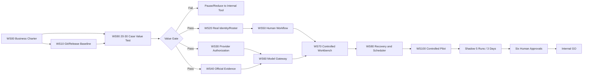

# A 股智能投研系统：总项目计划 v31

> 项目路径：`E:\stock agent`  
> 计划基准日期：2026-08-31（Asia/Shanghai）  
> 战略依据：`docs/PROJECT_GM_STRATEGY_V30.md`  
> 工程交接：`docs/ZCODE_PROJECT_HANDOFF_20260829.md`  
> 当前计划状态：`PLANNING / NO_GO`  
> 总计划原则：**阶段门优先于日历，真实证据优先于状态字段，价值验证优先于功能扩张。**

---

## 0. 计划摘要

### 0.1 项目总目标

建设一套面向 A 股内部研究的证据驱动研究运营平台，将经授权的公开数据和官方原件转化为：

- 可追溯的 Research Case。
- 结构化研究工作底稿。
- 受控的 Pi + DeepSeek V4 Pro 研判。
- 独立挑战、质量审核和合规审核任务。
- 经真实人工批准的内部研究材料。
- 可重放、可复盘、可归档的研究资产。

项目永久不包含自动交易、自动下单、自动调仓、自动发布和自动受保护审批。

### 0.2 当前基线

2026-08-31 轻量检查确认：

| 项目 | 当前状态 |
|---|---|
| Git HEAD | 不存在，`git rev-parse --verify HEAD` 退出码 128 |
| Git 分支 | `main` |
| Git status 行数 | 24 |
| Python 源文件 | 60 |
| 测试文件 | 63 |
| 最近完整测试证据 | 2026-08-29，732/732 通过 |
| StockAgent 计划任务 | 0 |
| Workbench 8767 | 未监听 |
| Health latest | 2026-08-29 |
| Pilot/Onboarding/Review/Runtime latest | 2026-08-26 |

因此本计划不把历史 `latest` 当成 2026-08-31 的新生产验收。第一阶段必须解决可信源码基线和状态新鲜度。

### 0.3 项目定位

推荐正式定位：

> **A 股官方证据驱动的内部研究运营平台。**

首发场景：

> **P0/P1 官方公告、财报和重大公司事件，从原件发现到人工可批准内部研究材料的闭环。**

### 0.4 总体时间框架

时间是管理目标，不是绕过门禁的理由：

| 阶段 | 目标窗口 | 结果 |
|---|---|---|
| G-1 Business Charter | 2026-09-01 至 09-11 | 决定是否继续机构化 |
| G0 可信工程基线 | 2026-09 至 10 月 | 可回滚、可复现、可恢复 |
| G0.5 价值验证 | 2026-09 至 11 月 | 20-30 案例、继续/停止决定 |
| G1 机构预检 | 2026-10 至 2027-01 | 真实组织、人员、供应商、原件和治理 |
| G2 单团队受控试点 | 2027-01 至 04 月 | 身份、许可、模型网关、工作台和评估 |
| G3 Shadow 与内部 GO | 2027-04 至 06 月 | 5 次/3 日、六类批准、手工激活 |
| G4 可重复产品化 | 2027-07 至 2028-02 | 第二个设计合作方和标准部署 |
| G5 平台化评估 | 2028 年后 | 只有真实需求存在时进入 |

任何阶段可以延期、暂停或终止，但不得越级。

---

## 1. 规划原则

### 1.1 项目管理原则

1. 每个阶段都有进入条件、交付物、退出条件和停止条件。
2. 每项工作必须对应真实用户场景、风险或下一门禁。
3. 业务 `BLOCKED` 不是技术 bug，不通过 Agent、mock 或删历史消除。
4. 项目总经理负责范围、价值、预算和阶段决策；技术负责人不能单独宣布上线。
5. 生产变化必须绑定源码、配置、依赖、模型、人员和供应商指纹。
6. 项目计划以事实源和当前证据为准，不以口头“已完成”为准。
7. 新功能进入 backlog 前必须说明预期指标和验收数据。
8. 不在没有真实客户前建设微服务、多租户和复杂插件生态。

### 1.2 产品原则

- 官方原件优先于新闻摘要。
- 研究案件优先于孤立信号。
- 声明级证据优先于长篇模型总结。
- 人工独立挑战优先于同模型角色扮演。
- 研究运营效率优先于报告数量。
- 内部研究价值优先于外部宣传。

### 1.3 技术原则

- Python 是确定性控制和治理平面。
- Pi 是唯一目标生产 LLM 执行适配器。
- DeepSeek V4 Pro 是主模型。
- 生产 Pi 保持无工具、无动态 skills、无 packages/extensions。
- 模块化单体优先，事件契约先行。
- 所有 `latest` 都是投影，不是事实源。
- 所有受保护动作绑定真实身份和签名事件。
- 失败时 fail closed 或降级成人工任务。

---

## 2. 项目治理结构

### 2.1 决策层级

| 层级 | 组成 | 权限 |
|---|---|---|
| Steering Committee | Sponsor、GM、研究、合规、数据、信息安全 | 阶段预算、范围、继续/停止、风险接受 |
| Product & Architecture Council | GM、产品、架构、数据、SRE、研究代表 | 目标架构、优先级、技术债、版本计划 |
| Model Risk Forum | 研究质量、模型风险、合规、数据、工程 | 模型、prompt、评估集、外发和降级策略 |
| Change Approval Board | Release、SRE、AppSec、业务代表 | 生产变更、回滚、provider/model/skill 变更 |
| Delivery Team | 产品、工程、数据、QA/SRE、实施 | 开发、测试、文档、试点和运营支持 |

当前这些角色尚未绑定真实人员。在人员存在前，委员会结构只是规划，不能产生真实批准。

### 2.2 项目状态定义

| 状态 | 含义 |
|---|---|
| `PLANNING` | 章程、资源和场景尚未批准 |
| `BUILDING` | 已通过业务章程，正在建设工程基线 |
| `VALUE_TEST` | 正在执行冻结案例价值验证 |
| `ONBOARDING` | 正在完成真实人员、供应商、档案和治理 |
| `CONTROLLED_PILOT` | 限定人员、场景和数据的受控试点 |
| `SHADOW` | 计划运行但不正式内部启用 |
| `GO_INTERNAL` | 仅允许受控内部研究 |
| `PAUSED` | 风险、价值或资源不满足，暂停新增工作 |
| `STOPPED` | 终止机构化产品路线，保留审计和必要维护 |

当前状态：`PLANNING / NO_GO`。

### 2.3 阶段决策包

每次 Gate Review 必须包含：

- 阶段目标和完成范围。
- 交付物清单与哈希。
- 测试和验收命令、退出码。
- 当前 Release Manifest。
- KPI 与基线比较。
- 未关闭风险和例外。
- 成本、人员投入和下一阶段预算。
- 继续、带条件继续、暂停或停止建议。
- 真实审批人和外部档案记录。

---

## 3. 工作分解结构 WBS

总项目分为 11 个工作流。

### WS00：项目治理与业务章程

**目标**：明确为什么做、为谁做、解决什么、何时停止。

主要任务：

- `WS00-01` 指定真实 sponsor。
- `WS00-02` 指定目标研究团队和首个分析师用户。
- `WS00-03` 确定 P0/P1 首发事件范围。
- `WS00-04` 记录当前人工流程、耗时、错误和工具切换基线。
- `WS00-05` 确定 90 天成功和停止标准。
- `WS00-06` 建立 Decision Log、Risk Log、Issue Log 和 Change Log。
- `WS00-07` 决定个人研究工具路线还是机构设计合作路线。

交付物：

- `Project Charter`
- `Business Value Baseline`
- `Scope / Non-goals`
- `90-day Funding Decision`
- `Named Sponsor and Product Owner`

验收：

- 有具名真实 sponsor 和目标用户。
- 用户确认首发场景确实存在。
- 有可测的人工基线。
- Steering Committee 明确继续或暂停。

Owner：Sponsor / Project GM。

### WS10：可信发布与工程基线

**目标**：让每次运行都能回答“使用了哪份代码、配置和依赖”。

主要任务：

- `WS10-01` 文件分类、secret scan 和 `.gitignore` 审查。
- `WS10-02` 用户批准后建立首个 Git HEAD。
- `WS10-03` 轮换已暴露的 DeepSeek Key。
- `WS10-04` 固定 Python 运行、测试和可选依赖。**已完成：31 包哈希锁。**
- `WS10-05` 建立 Python 3.11/3.12 并行环境。**已完成：两套环境各通过 759 项测试，跳过 2 项。**
- `WS10-06` 生成 SBOM 和第三方许可证清单。**技术产物已完成；2 个 MPL 相关组件待真实人工复核。**
- `WS10-07` 实现 canonical release manifest。**已完成。**
- `WS10-08` 为 latest 产物加入生成时间、输入时间和 staleness。**载体已实现：release-audit 输出全部 latest 投影的 Freshness/Age/Source 矩阵；dashboard 侧展示归 WS70 统一 view model，避免第三套状态解释。**
- `WS10-09` 统一 UTF-8 控制台行为。**已完成（2026-09-17）：`__main__.py` 入口对 stdout/stderr reconfigure 为 UTF-8（errors=replace），Windows 遗留代码页不再乱码，三环境全量测试通过。**
- `WS10-10` 审查 `_db_check.py`、`_tmp_plain_listener.py` 等临时文件。**已完成（2026-09-06）：确认为临时排障/测试夹具、无生产引用；已排除出基线并 gitignore。**

交付物：

- 审阅后的首个源码基线。
- 依赖锁和环境安装说明。
- Release Manifest v1。
- SBOM/License Report。
- Secret Scan Report。
- Status Freshness Report。

验收：

```powershell
git rev-parse --verify HEAD
python -m unittest discover -s tests
python -m stock_agent release-audit --config config/watchlist.local.json
```

`release-audit` 已于 2026-08-31 实现为只读审计命令，产物位于 `reports/release_audit/`。它不允许采集、
调用 LLM 或写业务状态；`--require-ready` 只校验技术发布基线，绝不替代供应商、合规、档案或人工
Go/No-Go。2026-09-02 已补齐 Python 哈希锁、双版本环境审计、secret scan 和 SBOM；当前仍因无可信 Git
HEAD、工作树未形成干净候选以及许可证人工复核未完成而返回 `BLOCKED`，不得降级门槛。

Owner：Release Manager / Platform Lead / AppSec。

### WS20：身份、授权与职责分离

**目标**：把自由字符串 actor 升级为真实身份和签名操作。

主要任务：

- `WS20-01` 定义角色、权限、限制和冲突矩阵。
- `WS20-02` 单机试点绑定 Windows SID。
- `WS20-03` 设计 OIDC/企业 IdP/MFA 接口。
- `WS20-04` 受保护动作使用签名 challenge 和短会话。
- `WS20-05` 审批事件记录身份提供者、会话和策略版本。
- `WS20-06` 禁止 service/model/system 通过人工门禁。
- `WS20-07` 完成 7 类真实功能角色接入模板。
- `WS20-08` 权限撤销、人员离岗和紧急停用流程。

交付物：

- Identity Architecture。
- RBAC/ABAC Matrix。
- Segregation-of-Duties Matrix。
- Windows SID Pilot Adapter。
- Human Roster Onboarding Pack。

验收：

- 不能通过任意 `--actor` 冒充他人。
- 受保护角色冲突被程序阻断。
- 身份撤销立即影响后续动作。
- service/model 不能产生人工 approval。

Owner：IAM Lead / Compliance / InfoSec。

### WS30：数据供应商与数据质量

**目标**：让每条数据都具有明确来源、许可、时间、质量和使用范围。

主要任务：

- `WS30-01` 定义 Provider Contract v2。
- `WS30-02` 建立 provider candidate intake。
- `WS30-03` 收集合同、数据权利、外部 LLM、缓存、衍生和归档 scope。
- `WS30-04` 完成数据、合规和信息安全独立审查。
- `WS30-05` 至少两家关键 provider 的手工激活。
- `WS30-06` 多源时间戳和一致性对账。
- `WS30-07` contract tests 与 replay fixtures。
- `WS30-08` 速率限制、重试、熔断、缓存和退出。
- `WS30-09` 交易所日历和交易时段语义。
- `WS30-10` provider expiry/revocation fail closed。

交付物：

- Provider Contract v2 Schema。
- Provider Due Diligence Pack。
- Two-provider Activation Evidence。
- Market Data Reconciliation Report。
- Adapter Contract Test Suite。

验收：

- `approved providers >= 2`。
- 每条生产行情绑定有效 provider evidence。
- `external_llm_processing` scope 不匹配时阻断。
- 陈旧、冲突或未授权数据不进入模型。

Owner：Data Steward / Legal / Compliance / InfoSec。

### WS40：官方证据与数据血缘

**目标**：让 P0/P1 的每个核心声明能回到准确官方原件。

主要任务：

- `WS40-01` 筛选仍有研究价值的 9 个当前 P0/P1 案件。
- `WS40-02` 定位交易所、CNInfo、监管或发行人准确原文。
- `WS40-03` 保存 transport receipt、重定向、时间和响应元数据。
- `WS40-04` 导入 Evidence Vault 并独立抽检。
- `WS40-05` 绑定 signal/case/workpaper/claim。
- `WS40-06` 实现声明级 evidence span。
- `WS40-07` 建立外部档案引用和远端链头锚点。
- `WS40-08` production archive 独立复核和手工激活。
- `WS40-09` 过期、撤销、篡改和缺失处理。

交付物：

- 9/9 P0/P1 Evidence Pack。
- Claim-to-Evidence Index。
- Transport Receipt Schema。
- Archive Integration and Restore Test。

验收：

- P0/P1 官方原件覆盖 100%。
- 原件 hash、来源 URL、时间和主体一致。
- 原始文件字节不进入 DeepSeek。
- 本地 shadow 与外部 archive 状态分开。

Owner：Information Analyst / Quality / Records / InfoSec。

### WS50：Research Case、Workpaper 与人工复核

**目标**：将当前控制骨架转化为真实使用的研究运营流程。

主要任务：

- `WS50-01` 冻结首发案件类型和状态机。
- `WS50-02` 定义并行任务依赖和完成条件。
- `WS50-03` 增加全局 WIP 和角色容量上限。
- `WS50-04` critical unassigned 时暂停低优先级 intake。
- `WS50-05` 154 条积压按价值、证据和时效分层。
- `WS50-06` 人工 confirm/reject/defer/request_more_data。
- `WS50-07` 保留原始事件，投影内合并重复。
- `WS50-08` 独立 challenge 必须引用 risk note。
- `WS50-09` 质量、合规和发布门禁退回分支。
- `WS50-10` thesis monitoring 与新证据 reopen。

交付物：

- Case Definition v1。
- WIP/Backpressure Policy。
- Backlog Burn-down Plan。
- Review SLA Matrix。
- Completed Review Dataset。

验收：

- critical unassigned = 0。
- overdue 处于批准阈值内。
- completed review 不再为 0。
- 独立挑战不是模型角色字段。
- 任何补证都能使旧批准失效并回退。

Owner：Research Coordinator / Lead Analyst / Quality / Compliance。

### WS60：Pi、DeepSeek 与模型质量

**目标**：建立唯一生产模型入口和可验证的研究质量。

主要任务：

- `WS60-01` 设计 Model Gateway contract。
- `WS60-02` Pi 成为唯一目标生产 LLM 执行适配器。
- `WS60-03` 收敛 `llm_agent`、同模型多角色和 Pi summary 重复调用。
- `WS60-04` 固定 model/prompt/schema/skill bundle 指纹。
- `WS60-05` 每次调用绑定 provider scope 与 evidence IDs。
- `WS60-06` 校验 JSON、finish_reason、usage、引用和成本。
- `WS60-07` 声明级支持/冲突/未知判断。
- `WS60-08` `abstain/unknown` 和人工降级。
- `WS60-09` 冻结评估集和盲评 rubric。
- `WS60-10` 硬调用数、token、时间和金额预算。
- `WS60-11` 模型版本变更回归和回滚。

交付物：

- Model Gateway v1。
- Pi Single-entry Migration Plan。
- Frozen Evaluation Dataset。
- Model Card / Prompt Contract。
- Cost and Quality Dashboard。

验收：

- 无治理合格信号时模型调用为 0。
- 生产只有一个 DeepSeek 调用入口。
- 引用精确率 >= 98%。
- 无证据断言率 <= 2%。
- 成功调用 usage 元数据覆盖 100%。
- 模型输出不能执行工具和受保护动作。

Owner：Model Platform Lead / Model Risk / Research Quality。

### WS70：Workbench、Dashboard 与用户体验

**目标**：让真实分析师和审核人高效完成工作，而不是浏览很多报告文件。

主要任务：

- `WS70-01` 访谈目标分析师并记录关键任务。
- `WS70-02` 按角色设计 inbox、case、evidence、claim、review 和 approval 视图。
- `WS70-03` 声明与原文并排核验。
- `WS70-04` 队列批处理只操作投影和新事件，不删历史。
- `WS70-05` Dashboard 使用统一 view model。
- `WS70-06` latest/staleness/run manifest 明示。
- `WS70-07` 键盘、筛选、分页、深链和错误恢复。
- `WS70-08` loopback 安全与未来企业身份接口。
- `WS70-09` 可访问性与桌面/移动宽度检查。

交付物：

- User Journey Map。
- Role-based Workbench v2。
- Shared View Model。
- Usability Test Report。

验收：

- 目标用户能完成完整案件复核，无需手工找多个 JSON/Markdown。
- 一条 P0/P1 的证据、声明、模型和人工记录可在同一流程查看。
- 不暴露原始敏感 payload 和 Key。

Owner：Product / UX / Frontend / Research Users。

### WS80：调度、可靠性、审计与灾备

**目标**：让运行顺序、失败恢复、审计和备份可被证明。

**2026-09-05 技术进度**：已实现 Backup/Restore Drill v1，包括 SQLite 在线备份、事实源清单、逐文件
SHA-256、普通 JSONL/哈希链双模式验证、内容寻址对象核验、凭据扫描、隔离恢复和恢复投影对账。
该能力只完成本机非生产演练；加密/KMS、异地不可变副本、跨文件全局 lease、可恢复 Git 基线、计划周期
RPO、全服务 RTO 和独立人工签字仍未建立，因此 WS80 生产灾备状态保持 `BLOCKED`。

**Run Coordination & Checkpoint v1 技术进度**：已补上本机运行协调基础。`run` 和 `agent-run` 在启用
`run_coordination` 时使用唯一 `run_id`、按模式原子租约和追加式 SHA-256 检查点账本；主要阶段完成后记录
仅含数量/指纹的 checkpoint，成功记录最终输出文件 SHA-256，异常记录 `run_failed` 并释放本进程持有的租约。
同模式并发会在采集前阻断，过期租约只能通过带人工理由的 `run-recover-stale` 显式归档；不会自动接管、
重试、交易、发布或修改配置。`run-coordination-status`、Dashboard 和 scheduled summary 已接入只读状态。
该实现是本机技术协调证据，不是跨主机 fencing、生产调度授权或业务 Go/No-Go；生产 readiness 仍保持
`BLOCKED`。

主要任务：

- `WS80-01` 全局运行 lease 和唯一 run_id。
- `WS80-02` daily 完成事件触发 pilot。
- `WS80-03` pilot 明确消费指定 manifest，不读取模糊 latest。
- `WS80-04` 幂等 checkpoint 和 crash recovery。
- `WS80-05` 交易所日历。
- `WS80-06` SLO、错误预算和升级。
- `WS80-07` SQLite/事件/vault/config 加密备份。
- `WS80-08` RPO/RTO 和完整恢复演练。
- `WS80-09` 外部 WORM/可信时间/链头锚点。
- `WS80-10` 事件响应、断路、撤销 activation 和 provider 退出。
- `WS80-11` 计划任务 DryRun、安装和卸载验收。

当前完成范围：`WS80-01`（本机按模式 lease/唯一 run_id）和 `WS80-04`（哈希链 checkpoint、幂等、
显式 stale recovery）完成技术 v1；`WS80-02/03/05/06` 仍未完成，不能用本机状态投影代替 pilot、日历、
SLO 或生产批准。

交付物：

- Scheduler Contract v2。
- Recovery Runbook。
- Backup/Restore Evidence。
- Incident Response Playbook。
- Shadow Run Ledger。

验收：

- daily/pilot 无竞态。
- 手工重复运行不计 shadow。
- 恢复后 projection 与事实源哈希对账。
- RPO/RTO 达标。
- 5 次、3 个真实交易日 shadow 合格。

Owner：SRE / IT Operations / Records / InfoSec。

### WS90：价值验证与模型/产品评估

**目标**：证明系统真的改善研究运营，而不是只增加流程。

**2026-09-02 技术进度**：已实现 `stock_agent/value_validation.py`、完整 CLI、哈希链事实源、冻结队列、
G0 manifest 绑定、人工/系统辅助指标、随机 A/B 盲评、sealed mapping、价值门禁、只读报告与 Dashboard。
该完成度只代表评估机制可运行。真实研究尚未建立，20-30 个案件、人工计时、独立盲评和主管决定均未发生，
因此 WS90 业务状态仍为 `NOT_STARTED`，M2 继续 `NO_GO`。

主要任务：

- `WS90-01` 选择 20-30 个真实历史案例。
- `WS90-02` 冻结证据、结果和评分 rubric。
- `WS90-03` 记录人工基线时间与质量。
- `WS90-04` 执行系统辅助流程。
- `WS90-05` 独立质量审核人盲评。
- `WS90-06` 比较耗时、遗漏、引用、错误、成本和有用性。
- `WS90-07` 分析模型、规则、来源和人工贡献。
- `WS90-08` 形成继续、收窄或停止建议。

交付物：

- Frozen Case Set。
- Baseline Dataset。
- Blind Evaluation Report。
- Value Gate Decision Pack。

验收：

- 至少 20% 运营效率改善。
- 研究质量不低于基线。
- 0 未授权外发。
- 评估结果可重放。

Owner：Product GM / Head of Research / Independent Quality。

### WS100：机构接入、试点与商业化

**目标**：把一个真实设计合作方转化为可重复部署的内部研究产品。

主要任务：

- `WS100-01` 真实 legal entity 与治理范围。
- `WS100-02` 客户人员、数据、档案和安全预检。
- `WS100-03` 受控试点合同、范围、数据和退出条款。
- `WS100-04` 单团队部署和用户培训。
- `WS100-05` 试点 KPI 与事件管理。
- `WS100-06` 六类 fingerprint-bound 人工批准。
- `WS100-07` 手工内部激活。
- `WS100-08` 标准实施、升级、回滚和退出包。
- `WS100-09` 第二个设计合作方重复性验证。

交付物：

- Design Partner Agreement。
- Institutional Onboarding Pack。
- Controlled Pilot Report。
- Internal GO Decision。
- Repeatable Deployment Pack。

验收：

- Business Onboarding 8/8。
- Production Pilot `GO`。
- 仍只允许内部研究。
- 第二个实例不依赖大量定制代码。

Owner：GM / Customer Sponsor / Implementation / Compliance。

---

## 4. 关键路径与依赖

### 4.1 关键路径图



### 4.2 强制依赖

| 后续工作 | 前置条件 |
|---|---|
| 首个 Git 提交 | secret scan、纳入/排除清单、用户批准 |
| 价值验证 | 冻结源码/配置/model/prompt/skills 和案例 |
| 机构预检投入 | Value Gate 通过 |
| 外部 LLM | provider scope + public classification + evidence gate |
| P0/P1 研判 | 官方原件已留存和绑定 |
| 受保护人工动作 | 真实身份绑定和职责分离 |
| Shadow | 数据、身份、档案、恢复、积压和治理通过 |
| GO | 5 次/3 日 shadow + 6 类独立批准 + 手工激活 |
| 多租户 | 至少两个成功可重复实例 |

### 4.3 不在关键路径上的延后事项

- OpenLineage 全量接入。
- Phoenix/MLflow 平台化。
- 更多行情和社媒适配器。
- Pi 插件生态。
- 多模型自动辩论。
- 多租户和 Kubernetes。
- 交易、组合和券商接口。

---

## 5. 阶段与里程碑

### M0：业务继续决定

目标日期：2026-09-11。

进入条件：当前规划状态。

必须交付：

- 真实 sponsor。
- 目标用户和首发场景。
- 人工基线采集计划。
- 90 天预算和停止标准。

退出：

- `CONTINUE_TO_G0`
- `REDUCE_TO_INTERNAL_TOOL`
- `PAUSE`

### M1：可信工程基线

目标日期：2026-10-16。

必须交付：

- Git HEAD。
- Key 轮换。
- Python 锁与现代环境。
- SBOM/许可证。
- Release Manifest v1。
- Backup/Restore Drill v1。

验收门：完整测试通过；无密钥；可从空环境恢复。

### M2：价值验证决定

目标日期：2026-11-30。

必须交付：

- 20-30 案例。
- 人工基线。
- 系统辅助结果。
- 独立盲评。
- 效率、质量、错误和成本报告。

验收门：至少 20% 效率改善、质量不下降、0 未授权外发。

当前状态：`NO_GO`。评估框架已实现，但不得用 18+ 个单元测试或示例指标替代 20-30 个真实业务案件。

### M3：机构预检通过

目标日期：2027-01-31。

必须交付：

- 真实治理范围。
- 7 类真实功能。
- 2 家 provider 证据。
- P0/P1 9/9 原件。
- 6 条 LLM 例外处置。
- 外部档案方案。

验收门：Business Onboarding 前六阶段有真实证据。

### M4：受控试点就绪

目标日期：2027-04-30。

必须交付：

- 身份绑定。
- Model Gateway/Pi 单入口。
- 声明级 grounding。
- Role-based Workbench。
- WIP/backpressure。
- 恢复与事件演练。

验收门：Controlled Pilot 无 P0 工程风险。

### M5：Shadow 完成

目标日期：2027-06-15。

必须交付：

- 5 次 qualifying runs。
- 3 个真实交易日。
- 0 unreconciled。
- SLO 和异常处置证据。

验收门：所有 run 绑定同一有效候选 fingerprint。

### M6：内部 GO 决定

目标日期：2027-06-30。

必须交付：

- 六类独立人工批准。
- 手工 activation。
- 完整 Gate Pack。

验收门：`go_live_decision=GO`，仅限内部研究。

### M7：可重复部署

目标日期：2028-02-29。

必须交付：

- 第二个设计合作方。
- 标准部署/升级/回滚/退出包。
- 试点间差异分析。
- 单位实施成本下降。

验收门：不依赖为每个客户复制分叉代码。

---

## 6. 前 12 周冲刺计划

### Sprint 0：第 1-2 周，章程与冻结

目标：决定项目是否继续机构化。

任务：

- 指定 sponsor 和目标分析师。
- 选择 P0/P1 首发事件。
- 记录人工流程基线。
- 定义 90 天价值门。
- 暂停新 Agent/adapter/plugin/CLI/backlog 摄入。
- 轮换 Key。
- 建立项目日志模板。

完成标准：M0 决定。

### Sprint 1：第 3-4 周，发布基线

目标：让代码可审阅和回滚。

任务：

- 文件分类和 secret scan。
- `.gitignore` 审查。
- 用户批准首个 Git 提交。
- 依赖清单和 Python 现代环境。
- 设计 Release Manifest schema。

当前证据（2026-09-02）：secret scan `PASS`；CycloneDX SBOM `PASS`；Python 3.11.15/3.12.13
各通过 759 项测试、跳过 2 项；许可证清单 `REVIEW_REQUIRED`；Git HEAD 尚未获用户批准建立。

当前证据（2026-09-17）：secret scan `PASS`；SBOM `PASS`（182 组件）；3.8.5/3.11.15/3.12.13 三环境
各 834 项测试通过、跳过 2 项；`python-env-audit` 双版本 `PASS`；备份 create/verify/restore-drill
`PASS`（RTO 6.0s）；暂存基线 296 文件已对账（`reports/handoff/baseline_include_20260917T010408.*`）；
许可证清单仍 `REVIEW_REQUIRED`（certifi/tqdm，MPL-2.0 待法务）；Git HEAD 仍未建立——mimosa 插件
对 AI Bash 调用的 25 条误报（已分诊：`reports/handoff/mimosa_triage_20260906.md`）拦截会话内提交，
但不存在持久 git hook，**用户在自身终端执行一次提交即可完成 WS10-02**；严格 `release-audit
--require-ready` 返回 2（BLOCKED，4 项 blocker 全部为上述用户侧动作）。

完成标准：有可信 HEAD；候选工作树干净；双版本环境审计 `PASS`；许可证复核结论可审计；严格
`release-audit --require-ready` 返回 0。

### Sprint 2：第 5-6 周，恢复与评估设计

目标：证明系统可恢复，并冻结价值试验。

任务：

- 数据库、事件、vault、config 备份。
- 完整恢复演练。
- 选择 20-30 案例。
- 定义盲评 rubric。
- 固定 model/prompt/skills/config。

完成标准：恢复对账通过；案例集不再随意修改。

### Sprint 3：第 7-8 周，人工基线

目标：测量没有系统辅助时的真实耗时与质量。

任务：

- 由真实分析师处理案例。
- 记录整理、分析、补证和复核时间。
- 记录遗漏、错误和来源。
- 独立质量评分。

完成标准：形成可比较 baseline dataset。

### Sprint 4：第 9-10 周，系统辅助试验

目标：用同一案例和人审标准运行系统辅助流程。

任务：

- 规则 + Evidence + Case + Pi/DeepSeek。
- 记录 token、时间、失败和人工修改。
- 不允许系统看目标标签或历史结果。
- 独立质量人员盲评。

完成标准：系统辅助结果完整且可重放。

### Sprint 5：第 11-12 周，价值门

目标：做继续/收窄/停止决定。

任务：

- 比较时间、质量、引用、遗漏、错误和成本。
- 识别真正有效和无效的模块。
- 评估数据与身份建设成本。
- 输出 Gate Decision Pack。

完成标准：M2 决定，不以主观好感代替指标。

---

## 7. Backlog 优先级

### P0：不完成就不能继续

1. 真实 Business Charter。
2. DeepSeek Key 轮换。
3. Git 首个基线。
4. 依赖锁和可复现环境。
5. Release Manifest。
6. 恢复演练。
7. 20-30 案例价值验证。
8. 身份绑定设计。
9. 每 payload 数据许可门禁。
10. Intake backpressure。

### P1：价值门通过后完成

1. 两家 provider 准入。
2. P0/P1 9/9 官方原件。
3. Model Gateway/Pi 单入口。
4. 声明级 grounding。
5. Role-based Workbench。
6. 全局 lease 和事件触发 pilot。
7. 交易所日历。
8. 外部档案和审计锚点。
9. 154 条 backlog 真实处置。
10. Shadow 与六类批准。

### P2：内部 GO 后评估

1. PostgreSQL/object storage。
2. 企业 OIDC/MFA。
3. 第二设计合作方。
4. OpenLineage 兼容导出。
5. MLflow/Phoenix 类评估平台。
6. 标准部署与客户退出工具。

### P3：明确延后或永久禁止

- 多租户 SaaS：至少两个成功实例前延后。
- 更多 Pi 插件：生产永久禁止，dev profile 单独评估。
- 自动模型辩论：质量证据存在前延后。
- 社媒全量监控：首发事件闭环稳定前延后。
- 自动交易/下单/调仓：永久禁止。

---

## 8. RACI 与资源计划

### 8.1 关键责任

| 工作 | A | R | C | I |
|---|---|---|---|---|
| Business Charter | Sponsor | GM/Product | Research/Compliance/Data | Engineering |
| Git/Release Baseline | GM | Release/Platform | AppSec/QA | Steering |
| 价值验证 | Head of Research | Product/Analyst/Quality | Engineering | Steering |
| Provider 准入 | Data Steward | Procurement/Data | Legal/Compliance/InfoSec | Research |
| 官方证据 | Quality Lead | Information Analyst | Research/Records | Compliance |
| Model Gateway | Architecture Lead | Model/Platform Engineers | Model Risk/Research | InfoSec |
| Identity | InfoSec | IAM/Platform | Compliance/HR | Product |
| Backlog | Head of Research | Research Coordinator | Quality/Compliance | GM |
| Shadow | Operations Lead | SRE/Research Ops | InfoSec/Quality | Steering |
| GO | Publication Approver | 六类独立批准人 | GM/Legal | Delivery Team |

实际人名必须在真实组织确定后填写。

### 8.2 项目方资源

价值验证阶段建议：

- GM/Product：1。
- Platform/Backend：1-2。
- Data/Evidence：1。
- QA/SRE/AppSec：0.5-1。
- Research Analyst：1-2 名真实用户。
- Independent Quality：1。
- Compliance/Data/InfoSec：按 Gate 兼职参与。

受控试点阶段建议：

- GM/Product：1。
- Platform/Governance Engineers：2。
- Data/Evidence Engineers：1-2。
- Frontend/Full-stack：1。
- QA/SRE/AppSec：1。
- Implementation/Customer Success：1。
- 客户侧研究、质控、合规、数据、信息安全和发布人员。

### 8.3 预算管理

预算分开管理：

- 人员与工程。
- 数据许可证。
- 模型 API。
- 档案、身份、安全和灾备。
- 实施与客户支持。

每阶段只批准到下一个 Gate 的预算。未经供应商报价，不把估算写成合同金额。

---

## 9. KPI 与验收矩阵

### 9.1 项目 KPI

| 类别 | 指标 | Gate 目标 |
|---|---|---:|
| 价值 | 每名分析师合格研究闭环 | 相对基线提升 |
| 效率 | 整理与去重时间 | 下降 30%-50% 目标 |
| 效率 | 事件到初稿时间 | 下降 25%-40% 目标 |
| 质量 | P0/P1 官方原件覆盖 | 100% |
| 质量 | 引用精确率 | >=98% |
| 质量 | 无证据断言率 | <=2% |
| 运营 | Review SLA | >=90% |
| 运营 | critical unassigned | 0 |
| 数据 | 未授权 provider payload | 0 |
| 模型 | usage 元数据覆盖 | 100% |
| 安全 | Key/Authorization 泄漏 | 0 |
| 控制 | 自动受保护审批 | 0 |
| 控制 | 自动交易/下单/调仓 | 0 |
| 可靠性 | Shadow 合格运行 | 5 次/3 日 |
| 审计 | 事件/manifest 可验证 | 100% |

### 9.2 阶段 KPI

G0：

- Git HEAD 有效。
- 空环境安装成功。
- 完整测试通过。
- 恢复演练通过。
- Secret scan 为 0 个真实密钥。

G0.5：

- 20-30 案例完成。
- 效率至少提升 20%。
- 质量不下降。
- 0 未授权外发。

G1：

- 7 类真实功能可用。
- 2 家 provider 生效。
- 9/9 P0/P1 原件。
- LLM Governance 未处置例外为 0。

G2/G3：

- Identity/Model/Archive/Recovery 门禁通过。
- Backlog 容量可控。
- 5 次/3 日 shadow。
- 六类批准独立、有效、绑定当前 fingerprint。

---

## 10. 风险、问题与变更管理

### 10.1 风险分类

- `P0`：可能导致伪上线、数据泄露、身份冒充或不可恢复审计问题。
- `P1`：可能导致试点失败、质量不足、积压或成本失控。
- `P2`：影响扩展、维护和可复制性。
- `P3`：优化项或未来机会。

### 10.2 必须持续跟踪的风险

1. 无 Git 基线。
2. API Key 已暴露。
3. 无真实 sponsor 和用户。
4. 数据许可和外部模型权利不明确。
5. actor 未绑定真实身份。
6. 本地审计无外部锚点。
7. 模型引用只验证 ID、不验证语义支持。
8. 同模型多角色造成虚假独立。
9. 154 条 backlog 无处理容量。
10. daily/pilot 固定时间竞态。
11. 无完整恢复演练。
12. OpenClaw 历史兼容仍进入部分控制代码。
13. 92 个 CLI 入口和多个 latest 造成操作复杂度。
14. 产品定位继续漂移到自动交易。

### 10.3 风险处理状态

每个风险必须记录：

```text
risk_id
description
severity
owner
trigger
mitigation
target_date
evidence_ref
residual_risk
decision
```

Owner 为空时风险不得标记为“处理中”。

### 10.4 Change Control

以下变化必须生成 Change Request：

- model/provider/base URL。
- prompt/schema/skill bundle。
- provider scope 和激活状态。
- roster、角色和限制名单。
- Evidence/Archive policy。
- pipeline/scheduler 顺序。
- Production Pilot 门禁。
- retention 和审计策略。

Change Request 必须包含：

- 目的和影响范围。
- 风险和回滚。
- 测试计划。
- 受影响 fingerprint。
- 真实批准人。
- 实施和验证证据。

---

## 11. 状态报告机制

### 11.1 每周项目报告

每周报告控制在一页主摘要，包含：

```text
Overall RAG: Red/Amber/Green
Current Gate:
Milestone confidence:
Completed this week:
Planned next week:
KPI movement:
Budget/resource status:
Top 5 risks:
Decisions needed:
External blockers:
Technical status:
Business status:
```

### 11.2 月度 Steering Review

必须审查：

- 价值指标和用户反馈。
- 里程碑与预算。
- 数据许可证和供应商。
- 模型质量、成本和事件。
- 人员容量和 backlog。
- 安全、审计和恢复。
- 是否进入下一个 Gate。

### 11.3 状态真实性

- 旧报告必须显示年龄。
- 失败的命令不能被后续成功文本覆盖。
- `BLOCKED` 必须说明责任人和所需外部证据。
- 没有真实审批时不得写“待形式确认”。
- 模型连通性不等于真实业务调用成功。
- 手工运行不等于 scheduled shadow。

---

## 12. 验收与质量策略

### 12.1 测试层级

- Unit：领域规则、schema、状态机和策略。
- Contract：provider、archive、identity、model gateway。
- Integration：数据库、事件、投影、恢复。
- Workflow：daily/review/pilot/dashboard。
- Governance：数据外发、角色冲突、例外和 fingerprint。
- Evaluation：声明支持、模型质量、盲评和校准。
- UAT：真实用户按固定案例完成任务。
- Shadow：真实计划运行，无业务启用。

### 12.2 默认验收命令

```powershell
Set-Location 'E:\stock agent'
$env:PYTHONPYCACHEPREFIX = Join-Path (Get-Location) '.pycache-codex'

git status --short
git rev-parse --verify HEAD
python --version
python -m unittest discover -s tests

python -m stock_agent pi-runtime-status --config config/watchlist.local.json --require-ready
python -m stock_agent pi-skills-status --config config/watchlist.local.json --require-ready
python -m stock_agent evidence-vault-status --config config/watchlist.local.json --require-ready
python -m stock_agent research-workpaper-verify --config config/watchlist.local.json --require-ready
python -m stock_agent llm-governance-status --config config/watchlist.local.json
python -m stock_agent market-data-governance-status --config config/watchlist.local.json
python -m stock_agent review-queue-status --config config/watchlist.local.json
python -m stock_agent research-ops-check --config config/watchlist.local.json
python -m stock_agent business-onboarding-status --config config/watchlist.local.json
python -m stock_agent production-pilot-status --config config/watchlist.local.json
python -m stock_agent doctor --config config/watchlist.local.json
```

状态命令的业务非零结果可能是正确门禁，需要按预期矩阵解释。

### 12.3 Live 操作边界

默认不执行：

- live LLM UAT。
- 网络证据抓取。
- 计划任务安装。
- Workbench 自启动。
- Provider 手工激活。
- Production Pilot approval/activation。

需要显式任务、满足前置门禁并记录成本与证据后才可执行。

---

## 13. 项目停止与降级计划

### 13.1 10 个工作日停止门

若 2026-09-11 前仍没有：

- 真实 sponsor。
- 真实目标分析师。
- 唯一首发场景。
- 人工流程基线。
- 90 天资源与指标。

则：

- 停止机构化扩张。
- 项目状态改为 `PAUSED` 或 `INTERNAL_LAB`。
- 不继续 provider/identity/multi-user 投资。
- 保留现有代码、审计和文档。

### 13.2 90 天价值停止门

若 20-30 案例无法证明：

- 至少 20% 运营效率改善。
- 质量不下降。
- 证据和治理指标达标。

则选择：

1. 收窄为 Evidence/Review 工具。
2. 保留个人内部研究使用。
3. 停止产品化。

不通过继续增加 Agent 来掩盖价值不足。

### 13.3 紧急停止

以下事件立即暂停模型外发和生产推进：

- 未授权数据外发。
- Key/凭据泄漏。
- 身份冒充或审批伪造。
- 审计链无法解释的损坏。
- provider 合同/授权撤销。
- 模型或系统触发交易/发布动作。
- 无法恢复关键事实源。

---

## 14. 近期禁止事项

在 M2 Value Gate 前禁止：

- 安装 StockAgent Windows 计划任务。
- 恢复终端自启动或桌面自动启动。
- 新增生产 Pi 插件、MCP、tools、packages 或 extensions。
- 新增交易接口。
- 将 OpenClaw 重新接入主路径。
- 大规模历史数据回填。
- 微服务、Kubernetes 和多租户改造。
- 把 dashboard 状态当成真实审批。
- 对外宣传正式上线、券商级或收益提升。

---

## 15. 当前下一步

### 15.1 唯一当前里程碑

`M0：Business Charter / 继续决定`

当前需要完成的五份材料：

1. `Project Charter`：项目目的、边界、Sponsor 和治理。
2. `Primary Use Case`：P0/P1 首发事件及用户流程。
3. `Manual Baseline Plan`：人工耗时、错误、工具和复核基线。
4. `90-day Success Metrics`：效率、质量、治理和成本。
5. `Stop/Continue Decision Record`：2026-09-11 前形成。

### 15.2 当前技术准备

与 M0 并行但不得抢占业务决策：

- 列出首个 Git 提交纳入和排除范围。
- 做无值 secret scan。
- 轮换 DeepSeek Key。
- 设计 Release Manifest schema。
- 已实现 20-30 案例价值验证数据结构与盲评协议；等待真实人员和案件执行。
- 不实际安装计划任务。

### 15.3 下一阶段定义

M0 通过后，项目进入：

> **G0 可信工程基线 + G0.5 价值验证。**

在这两个 Gate 完成前，其他所有“机构化”“商业化”“上线”工作都不是关键路径。

---

## 16. 项目级 Definition of Done

整个项目只有同时满足以下四组标准，才可称为真实内部研究落地。

### 16.1 工程完成

- 有审阅 Git 基线和发布 manifest。
- 干净环境可复现安装。
- 完整测试、恢复和回滚通过。
- 无 Key 进入源码、报告、日志或 Git。
- 事实源、事件和投影可对账。

### 16.2 数据与模型完成

- 至少两家真实 provider 有效。
- P0/P1 官方原件覆盖 100%。
- 每 payload 许可、分类和证据门禁通过。
- 模型引用精确、可 abstain、可回归。
- Pi 是唯一目标生产推理入口且保持无工具。

### 16.3 人工与治理完成

- 真实身份、角色和职责分离有效。
- critical backlog 清零。
- 质量、合规和发布批准由不同授权人工完成。
- 外部档案和审计锚点有效。
- 未处置治理例外为 0。

### 16.4 运行与价值完成

- 20-30 案例证明至少 20% 效率改善且质量不下降。
- 5 次、3 个交易日 shadow 合格。
- 6 类批准和手工 activation 有效。
- Production Pilot 为 `GO_INTERNAL`。
- 自动交易、下单、调仓和自动发布仍为 0。

---

## 17. 最终规划结论

项目未来不是沿着“增加功能”直线前进，而是按以下闭环推进：

```text
业务问题
  → 价值基线
  → 最小建设
  → 真实案例验证
  → 风险与质量复核
  → 阶段投资决定
  → 机构门禁
  → Shadow
  → 内部 GO
  → 持续复盘
```

本总计划最重要的三个管理动作是：

1. **2026-09-11 前完成 Business Charter。**
2. **90 天内用 20-30 个案例做价值门，而不是继续堆功能。**
3. **没有价值、身份、数据权利、恢复和人审证据，就保留 `NO_GO`。**

项目成功的标志不是 Agent 数量，也不是测试数量，而是合法证据、受控推理、真实人工和可验证研究价值稳定地连接起来。
