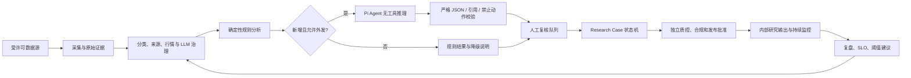

# Pi Agent 生产迁移与运行手册 v25

## 1. 迁移结论

生产 Agent 基座从 OpenClaw 切换为项目内固定版本的 Pi Agent。迁移不改变投研业务边界：

- Python 是控制、治理、状态机、审计、行情门禁和人工权限平面。
- Pi 是无工具、无会话的 LLM 推理执行平面，不是流程控制器，也不是审批人。
- DeepSeek V4 Pro 是主模型；密钥只从 `DEEPSEEK_API_KEY` 读取。
- OpenClaw 的目录、历史报告和审计文件保留为只读证据，不再进入生产计划任务。
- 系统仍禁止自动分派、批准、发布、交易、下单、调仓和修改治理配置。

技术运行通过不等于业务上线。真实名册、供应商许可、双源行情、治理例外、复核积压、影子样本和六个
独立人工批准未满足时，`go_live_decision` 必须保持 `NO_GO`。

## 2. 生产架构



实际运行不是单线流水线。`evidence_collection` 后可并行执行基本面、事件、市场背景和反证分析；
任一证据冲突、行情过期、提示注入、限制名单或人工退回都会回到补证分支。只有确定性状态机能迁移案件；
Pi 的输出只能形成工作底稿和建议。

## 3. Pi 供应链与隔离基线

| 项目 | 固定值 |
|---|---|
| 官方仓库 | `https://github.com/earendil-works/pi` |
| 审阅源码快照 | `1c28f3032e6a39566c95aa709a0b1cefcf81c5db` |
| npm 包 | `@earendil-works/pi-coding-agent` |
| 生产版本 | `0.84.2` |
| 锁文件 | `pi_runtime/package-lock.json`，lockfile v3 |
| registry | `https://registry.npmjs.org/` |
| 安装策略 | `npm ci --ignore-scripts`，不执行生命周期脚本 |
| 漏洞审计 | 使用官方 registry 运行 `npm audit` |

Pi 官方明确说明扩展与包拥有宿主进程权限，Pi 本身不是安全沙箱。因此生产调用同时使用以下硬约束：

1. `--no-tools`：禁用内置及自定义工具。
2. `--no-extensions --no-skills --no-prompt-templates --no-themes`：禁止资源发现与加载。
3. `--no-context-files --no-approve`：忽略项目 `AGENTS.md`、本地资源和信任请求。
4. `--no-session`：不持久化对话。
5. 独立 `PI_CODING_AGENT_DIR`、工作目录和最小环境变量白名单。
6. Prompt 通过 stdin 发送；密钥不进入命令行、配置、报告或审计内容。
7. stdout 只接受 Pi JSON 事件流；非 JSON、工具事件、异常结束、空输出和超限输出全部丢弃。
8. 审计只记录输入、系统提示和输出哈希、模型、用量、耗时和错误，不记录正文或密钥。

`.pi/skills/` 是项目拥有的研究方法资产，供人工维护和离线审阅。生产自动调用使用
`pi_runtime/roles/*.md` 的固定角色提示，并显式关闭 skill discovery，避免更新 skill 后绕过候选指纹和审批失效规则。

## 4. 第三方 Pi 工具评估

| 候选 | 可学习内容 | 生产决定 | 原因 |
|---|---|---|---|
| `nicobailon/pi-subagents` | 子任务分解、并行角色编排 | 不安装 | 会启动子进程且工具面较宽，不适合作为受控投研生产依赖 |
| `Weaxs/stock-analysis-plugin` | 行情工具分类、研究功能拆分 | 不安装 | 网络工具多、安装链和 Python 依赖宽，缺少本项目的数据许可与治理门禁 |
| `@pi-stef/finance` | 金融数据交互模式 | 不安装 | 更接近组合与交易操作，超出“研究辅助、不自动交易”的边界 |
| `himself65/finance-skills` | 金融 skill 组织方式 | 不安装 | 依赖外部 API 与交易语义，许可和审计面未完成 |
| `@firstpick/pi-skill-research-orchestration` | 研究编排提示词思路 | 不安装 | 目前没有必要引入供应链；本项目已有可审计状态机和角色提示 |

采用原则是“学习设计，不复制权限”。后续候选必须完成许可证、提交固定、依赖锁定、生命周期脚本、网络域名、
数据许可、secret 扫描、工具权限、输出契约和回滚演练后，才能进入隔离测试配置；生产默认仍为零第三方扩展。

## 5. 多角色职责

| 角色 | Pi 可做 | Pi 不可做 |
|---|---|---|
| signal analyst | 影响方向、时窗、论点、风险、复核问题 | 下单、仓位建议自动执行 |
| research desk | 基本面、事件、市场背景的并行工作底稿 | 改变案件状态或分派人员 |
| case analyst | 基于已给证据形成结构化分析草稿 | 质量、合规、发布批准 |
| public handoff | 汇总治理批准的公开信号 | 读取内部名册、积压、路径或治理例外 |
| risk challenge | 提出反证与证伪问题 | 代替已分派的真实风险复核人签字 |

## 6. 日常运行顺序

工作日 08:30 `daily`：

1. 缓存行情并写来源、时间与哈希证据。
2. `agent-run` 只对新增且通过门禁的信号调用 Pi 角色分析。
3. `evidence-vault-status --require-ready` 验证官方原件对象和事件链；技术失败时停止外部 handoff。
4. `pi-handoff-run` 构造公开最小化快照；零合格信号时零调用。
5. 同步去重人工复核队列、研究运营建议和工作区。
6. 生成生产试运行快照、Dashboard 和 Alerts。

工作日 08:45 `pilot` 只读取已完成 daily summary 做独立哈希对账，不采集、不调用 LLM。18:00 `dashboard`
只刷新视图。周六 `review` 汇总真实 completed review，不自动改阈值或配置。

## 7. 安装与切换

先预演：

```powershell
powershell -NoProfile -ExecutionPolicy Bypass -File scripts\migrate_to_pi_agent.ps1
```

正式切换会先备份配置、锁文件、Pi settings、四个计划任务和可读取的 OpenClaw registry，然后使用官方 npm
源、项目内缓存和禁用脚本的方式重装固定版本：

```powershell
powershell -NoProfile -ExecutionPolicy Bypass -File scripts\migrate_to_pi_agent.ps1 -Apply
```

关键验收：

```powershell
python -m stock_agent pi-runtime-status --config config/watchlist.local.json --require-ready
python -m stock_agent pi-runtime-uat --config config/watchlist.local.json --live
python -m stock_agent agent-handoff --config config/watchlist.local.json
python -m stock_agent doctor --config config/watchlist.local.json
python -m unittest discover -s tests
```

`pi-runtime-uat --live` 只发送合成公开文本，并产生一次明确的计费调用和哈希审计；不带 `--live` 会拒绝执行。
`agent-handoff` 不调用模型，可用于 Go-Live 检查。`pi-handoff-run` 只有在 handoff 明确
`external_llm_call_required=true` 时才允许一次公开摘要调用。

## 8. 回滚与退役

Pi 故障时优先做 fail-closed 回滚，只关闭 LLM 层并保留规则、报告、队列和人工流程：

```powershell
powershell -NoProfile -ExecutionPolicy Bypass -File scripts\rollback_pi_agent.ps1
powershell -NoProfile -ExecutionPolicy Bypass -File scripts\rollback_pi_agent.ps1 -Apply
```

该脚本不会自动恢复 OpenClaw，也不会启用 HTTP fallback。需要恢复时必须从脚本输出的备份路径显式复制原配置，
随后重新跑 Doctor 与 Pilot 对账。

Pi 全量验收完成后，可先预览再仅移除全局 registry 中 `stock_agent_*` 项；其他 OpenClaw agent 不受影响：

```powershell
powershell -NoProfile -ExecutionPolicy Bypass -File scripts\retire_openclaw_stock_agent.ps1
powershell -NoProfile -ExecutionPolicy Bypass -File scripts\retire_openclaw_stock_agent.ps1 -Apply
```

不得删除 `openclaw/`、历史报告、原始 JSONL、SQLite、审计日志或备份。

## 9. Go/No-Go 解释

- `Pi runtime READY`：固定版本、锁文件、隔离设置和凭据存在。
- `Doctor WARN`：通常表示真实业务输入或人工环节尚未完成，需逐项判断。
- `technical_readiness READY`：技术链和对账链可运行。
- `go_live_decision NO_GO`：真实商业门禁未齐，不代表代码失败。
- 只有真实 active 人工、合规许可行情供应商、完成的外发治理、合格影子样本和独立批准全部满足，才可能 `GO`。
