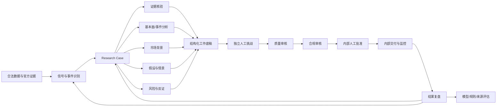
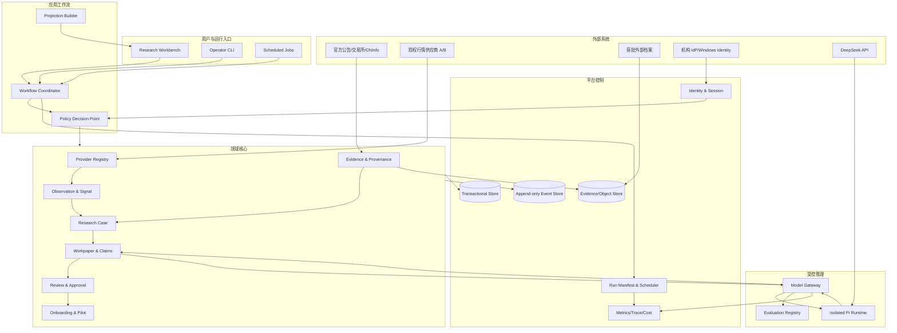

# A 股智能投研系统：项目总经理战略蓝图 v30

> 项目路径：`E:\stock agent`  
> 战略蓝图日期：2026-08-30（Asia/Shanghai）  
> 当前状态基线：`docs/ZCODE_PROJECT_HANDOFF_20260829.md`  
> 项目总经理结论：**继续，但收窄目标、停止堆功能、先证明真实用户价值，再按机构门禁逐级投资。**

---

## 0. 董事会一页结论

### 0.1 项目应该变成什么

本项目不应再被描述为“AI 选股系统”“一个人的华尔街”或“自动交易 Agent”。推荐的正式定位是：

> **A 股官方证据驱动的内部研究运营平台**：把公告、财报、重大事件和经授权的行情数据，转化为可追溯的 Research Case、结构化工作底稿、受控 AI 研判、独立挑战、人工质量/合规复核和内部研究交付。

客户最终购买的不是“大模型多聪明”，而是四个结果：

1. 从公开信息出现到形成可供人工判断的研究材料，耗时显著下降。
2. P0/P1 结论有准确的一手原件、声明级引用和完整责任链。
3. 重复整理、低价值消息和无依据模型输出显著减少。
4. 数据许可、模型外发、人工审批和档案审计可被复核。

### 0.2 当前项目处于什么阶段

当前不是空壳。它已经有约：

- 60 个 Python 源文件。
- 34,414 行源代码。
- 63 个测试文件和 18,315 行测试代码。
- 92 个 CLI parser 入口。
- 732 个测试全部通过的最近验收记录。
- Research Case、Workpaper、Evidence Vault、LLM Governance、Review Queue、Production Pilot、Pi 隔离运行时等完整控制骨架。

但它也不是生产候选：

- Git 没有首个 `HEAD`。
- 真实人员为 0。
- 已批准数据供应商为 0/2。
- 官方原件为 0，P0/P1 覆盖为 0/9。
- 154 条人工复核全部未完成、未分派且逾期。
- Business Onboarding 为 0/8。
- Production Pilot 为 `NO_GO`。

因此最准确的阶段定义是：

> **机构控制原型 / institutional control prototype**，尚未进入真实价值试点，更未进入业务生产。

### 0.3 总经理的五项立即决策

1. **暂停功能扩张**：暂不新增 Agent、插件、数据适配器、CLI 和状态投影。
2. **选择一个窄场景**：只做 P0/P1 官方公告与重大事件的研究闭环。
3. **增加业务价值门**：在昂贵的机构接入前，用 20 至 30 个真实历史案例验证效率与质量。
4. **建立可信发布基线**：Git、密钥轮换、依赖锁、身份绑定、灾备和 canonical release manifest 优先于新功能。
5. **保留 `NO_GO`**：没有真实 sponsor、用户、人员、数据权利和审批链，就不安装生产计划任务、不宣称上线。

### 0.4 推荐走势

```text
当前控制原型
    ↓
单一场景的价值验证工具
    ↓
单机构、单研究团队的受控试点
    ↓
机构内部研究运营工作台
    ↓
可重复部署的团队级产品
    ↓（只有出现真实付费需求时）
多机构平台
```

推荐走“基准路线”：先完成一个设计合作方的受控试点，再决定是否产品化。不要直接奔向多租户 SaaS，也不要退回到只看模型回答的玩具。

---

## 1. 总目标、目的与非目标

### 1.1 总目标

在真实数据权利、真实人员职责和真实人工批准的前提下，建设一套能够持续运行、可审计、可重放、可复盘的 A 股内部研究操作系统。

系统应使研究团队能够：

- 更快发现真正值得研究的事件。
- 更少在多个工具间复制、整理、去重和追进度。
- 更清楚地区分事实、数据观测、模型推断和人工判断。
- 更早发现缺证据、来源冲突、模型幻觉和反例。
- 更有把握地知道谁做了什么、基于什么、何时批准。
- 用真实复盘反推来源、阈值、提示词和研究方法，而不是追求更多模型输出。

### 1.2 经营目的

项目经营目标按优先级排序：

1. **研究运营效率**：减少低价值人工操作时间。
2. **研究质量**：提高证据覆盖、反证质量和声明可核验性。
3. **风险控制**：降低未授权数据使用、错误外发、虚假引用和职责混淆。
4. **组织能力**：把个人经验沉淀为可复用流程、底稿和复盘资产。
5. **商业可复制性**：在前四项被真实验证后，形成可重复部署的机构产品。

投资收益率、选股收益和超额收益只能作为长期观察变量，不能作为模型自动优化目标，也不能作为销售承诺。

### 1.3 永久非目标

- 自动交易、自动下单和自动调仓。
- 自动仓位、止损或止盈建议的执行。
- 自动质量批准、合规放行、发布批准或生产启用。
- 面向个人投资者的荐股、跟单和投顾包装。
- 未经授权的数据抓取、缓存、衍生、转售或发送给外部模型。
- 把 Agent 角色名称冒充真实机构岗位或人工独立性。
- 通过安装更多插件制造“能力很多”的表象。

---

## 2. 战略定位

### 2.1 推荐产品名称

工作名称可以保留“Stock Agent”，但对外与内部正式材料建议使用：

```text
A 股证据驱动研究运营平台
A-share Evidence-driven Research Operations Platform
```

### 2.2 首个产品切口

第一版只聚焦：

> **P0/P1 官方公告、财报与重大公司事件，从原件发现到内部研究材料人工批准的闭环。**

首批事件类型建议：

- 业绩预告、年报、半年报和重大财务修订。
- 重大合同、订单和经营数据。
- 回购、分红、减持、质押和融资。
- 监管处罚、诉讼、停牌和治理事件。
- 重大资产重组、投资设立公司和关联交易。

第一阶段暂不把社媒情绪、全市场新闻、自动估值、量化策略、组合管理和交易执行作为主产品。

### 2.3 首选用户

优先用户：

- 已有合规、数据采购和信息安全能力的 5 至 30 人投研团队。
- 私募证券管理人、资管研究部门、保险资管、机构自营研究团队或券商内部研究团队。
- 需要持续跟踪公告与重大事件、但缺少完整研究运营工具的团队。

购买与否定角色：

| 角色 | 关注点 |
|---|---|
| 研究负责人 | 研究时效、质量、覆盖与团队协作 |
| 投资负责人 | 材料是否可用于人工决策、是否减少漏报 |
| 研究运营负责人 | 队列、SLA、容量、交接与复盘 |
| 合规负责人 | 公开信息、利益冲突、职责分离和留痕 |
| 数据负责人 | 数据权利、来源、质量、供应商和退出 |
| 信息安全负责人 | 外发、身份、密钥、日志、档案和灾备 |

不适合的首批用户：

- 要求自动交易或自动调仓的客户。
- 没有真实数据授权能力的小团队。
- 以荐股、自媒体或投资收益分成为商业模式的客户。
- 拒绝职责分离和人工批准的组织。

### 2.4 核心价值主张

一句话：

> **缩短“合法公开信息出现”到“人工可批准的内部研究材料”之间的时间，并让证据、推断、模型和责任人完整可追溯。**

产品差异化不应是“Agent 数量”，而应是：

- 官方原件优先。
- 声明级证据和可证伪问题。
- 模型与人工职责严格分层。
- 非线性案件状态、退回和补证。
- 数据许可与外发逐次验证。
- 生产候选与批准绑定同一指纹。
- 真实复盘驱动质量改进。

---

## 3. 当前成熟度诊断

以下为总经理视角的主观成熟度评分，依据 2026-08-29 交接快照，不是独立审计结论。

| 能力域 | 当前成熟度 | 说明 |
|---|---:|---|
| 控制与治理代码 | 3.5/5 | 模块丰富、测试多、门禁清楚，但状态入口过多 |
| 研究案件与底稿 | 3/5 | 数据结构完整，真实完成案例与人工挑战不足 |
| Pi/DeepSeek 推理 | 2.5/5 | 运行时隔离较好，但存在重复推理与质量证据不足 |
| 数据供应与许可 | 1/5 | 适配器多，授权供应商为 0 |
| 官方证据 | 1/5 | Vault 技术完整，真实原件为 0 |
| 身份与职责分离 | 0.5/5 | 有角色规则，无真实身份绑定和真实人员 |
| 人工研究运营 | 0.5/5 | 队列和 SLA 有，154 条全部未闭环 |
| 模型质量评估 | 1.5/5 | 有结构/grounding 门禁，无冻结盲评集和声明语义核验 |
| 可靠性与灾备 | 1.5/5 | 有 doctor、SLO、日志，无可信发布和恢复演练 |
| 产品与商业验证 | 0.5/5 | 功能多，尚无设计合作方、付费场景和效率基线 |

### 3.1 项目当前最强的部分

- 技术状态和业务状态被明确分开。
- P0/P1 官方原件、人审和职责分离没有被模型绕过。
- Evidence Vault、Workpaper、Case、Review、Pilot 形成了较完整的控制骨架。
- Pi 生产运行时采用无工具、无动态插件和最小外发。
- 失败降级不会直接变成交易或发布动作。
- 测试覆盖面远高于一般个人原型。

### 3.2 项目当前最弱的部分

- 真实 sponsor、真实用户和明确价值场景尚不存在。
- 数据权利和外部模型处理权没有成为每次 payload 的强绑定条件。
- CLI 的 actor 仍是字符串参数，角色校验不等于身份认证。
- 本地哈希链不能证明没有整链回滚、截尾或离机篡改。
- 同一 DeepSeek 模型承担主分析、多角色和 Pi 总结，容易制造虚假独立性。
- 功能和控制建设领先于真实用户、数据和人员，形成阶段性过度工程化。
- 92 个 CLI 入口和多个 `latest` 投影增加学习成本与状态漂移。
- OpenClaw 已退出生产，但兼容代码、doctor 和旧文档仍有历史耦合。

### 3.3 总经理判断

这不是需要推倒重来的失败项目，而是需要从“功能驱动”切换到“价值与门禁驱动”的项目。

未来每项开发必须能回答：

1. 它服务哪个真实研究场景？
2. 它改善哪个有基线的指标？
3. 它减少哪个现有风险？
4. 它需要什么真实人员或外部证据？
5. 不做它会阻塞哪一个下一阶段门禁？

回答不了的功能不进入路线图。

---

## 4. 未来能力框架



能力分为七层：

1. **Data & Provider Plane**：数据源、许可、质量、时间和标准化。
2. **Evidence & Provenance Plane**：原件、哈希、血缘、声明和引用。
3. **Research Domain Plane**：信号、案件、任务、底稿、假设、挑战和监控。
4. **Agent & Model Plane**：Pi、DeepSeek、提示词、方法、schema 和评估。
5. **Human Control Plane**：身份、角色、职责分离、复核、批准和升级。
6. **Delivery Plane**：工作台、日报、Dashboard、Alert 和内部发布。
7. **Operations & Governance Plane**：运行、审计、SLO、成本、灾备、Onboarding 和 Pilot。

---

## 5. 目标技术架构

### 5.1 核心原则

1. **模块化单体优先**：当前规模不应直接拆微服务。
2. **事件驱动但不迷信中间件**：先统一事件契约，再决定是否引入队列。
3. **一个事实源，多种投影**：`latest` 只做视图，不做事实。
4. **一个模型网关**：所有生产 DeepSeek 调用从同一治理入口经过 Pi。
5. **许可和身份是运行时条件**：不能只在 onboarding 时检查一次。
6. **每个结论可回到声明和证据片段**。
7. **人类审批是签名事件，不是字符串字段**。
8. **生产候选必须绑定完整 release manifest**。
9. **失败时缩小范围、停止调用或转人工，不降低门禁**。
10. **任何外部系统都可撤销，不成为不可替代单点**。

### 5.2 建议的代码域边界

短期不需要立刻移动文件，但后续重构目标应类似：

```text
stock_agent/
├─ domains/
│  ├─ providers/          # 供应商、许可、质量、激活
│  ├─ observations/       # 原始观测、标准化、去重
│  ├─ evidence/           # 原件、证据对象、引用、血缘
│  ├─ cases/              # Research Case 与状态机
│  ├─ workpapers/         # 声明、假设、情景、风险、版本
│  ├─ reviews/            # 队列、挑战、质控、合规、批准
│  ├─ models/             # Prompt contract、schema、评估
│  └─ production/         # Onboarding、Pilot、activation
├─ application/
│  ├─ commands/           # 用例命令，不含 CLI 格式
│  ├─ workflows/          # daily、review、pilot、dashboard
│  ├─ policies/           # 可组合门禁与决策说明
│  └─ projections/        # latest/dashboard/report view models
├─ platform/
│  ├─ database/           # 事务、迁移、仓储接口
│  ├─ event_store/        # 事件契约、链、锚点
│  ├─ identity/           # Windows SID/OIDC/MFA/签名
│  ├─ model_gateway/      # Pi + DeepSeek 唯一生产入口
│  ├─ scheduler/          # lease、run_id、交易日历、重试
│  ├─ archive/            # 外部档案适配器
│  └─ observability/      # metrics、trace、cost、SLO
└─ interfaces/
   ├─ cli/
   ├─ web/
   └─ jobs/
```

这是一张迁移地图，不是要求一次重写。现有模块应通过接口逐步归位，确保每步仍通过完整测试。

### 5.3 目标系统图



### 5.4 核心领域对象

未来所有功能应围绕以下对象收敛：

| 对象 | 责任 |
|---|---|
| `Provider` | 法律主体、产品、许可范围、审查、有效期、激活 |
| `Observation` | 某来源在某时刻观察到的原始事实或数据 |
| `EvidenceObject` | 原件字节、哈希、来源元数据、验证和档案状态 |
| `Signal` | 规则或模型发现的候选研究事件，不是结论 |
| `ResearchCase` | 对一个实体/事件的研究生命周期 |
| `ResearchTask` | 证据、基本面、市场、假设、挑战等并行任务 |
| `Claim` | 可被证据支持或否定的最小声明 |
| `Workpaper` | 声明、观测、推断、假设、风险和人工判断集合 |
| `Review` | 独立挑战、质量、合规和发布复核事件 |
| `Approval` | 身份绑定、签名、指纹绑定的受保护决定 |
| `ModelInvocation` | 输入分类、引用、模型、token、成本和结果状态 |
| `RunManifest` | 本轮源码、配置、依赖、数据、模型和产物指纹 |
| `AuditEvent` | 谁、何时、基于什么、改变了什么 |

### 5.5 统一事件契约

建议所有领域事件使用统一 envelope：

```json
{
  "event_id": "uuid",
  "event_type": "EvidenceLinked",
  "schema_version": "1.0",
  "occurred_at": "ISO-8601",
  "actor_id": "bound-identity",
  "actor_type": "human|service|model",
  "case_id": "case-id",
  "run_id": "run-id",
  "correlation_id": "case-or-business-flow-id",
  "causation_id": "previous-event-id",
  "policy_fingerprint": "sha256",
  "release_manifest_id": "sha256",
  "input_hashes": [],
  "payload": {}
}
```

目标不是追求漂亮 schema，而是解决：

- `latest` 文件来自哪次运行。
- 哪个事件导致哪个案件状态。
- 哪次模型调用使用了哪组证据。
- 哪次批准对应哪个源码、配置、人员和供应商状态。
- 整条事件是否被截尾、替换或回滚。

### 5.6 Canonical Release Manifest

未来 doctor、onboarding、pilot 和 release audit 应共享一个 canonical manifest：

```text
source_head
source_tree_hash
dirty_state
python_version
dependency_lock_hash
pi_package_version
pi_settings_hash
skill_bundle_hash
model_provider/model
prompt_contract_hash
config_hash
roster_hash
provider_registry_hash
policy_hash
archive_policy_hash
input_dataset_hashes
run_id
```

当前没有 Git HEAD，因此任何 production candidate fingerprint 都缺少可信源码根。建立首个审阅基线是架构 P0，不是行政整理。

---

## 6. Agent 与模型策略

### 6.1 未来只保留一个生产推理入口

当前存在：

- `llm_agent.py` 主研判。
- `role_analyst.py` 同模型多角色。
- `pi-handoff-run` 的外部 Pi 总结。

这容易让同一个 DeepSeek 模型对同一材料重复推理，增加成本、延迟、状态面和虚假独立性。

目标架构：

```text
Python 决定是否允许推理
    ↓
Model Gateway 生成最小、证据化、schema 固定的请求
    ↓
Pi 作为唯一生产 LLM 执行适配器
    ↓
DeepSeek V4 Pro 主模型
    ↓
Python 校验 schema、引用、许可、finish_reason 和成本
    ↓
写入 Workpaper，不直接推进审批
```

迁移完成后：

- Python 直接 Chat Completions 只保留测试/兼容路径，或由同一 Model Gateway 封装。
- Pi 不再做第二次“摘要式 handoff”，而是正式承担受控推理执行。
- 一次推理可以输出多个分析视角，但必须标记为“同模型相关视角”，不能冒充独立风险复核。
- P0/P1 可选择第二模型或第二证据流程进行机器挑战，但真正独立 challenge 仍由人工完成。

### 6.2 DeepSeek V4 Pro 的角色

DeepSeek V4 Pro 是主力模型，适合：

- 从已核实材料提取结构化声明。
- 解释事件影响路径和情景。
- 提出证伪条件、风险和待核验问题。
- 对冲突来源提出差异点。
- 生成工作底稿草稿。

不适合直接承担：

- 数据许可判断。
- 官方来源真实性决定。
- 独立质量批准和合规放行。
- 交易、仓位和发布决定。
- 人员分派和生产激活。

DeepSeek 官方文档支持 `deepseek-v4-pro`、JSON Output、thinking 和 usage，但也明确提示工具参数仍可能无效或产生幻觉，必须由应用侧校验。因此生产继续保持无工具 Pi 和严格 schema 是正确方向。

### 6.3 研究方法与 skills

保留当前“注册表 + commit + 许可证 + 内容锁 + 角色编译”方案。

生产原则：

- `packages=[]`
- `extensions=[]`
- `defaultTools=[]`
- `--no-skills --no-tools`

外部 skill 只能作为方法文本进入审查流程。未来若试验 Pi 插件，应放在完全隔离的 `operator/dev` profile，不能进入生产研究运行时。

### 6.4 声明级 grounding

当前引用检查主要证明“引用 ID 来自输入”，未来必须升级为：

1. 每个 `Claim` 引用原文片段或结构化数据行。
2. 保存片段 hash、位置和 evidence object ID。
3. 检查声明是否被片段支持、冲突或无法判断。
4. 模型必须能选择 `abstain/unknown`。
5. 无证据声明自动进入人工队列，不进入核心结论。
6. 质量审核人能在一个界面看到声明与原文并排。

---

## 7. 数据、供应商与证据战略

### 7.1 数据可达不等于数据可用

每个 provider 必须把以下范围变成运行时策略：

- `internal_research_use`
- `cache_use`
- `derived_data_use`
- `external_llm_processing`
- `archive_use`
- `redistribution`
- `retention_period`
- `territory`
- `user_scope`

每次进入 LLM 的 payload 不只要 `classification=public`，还要绑定当前有效的 `provider_evidence_id` 和允许 `external_llm_processing` 的 scope。合同过期、撤销或 scope 不匹配时 fail closed。

### 7.2 供应商策略

首个试点至少需要：

- 一条官方披露主通道。
- 两家经过独立审查的关键行情/基础数据提供者，或一主一备且权利范围清楚的方案。
- 明确时间戳、修订、故障、缓存和退出语义。

不建议把多个免费接口简单拼成“两家供应商”。技术来源独立与法律授权独立必须同时成立。

### 7.3 Provider Contract v2

统一适配器输出至少包含：

```text
provider_id
product_id
provider_version
license_scope_id
entity_id / exchange / symbol
source_timestamp
observed_at
timezone
as_of
raw_reference_hash
schema_version
quality_flags
freshness_status
revision_id
cache_status
```

每个适配器必须具备：

- contract tests。
- 固定重放夹具。
- 时间语义测试。
- 速率限制和指数退避。
- 熔断、缓存和错误分类。
- 不记录凭据的遥测。
- 数据授权 scope 测试。

### 7.4 Evidence-first

未来 P0/P1 的顺序应从“先分析、后补原件”改为：

```text
候选事件
  → 精确官方 URL
  → 原件采集/人工确认
  → transport receipt 与响应元数据
  → hash 和外部档案
  → Signal/Case
  → LLM 研判
```

本地 hash 只能证明所存字节没变，不能单独证明它确实来自所填 URL。未来还应保存：

- TLS/HTTPS 获取时间。
- 状态码和关键响应头。
- 最终 URL 与重定向链。
- 内容类型和字节长度。
- 人工确认与独立抽检事件。
- 外部 WORM/档案锚点。

---

## 8. 身份、人工控制与组织职责

### 8.1 字符串 actor 不等于身份

当前 CLI 通过 `--actor` 和名册角色校验，这是原型控制，不足以支撑机构生产。

演进顺序：

1. 单机试点：绑定 Windows SID、本机账号、会话 nonce 和操作签名。
2. 团队部署：OIDC/企业 IdP、MFA、短会话、RBAC + ABAC。
3. 受保护批准：签名 challenge、设备/会话证据、approval record URI。
4. 审计：记录身份提供者、会话、授权决策和策略版本，不保存口令或 token。

### 8.2 职责分离不是固定人数游戏

项目当前要求 7 类功能是合理的控制基线，但未来应使用“冲突矩阵”表达：

| 动作 A | 动作 B | 是否可由同一人完成 |
|---|---|---|
| 原件登记 | 原件独立复核 | 否 |
| 主分析 | 质量审核 | 否 |
| 主分析 | 合规放行 | 否 |
| 供应商尽调 | 合规审查 | 否 |
| 供应商尽调 | 信息安全审查 | 否 |
| 质量审核 | 发布批准 | 按机构制度，默认否 |
| 发布准备 | 最终内部激活 | 必须是授权发布角色 |

角色名称可以因机构而异，但冲突规则、资格、授权和真实身份不能弱化。

### 8.3 人类与模型的责任界面

| 事项 | Python | Pi/DeepSeek | 人工 |
|---|---|---|---|
| 数据许可检查 | 执行规则 | 不参与 | 设定与批准 |
| 去重/状态/哈希 | 执行 | 不参与 | 复核异常 |
| 证据提取 | 校验 | 可辅助 | 确认关键原件 |
| 影响分析 | 组织输入 | 生成草稿 | 形成最终判断 |
| 风险问题 | 记录 | 生成候选 | 独立 challenge |
| 质量/合规 | 强制门禁 | 不得批准 | 独立批准或退回 |
| 内部发布 | 验证批准 | 不得发布 | 授权批准 |
| 交易与仓位 | 永久禁止 | 永久禁止 | 在本系统外按机构制度处理 |

---

## 9. 非线性研究运营模型

### 9.1 案件而不是流水线

每个案件应是一张依赖图：

```mermaid
flowchart LR
    I[Intake] --> T[Triage]
    T --> E[Evidence Collection]
    E --> F[Fundamental/Event]
    E --> M[Market Context]
    E --> H[Hypothesis]
    E --> R[Risk/Falsification]
    F --> W[Workpaper Synthesis]
    M --> W
    H --> W
    R --> W
    W --> C[Independent Challenge]
    C --> Q[Quality Review]
    Q --> CO[Compliance Review]
    CO --> A[Human Approval]
    A --> P[Internal Publish]
    P --> MON[Monitoring]

    F --> E: 缺证据
    M --> E: 数据冲突
    C --> H: 假设需重做
    Q --> W: 质量退回
    CO --> E: 公开性/披露不足
    MON --> E: 重大新证据
```

### 9.2 Intake Backpressure

当前有 154 条逾期未分派任务。继续自动摄入会扩大形式化积压。

建议立即增加：

- 全局 WIP 上限。
- 每角色容量和每优先级保留容量。
- `critical unassigned > 0` 时，除 P0/P1 外暂停新案件。
- 同实体/同事件窗口的案件合并候选。
- 低质量来源只进入观察池，不自动建 Case。
- 超过保留期且无研究价值的案件由人工 `close_as_stale`，保留审计。

### 9.3 运行编排

当前 daily 08:30、pilot 08:45 的固定时间差可能产生竞态。目标编排应采用：

- daily 全局 lease。
- 明确 `run_id` 和输入 report path。
- 每阶段幂等 checkpoint。
- daily 完成事件触发 pilot，而不是只依靠固定 15 分钟。
- 交易所日历，不用简单工作日推断交易日。
- pilot 只消费指定 run manifest，不读取模糊 `latest`。
- crash 后从最后合法 checkpoint 恢复或安全终止。

---

## 10. 部署与存储演进

### 10.1 0-6 个月：可信单机模块化单体

- Windows 单机或受控工作站。
- SQLite WAL + 明确迁移。
- 本地只读 evidence shadow + 外部档案引用。
- loopback Workbench。
- Windows SID 身份绑定。
- 单个调度器和全局 lease。
- 不拆微服务。

### 10.2 6-18 个月：单机构团队部署

在出现真实团队和负载后才考虑：

- PostgreSQL 事务数据库。
- S3-compatible/object storage 与外部 WORM。
- OIDC/企业 IdP/MFA。
- 独立 worker 与任务队列。
- 受控内部 Web 服务。
- 备份、监控、告警和蓝绿升级。
- 开发/测试/shadow/生产环境分离。

### 10.3 18-36 个月：可重复产品化

只有 2 个以上成功设计合作方后才考虑：

- 租户隔离。
- 客户自管密钥和供应商凭据。
- 每租户策略与模型路由。
- 审计导出和退出工具。
- 区域部署与数据驻留。
- SLA、版本支持和兼容策略。

不要在没有真实客户之前建设多租户、Kubernetes 和复杂微服务。

---

## 11. 真实日常、每周与每月运营

### 11.1 每日节奏

未来受控试点可采用：

| 时间 | 动作 | 责任 |
|---|---|---|
| 08:00 | 身份、供应商、证据、积压和前一日异常预检 | Research Ops/Data/SRE |
| 08:20 | 官方公告与重大事件采集、证据登记 | Information Analyst/System |
| 08:30 | daily 运行：规则、案件、受控推理、底稿草稿 | System |
| daily 完成后 | pilot 独立哈希对账 | System/SRE |
| 09:00 | P0/P1 人工分诊和责任人确认 | Coordinator/Lead Analyst |
| 09:30-15:00 | 事件驱动补证、分析、挑战和升级 | Research Team |
| 11:45 | 午间未结风险与来源冲突检查 | Research Ops |
| 15:30 | challenge、质量和合规队列 | Human Reviewers |
| 18:00 | Dashboard、未结事项、运行交接 | System/Coordinator |

这只是运营模板，实际时间由团队和数据合同决定。生产前不得安装计划任务。

### 11.2 每周节奏

- 周一：覆盖范围、重点事件、容量和限制名单确认。
- 周三：积压、供应商质量、数据冲突和治理例外检查。
- 周五：20% 案例抽样、模型错误、来源贡献和人工反馈复盘。
- 周末：生成汇总，不自动改配置、不自动批准。

### 11.3 每月节奏

- KPI 和成本复盘。
- 数据许可、供应商 SLA 和外发 scope 检查。
- 角色、权限和限制名单复核。
- 模型版本、prompt、skill bundle 和冻结评估集回归。
- 档案与工作底稿抽查。
- 备份恢复验证或桌面演练。
- 继续、暂停、收窄或扩大投资决定。

### 11.4 每季度节奏

- 供应商尽调和退出准备。
- Key 与凭据轮换。
- 灾备与完整恢复演练。
- 模型盲评和独立风险评估。
- 商业价值与产品方向评审。
- 是否进入下一阶段的正式 Gate Review。

---

## 12. 组织架构与 RACI

### 12.1 项目方核心团队

早期基准团队不需要几十人，建议：

| 功能 | 建议投入 |
|---|---:|
| 项目总经理/产品与行业负责人 | 1 |
| 平台与治理工程师 | 2 |
| 数据/证据工程师 | 1-2 |
| Workbench 前端/全栈 | 1 |
| QA/SRE/AppSec | 1 |
| 实施/客户成功 | 1 |
| 研究顾问 | 1-2 名兼职或客户共创 |

客户侧仍需真实研究、质控、合规、数据、信息安全和发布人员。产品团队不能代替客户批准。

### 12.2 治理结构

建议设立：

- **Project Steering Committee**：Sponsor、研究、合规、数据、信息安全和产品负责人。
- **Product & Architecture Council**：产品、架构、数据、SRE 和研究代表。
- **Model Risk Forum**：研究质量、模型评估、合规和风险代表。
- **Change Approval Board**：生产配置、provider、prompt、skill 和模型版本变更。

### 12.3 RACI 示例

| 事项 | GM/Product | Research | Data | Compliance | InfoSec | Engineering | Quality |
|---|---|---|---|---|---|---|---|
| 产品范围 | A | R/C | C | C | C | C | C |
| Provider 准入 | I | C | R | A/C | A/C | I | I |
| 模型版本 | A | C | I | C | C | R | R |
| P0/P1 结论 | I | R/A | I | C | I | I | R |
| 数据外发策略 | I | C | R | A | A | R | I |
| 生产发布 | A | C | C | C | C | R | C |
| 业务内部发布批准 | I | R | I | R | I | I | R/A |
| 事故处置 | A | C | C | C | R | R | I |

实际 RACI 必须由真实机构批准，表格不能替代授权。

---

## 13. 指标体系与预计效果

### 13.1 北极星指标

推荐：

> **每名活跃分析师每月完成的“合格研究闭环”数量。**

“合格”必须同时满足：

- 使用已授权数据。
- P0/P1 有官方原件。
- 声明、观测、推断和人工判断分开。
- 有独立 challenge。
- 在 SLA 内完成人工复核。
- 审计可重放。
- 内部用户确认材料有用。

原始信号数、Agent 数量、token 数、报告页数都不是北极星指标。

### 13.2 Guardrail 指标

以下目标需要由试点验证，不是当前成绩：

| 指标 | 目标 |
|---|---:|
| P0/P1 官方原件覆盖 | 100% |
| 未授权数据外发 | 0 |
| 自动交易/下单/调仓 | 0 |
| 自动受保护审批 | 0 |
| 引用精确率 | >= 98% |
| 无证据断言率 | <= 2% |
| critical unassigned | 0 |
| Review SLA 达成率 | >= 90% |
| 审计事件可验证率 | 100% |
| 成功模型调用 usage 覆盖 | 100% |

### 13.3 效率指标

建议以 20 至 30 个历史真实案例做 A/B 或交叉试验：

- 基线 A：现有人工 + 规则。
- 方案 B：系统辅助 + 相同人工批准。
- 独立质量审核人盲评结果。

初步目标区间：

| 效果 | 试点目标区间 |
|---|---:|
| 信息整理与去重时间 | 下降 30%-50% |
| 从事件发现到初稿时间 | 下降 25%-40% |
| 重复/低价值待办 | 下降 50%-70% |
| 原件和引用可追溯率 | 提升至 95%-100% |
| 人工复核遗漏 | 相对基线显著下降 |
| 单个合格研究包成本 | 随规模逐步下降 |

这些只是阶段目标。如果两个完整试点后无法证明至少 20%-30% 的运营效率改善，项目应停止产品化或收窄为内部治理工具。

### 13.4 不承诺的效果

- 不承诺提高收益率。
- 不承诺避免投资损失。
- 不承诺模型结论正确。
- 不承诺替代分析师、合规或投资负责人。
- 不用回测收益优化模型提示词。

---

## 14. 商业模式与单位经济

### 14.1 推荐商业路径

1. **准备度评估与设计合作**：梳理客户流程、数据权利、人员和控制缺口。
2. **单团队受控试点**：限定场景、期限、用户和数据。
3. **年度软件许可 + 实施 + 支持**：前提是试点达到价值与控制门禁。
4. **可选托管运维**：只管理平台，不代替研究、合规和批准。

数据应由客户直接向供应商采购。产品方不转售数据、不按投资收益分成、不承担投顾或交易执行角色。

### 14.2 成本结构

主要成本通常包括：

- 产品、工程、QA/SRE 和实施人员。
- 客户研究、质控、合规、数据和信息安全人员时间。
- 数据许可证。
- 外部档案、身份、安全评估和灾备。
- 模型 token、网络和计算。

项目不能只计算 DeepSeek token 成本。真实单位成本应为：

```text
单个合格研究闭环成本
= 分摊数据成本
+ 模型与基础设施成本
+ 人工整理/分析/复核时间成本
+ 合规、档案和运维成本
```

### 14.3 投资纪律

- G0 前只投入基线和价值定义所需资源。
- 没有 sponsor 和真实用户，不批准机构化扩张预算。
- 没有 20-30 案例价值证据，不批准多人产品化。
- 没有数据权利和身份控制，不批准 shadow。
- 没有两个可重复部署案例，不批准多租户平台。

具体人民币预算必须以人员成本、供应商报价和客户范围为依据。本蓝图不把未经询价的金额当成承诺。

---

## 15. 三种发展走势

### 15.1 保守走势：内部研究工具

**适用条件**：没有真实机构设计合作方，但用户仍需要个人或小团队内部研究。

结果：

- 保留 Evidence、Case、Workpaper、Pi 推理和人审。
- 关闭机构生产、多人审批和商业化表述。
- 只做个人内部研究辅助，不接交易。
- 大幅简化未被真实使用的流程和报表。

成功标准：稳定、少维护、可复盘；不以销售或生产 GO 为目标。

退出条件：维护成本持续高于真实使用价值。

### 15.2 基准走势：单机构设计合作，推荐

**适用条件**：找到一个有研究、合规、数据和信息安全参与的真实团队。

结果：

- 一个窄场景完成 20-30 案例价值验证。
- 单机构单团队受控试点。
- 完成 provider、identity、archive、evaluation 和 shadow。
- 至少一个真实内部 `GO`。
- 形成可重复实施手册和审计包。

退出条件：

- 90 天无具名 sponsor/分析师/场景/预算。
- 9 个月无受控付费试点。
- 12 个月无一个合格 GO。
- 两轮试点未达到 20%-30% 效率改善。

### 15.3 进取走势：多机构平台

**适用条件**：至少两个设计合作方证明产品可重复，且数据、身份和合规模式能复制。

结果：

- 多租户或独立实例产品。
- 标准化 provider/IdP/archive 接口。
- SLA、升级、退出和客户隔离。
- 多团队 Research Ops 管理。

立即退回基准走势的条件：

- 单客户部署长期依赖定制代码。
- 数据许可无法跨客户复制。
- 出现重大数据外发、审计或职责分离事件。
- 支持成本随客户线性失控。

---

## 16. 分阶段路线图

阶段以 Gate 为准，不以日历强行推进。

### G-1：Business Charter / 10 个工作日停止门

必须回答：

- 真实 sponsor 是谁？
- 首个目标分析师是谁？
- 只解决哪个研究场景？
- 现有流程耗时和错误基线是什么？
- 可投入多少人员与预算？
- 90 天成功与停止标准是什么？

若 10 个工作日后仍没有具名 sponsor、用户、场景、预算和指标，项目冻结为实验室原型，不继续机构化扩张。

### G0：可信工程基线，0-6 周

交付：

- 审阅后的 Git 首个基线。
- DeepSeek Key 轮换。
- Python 依赖锁、SBOM 和许可证清单。
- Python 3.11/3.12 可复现环境。
- canonical release manifest v1。
- 状态 staleness 与统一 release audit。
- 外部备份、RPO/RTO 和首次完整恢复演练。
- OpenClaw 兼容层隔离计划。

Gate：无密钥、可回滚、可恢复、可复现。

### G0.5：20-30 案例价值验证，4-10 周

交付：

- 冻结历史案例集。
- 人工基线流程。
- 系统辅助流程。
- 盲评 rubric。
- 效率、质量、错误和成本报告。

Gate：至少 20% 运营效率改善，质量不下降，0 未授权外发。

### G1：机构预检，6-16 周

交付：

- 真实 legal entity 和治理范围。
- 7 类真实人工功能与身份绑定方案。
- 至少两家供应商尽调和 scope 设计。
- 9/9 P0/P1 官方原件。
- 6 条 LLM exception 真实处置。
- critical backlog 清零方案。

Gate：Business Onboarding 前六阶段具备真实证据，不以 mock 通过。

### G2：单团队受控试点，4-9 月

交付：

- Provider Contract v2。
- Model Gateway + Pi 单一生产推理入口。
- 声明级 grounding。
- Windows SID/OIDC 身份绑定。
- role-based Workbench。
- WIP/backpressure。
- 外部档案和审计锚点。

Gate：工程、数据、身份、模型和研究质量达到试点门槛。

### G3：Shadow 与内部 GO，7-12 月

交付：

- 事件触发的 daily/pilot 编排。
- 交易所日历和全局 lease。
- 5 次/3 个真实交易日合格 shadow。
- 0 unreconciled。
- 6 类不同人工的 fingerprint-bound 批准。
- publication approver 手工激活。

Gate：Production Pilot `GO`，但仍只允许内部研究。

### G4：可重复产品化，12-18 月

交付：

- 第二个设计合作方。
- 标准部署、升级、回滚、审计和退出包。
- 客户自管 provider、identity 和 archive。
- SLA、客户支持和版本策略。

Gate：两个实例不依赖大规模定制代码，单位实施成本下降。

### G5：平台化，18-36 月

只有真实需求存在时：

- 租户隔离。
- 自助策略与连接器。
- 区域部署。
- 更完整的 experiment/evaluation registry。
- 开放但严格审查的 provider/method SDK。

Gate：商业可重复性、安全和合规能力支持扩张。

---

## 17. 未来 90 天执行计划

### 第 1-10 个工作日

1. 完成 Business Charter。
2. 指定 sponsor、目标分析师和一个窄场景。
3. 明确 90 天停止标准。
4. 暂停新 Agent、adapter、plugin、CLI 和 backlog 摄入。
5. 轮换已暴露的 DeepSeek Key。
6. 输出 Git 基线纳入/排除清单。

### 第 11-30 天

1. 经用户授权建立首个 Git 基线。
2. 创建依赖锁、SBOM 和许可证清单。
3. 建立 Python 3.11/3.12 并行环境。
4. 新增只读 canonical release audit。
5. 将 doctor/onboarding/pilot 状态映射到同一 manifest。
6. 设计 Windows SID/OIDC 身份绑定。
7. 定义备份、RPO/RTO，并完成一次恢复演练。

### 第 31-60 天

1. 选定 20-30 个历史真实 P0/P1 案例。
2. 形成证据原件和人工基线。
3. 固定 prompt/model/skill bundle。
4. 运行规则+人工与系统辅助对照试验。
5. 实现声明级 evidence span。
6. 测量耗时、引用、幻觉、遗漏、复核和成本。

### 第 61-90 天

1. 由独立质量人员盲评。
2. 输出价值验证报告。
3. 决定继续、收窄、暂停或转内部工具。
4. 达标后启动真实 governance scope 与 roster onboarding。
5. 与候选供应商发起正式权利和安全询证。
6. 不安装 production schedule，不宣称 GO。

### 90 天唯一成功定义

不是“又增加了多少代码”，而是：

- 有可信源码和恢复基线。
- 有真实 sponsor 和用户。
- 有一个窄场景。
- 有 20-30 个案例的可复核价值证据。
- 有明确的继续/停止决定。

---

## 18. 改进清单：停止、合并、保留、新增

### 18.1 立即停止

- 新增 Agent 数量。
- 新增未经业务需求证明的数据适配器。
- 生产 Pi 插件、MCP 和工具。
- 新增平行 CLI/status/latest 投影。
- 在 154 条积压未处理前无上限摄入新案件。
- live 定时任务和自启动。
- 用 mock 人员、供应商、原件或批准清除 `BLOCKED`。

### 18.2 应合并

- `llm_agent`、同模型多角色和 Pi summary：收敛到 Model Gateway + Pi 单一入口。
- Doctor、Business Onboarding、Production Pilot、Release Audit：共享 canonical manifest 和政策决策结果。
- Dashboard/Workbench/Reports：共享 view model，减少三套状态解释。
- OpenClaw compatibility：集中到 `legacy/compat` 边界，主流程不再 import 历史命名。
- 92 个 CLI parser：按领域拆命令模块，但保留兼容别名和弃用期。

### 18.3 应继续投入

- Evidence Vault 和 Workpaper 的事实/推断分离。
- Research Case 非线性状态。
- 人工 challenge、质量和合规门禁。
- Pi 无工具隔离。
- provider、LLM、market、archive 的 fail-closed 策略。
- 审计历史只追加和可重建投影。

### 18.4 必须新增

- Business Sponsor 与价值停止门。
- 身份绑定和签名审批。
- 每 payload 的数据许可 scope。
- Canonical Release Manifest。
- 远端/WORM 审计锚点。
- 交易日历、全局 lease 和事件触发编排。
- Intake backpressure/WIP limits。
- 声明级 grounding 和冻结评估集。
- 硬成本预算与账单对账。
- Shadow 前备份和完整恢复演练。

---

## 19. 风险登记表

| 风险 | 级别 | 触发信号 | 控制 | 目标 Owner | 残余风险 |
|---|---|---|---|---|---|
| 无可信发布基线 | P0 | 无 Git HEAD、dirty 工作区运行 | 审阅基线、签名 manifest、只读部署 | Release Manager/CISO | 中 |
| 伪造职责分离 | P0 | actor 只是自由字符串 | SID/IdP/MFA/签名/冲突矩阵 | IAM/Compliance | 中高 |
| 未授权数据进入 LLM | P0 | public 分类但无合同 scope | payload 绑定 provider evidence 与 external LLM 权利 | Data/Legal/InfoSec | 高 |
| 审计截尾/整链回滚 | P0 | 本地链没有外部锚点 | WORM、可信时间、远端链头、独立备份 | Records/Internal Audit | 中 |
| 无真实业务价值 | P0 | 无 sponsor、用户和案例基线 | 10 日停止门、20-30 案例试验 | Sponsor/GM/Research | 高 |
| 官方原件真实性不足 | P1 | 仅 operator attested | transport receipt、双人抽检、外部档案 | Information/Quality | 中 |
| LLM 隐私与留存 | P1 | 未确认不训练/留存/地域 | 合同、网关、端点白名单、断路器 | InfoSec/Compliance | 高 |
| 模型幻觉/伪引用 | P1 | 只校验引用 ID | claim-level span、盲评、abstain、人工 challenge | Model Risk/Research | 高 |
| 多角色虚假独立 | P1 | 同一模型一次生成四个角色 | 明示相关视角；独立人审或第二证据流程 | Risk Committee | 高 |
| 计划任务竞态 | P1 | 固定 15 分钟、latest 漂移 | 完成事件、run_id、lease、交易日历 | SRE/Operations | 中 |
| 灾备不足 | P1 | 无恢复演练 | shadow 前完成加密备份与恢复 | BCP/IT Ops | 中 |
| 供应链与 Key | P1 | Key 暴露、Python 未锁 | 轮换、lock、SBOM、签名制品 | AppSec | 中 |
| 积压失控 | P1 | 154 条全部逾期 | WIP、backpressure、真实分派、停止低优先级摄入 | Research Ops | 高 |
| 成本失控 | P1 | 只管调用数，不管金额/人时 | 硬预算、账单对账、单位闭环成本 | Finance/Sponsor | 中 |
| 商业定位漂移 | P1 | 同时宣传个人 MVP、机构 OS、交易 Agent | 正式产品章程和非目标 | GM/Product | 中 |
| 过度平台化 | P2 | 无客户先做微服务/多租户 | 模块化单体和 Gate 投资 | Architecture Council | 低中 |

当前所有 Owner 实际上仍是空缺，因为真实 human principal 为 0。给角色填一个 Agent 名称不能降低风险。

---

## 20. Go/No-Go 与退出机制

### 20.1 项目继续条件

- 有真实 sponsor。
- 有真实分析师愿意共同试验。
- 有明确窄场景和人工基线。
- 数据授权路径现实可行。
- 组织接受人工审批和职责分离。
- 价值验证达到最低改善目标。

### 20.2 项目暂停或收窄条件

- 10 个工作日没有 sponsor、用户、场景、预算和指标。
- 90 天没有可复核的 20-30 案例价值结果。
- 两轮试点后效率改善低于 20%。
- 数据供应商不允许外部模型处理，且没有可行隔离替代。
- 客户拒绝职责分离、档案或身份控制。
- 单客户持续依赖大量定制，无法形成产品。

### 20.3 项目立即停止条件

- 客户要求绕过人工审批或自动交易。
- 发生无法修复的审计链破坏。
- 出现重大未授权数据外发且不能建立可信修复。
- 真实 Key 或敏感材料被持续写入源码/日志。
- 团队试图通过伪造人、合同、原件或批准制造 GO。

---

## 21. 监管与外部依据

本蓝图不是法律意见，具体适用性必须由真实法律、合规、数据和信息安全人员判断。

项目已有运营模型参考：

- 中国证券业协会证券研究报告相关执业规范：合法来源、信息核实、工作底稿、发布前质量控制和职责分离。  
  <https://www.sac.net.cn/sjb/zlgl/zlgz/202512/t20251231_69839.html>
- 中国证券业协会信息隔离墙制度指引：需知原则、跨墙审批、观察/限制名单和外部服务商保密。  
  <https://www.sac.net.cn/zlgl/zlgz/202512/t20251231_69829.html>
- 中国证监会证券基金经营机构信息技术管理要求：上线前审查、数据生命周期、最小权限、供应商尽调、SLA、事件和退出。  
  <https://www.csrc.gov.cn/csrc/c106256/c1653896/content.shtml>
- 国家网信办等《生成式人工智能服务管理暂行办法》：合法数据来源、个人信息、知识产权、准确性、可靠性与服务责任。内部研究是否直接适用需由法律人员判断，但其控制原则值得采用。  
  <https://www.cac.gov.cn/2023-07/13/c_1690898327029107.htm>
- DeepSeek Chat Completions 官方文档：模型、JSON Output、thinking、usage、finish reason 和工具参数校验。  
  <https://api-docs.deepseek.com/api/create-chat-completion/>

未来还可借鉴：

- OpenBB 的 provider contract。
- Qlib 的数据和实验复现。
- OpenLineage 的 run/job/dataset 血缘。
- MLflow/Phoenix 的评估与 trace 思路。
- OpenAlice 的持久工作区和交互设计。

借鉴架构不等于复制许可证受限代码，也不等于接入交易执行。

---

## 22. 总经理最终建议

### 22.1 战略选择

我建议继续这个项目，但做三次收敛：

1. **业务收敛**：从“全市场 AI 投研系统”收敛到“P0/P1 官方事件研究闭环”。
2. **模型收敛**：从多处 DeepSeek 调用收敛到 Pi + Model Gateway 单一生产推理入口。
3. **控制收敛**：从多个 status/latest/doctor 视图收敛到 canonical release manifest 和统一政策决策。

### 22.2 下一目标

项目下一目标不是 Production GO，而是：

> **在 90 天内完成可信工程基线和 20-30 个真实案例的价值验证，证明系统在不降低研究质量和治理标准的情况下，至少改善 20%-30% 的研究运营效率。**

### 22.3 下一步顺序

1. Business Charter 和 10 日停止门。
2. Key 轮换与 Git/依赖/恢复基线。
3. 20-30 案例价值验证。
4. 决定继续、收窄或暂停。
5. 达标后再进入真实组织、人员、供应商和档案 onboarding。
6. 完成身份、许可、模型网关和编排改造。
7. 最后才是 shadow 与内部 GO。

### 22.4 最重要的一句话

> **这个项目未来的竞争力，不是拥有多少 Agent，而是能否把合法证据、受控推理、真实人工和可验证结果稳定连接起来。**

