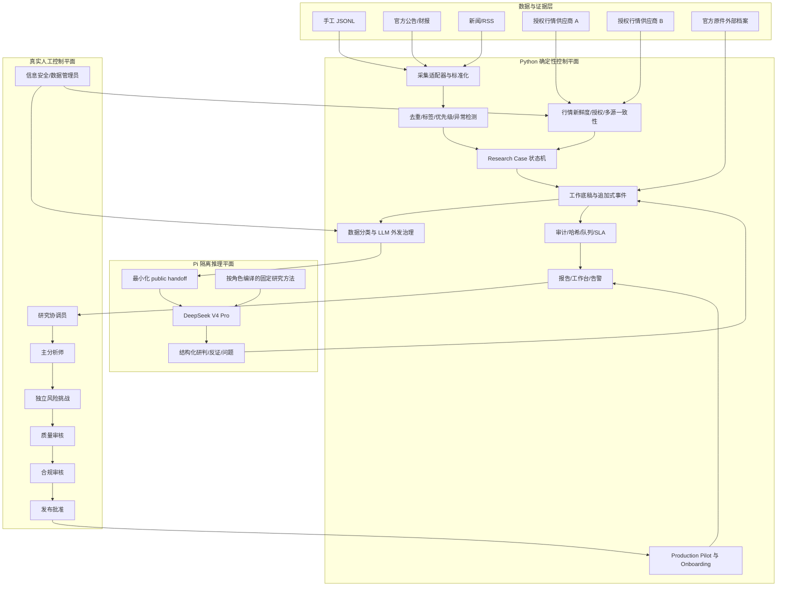
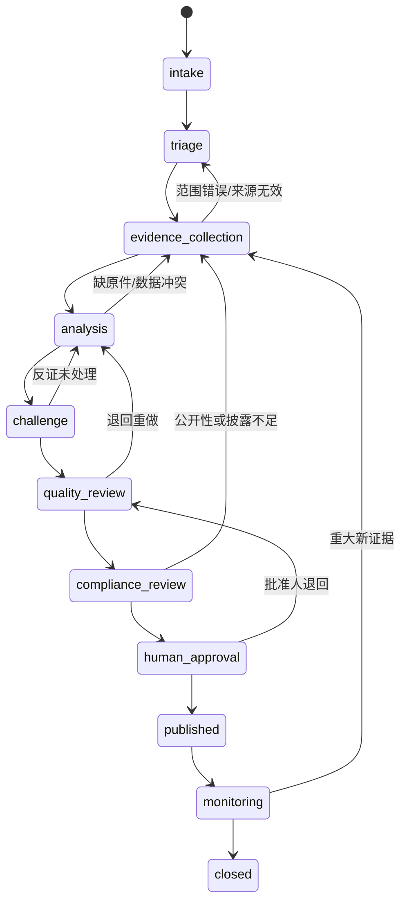

# A 股智能投研系统：Zcode 项目接手总说明

> 项目路径：`E:\stock agent`  
> 交接快照日期：2026-08-29（Asia/Shanghai）  
> 接手对象：Zcode 及后续维护者  
> 当前生产基座：Python 确定性控制平面 + Pi Agent 隔离推理平面 + DeepSeek V4 Pro  
> 当前总体结论：**技术组件大体可运行；业务启用仍为 `BLOCKED`；生产试运行仍为 `NO_GO`。**

---

## 0. 如何阅读这份交接书

这不是一份“功能宣传页”，而是一份接手工作的工程与业务状态说明。全文严格区分四种状态：

1. **已实现**：代码、配置、命令或测试已经存在。
2. **本轮实测**：2026-08-29 接手盘点时实际执行或读取了当前状态证据。
3. **历史产物**：目录中存在，但生成时间早于本次交接；不能冒充当前运行证明。
4. **外部阻塞**：必须依赖真实人员、合同、授权、档案、交易日计划任务或人工审批，不能靠补代码伪造完成。

Zcode 接手后必须先阅读：

- `AGENTS.md`
- `README.md`
- 本文件
- `docs/BUSINESS_ONBOARDING_V29.md`
- `docs/RESEARCH_WORKPAPERS_V27.md`
- `docs/CONTROLLED_PRODUCTION_PILOT_V24.md`
- `docs/PI_AGENT_MIGRATION_V25.md`
- `docs/PI_SKILLS_SUPPLY_CHAIN_V26.md`

任何后续开发都不得把“测试通过”写成“业务上线”，也不得为了消除 `BLOCKED` 或 `NO_GO` 而虚构人、证据、授权、审批、运行样本或供应商状态。

---

## 1. 项目总目标

### 1.1 一句话目标

构建一套能够在真实机构控制逻辑下持续运行的 **A 股内部研究操作系统**：把合法取得的公开新闻、公告、财报、行情和人工情报转化为可追溯的研究案件、工作底稿、模型研判、反证问题、人工复核任务、日报、预警和复盘结果，同时保证外部 LLM、Pi Agent 和任何自动化程序都不能自行交易、发布、审批或绕过合规门禁。

### 1.2 最终业务形态

最终系统应具备以下能力：

- 持续采集已获授权的数据源，并记录来源、时间、许可证和使用范围。
- 把信号从“消息”提升为“Research Case”，而不是沿一条死流水线直接得出结论。
- 允许基本面、事件、市场、风险、证据核验等研究支线并行推进。
- 使用 DeepSeek V4 Pro 和 Pi Agent 做受控推理、反证、问题生成与解释，不把业务判断写死在规则里。
- 用确定性 Python 控制权限、分类、去重、状态机、哈希、审计、门禁和输出格式。
- 让真实人工在关键节点决定：补证、退回、质控、合规、内部发布和复盘结果。
- 形成可重放、可审计、可复盘、可追责的追加式事件和工作底稿。
- 在真实供应商、真实人员、真实档案和真实影子运行证据齐备后，进入受控内部研究生产模式。

### 1.3 明确非目标

本项目当前及可预见阶段 **不做**：

- 自动交易、自动下单、自动调仓、自动止损或自动止盈。
- 让 LLM 或 Agent 代替质量审核、合规批准、发布批准或生产启用。
- 把免费接口可访问等同于获得商业数据使用权。
- 把新闻聚合站、搜索结果或模型总结冒充官方公告原件。
- 把本地哈希链或本地磁盘冒充获批的不可变生产档案。
- 把模拟、mock、连通性探测或一次测试信号冒充真实业务闭环。
- 在生产 Pi 中动态安装一堆插件、MCP、skills 或工具。
- 绕过验证码、访问控制、网站条款、限制名单、数据分类或外发审查。

---

## 2. 当前总体状态

### 2.1 管理层结论

| 维度 | 当前状态 | 说明 |
|---|---|---|
| 单元与集成测试 | `PASS` | 2026-08-29 重新执行，`732/732` 通过 |
| Python 控制平面 | 可运行 | 数据、规则、案件、底稿、审计、报告和门禁模块齐全 |
| Pi 固定运行时 | `READY` | 固定包、隔离设置、无工具生产边界通过 |
| Pi 方法供应链 | `READY` | 11 个批准方法，锁文件与内容哈希匹配 |
| DeepSeek 凭据/连通性 | `OK` | 环境变量存在，doctor 连通性检查通过；不等于本轮真实业务研判 |
| LLM 外发治理 | `ATTENTION` | 6 条历史治理例外待真实人工处置 |
| 行情治理 | `FAIL` | 3 个价格信号全部被阻断；无内部核准供应商、缺多源一致性 |
| 官方原件证据库 | 技术 `READY` / 业务 `BLOCKED` | 哈希链正常，但官方原件数量为 0，生产档案未获批 |
| 研究工作底稿 | 技术 `READY` / 业务 `BLOCKED` | 32 份底稿、56 个事件，全部存在业务警告 |
| Research Operations | `BLOCKED` | 只有 4 个 service principal，没有真实人工角色 |
| 人工复核队列 | `BLOCKED` | 154 条未完成、154 条逾期、154 条未分派 |
| Business Onboarding | 技术 `READY` / 业务 `BLOCKED` | 8 个阶段完成 `0/8`，当前停在 `governance_scope` |
| Production Pilot | `NO_GO` | 技术和候选均 `BLOCKED`，12 类门禁未通过 |
| 定时任务 | 未安装 | 不会自动弹终端；当前符合“关闭自启动”的要求 |
| 本地工作台 | 未运行 | `127.0.0.1:8767` 当前无监听 |
| Git 工程基线 | 严重风险 | 仓库无任何 `HEAD` 提交，全部项目文件仍未跟踪 |

### 2.2 最重要的判断

项目现在不是“什么都没做”，也不是“已经可以商业上线”。更准确的说法是：

> **控制系统、研究状态机和隔离推理框架已经形成；真实业务所需的人、数据权利、官方原件、档案系统、复核容量和批准链尚未形成。**

下一阶段不应继续堆 Agent 数量或安装插件。优先级应是：

1. 建立可回滚的源码基线。
2. 完成真实治理范围和真实人员名册。
3. 完成至少两家独立数据供应商的证据准入。
4. 回填 P0/P1 官方原件。
5. 清理治理例外和复核积压。
6. 再进行真实交易日的计划任务影子运行。

---

## 3. 目标架构

### 3.1 分层架构图



### 3.2 为什么不是“一条线”

真实研究不是 `采集 -> LLM -> 报告` 一次走完。当前设计采用案件状态机，并允许并行、退回和补证：



在 `analysis` 阶段，至少应并行维护：

- 基本面或事件影响工作流。
- 市场背景与价格/资金一致性工作流。
- 假设、情景和敏感性分析工作流。
- 证据缺口与来源权威性工作流。
- 风险、反证和证伪条件工作流。
- LLM/Pi 推理和独立人工挑战工作流。

模型只能产生研究材料和待回答问题，不能自行把案件推进到受保护的人工作业阶段。

---

## 4. 当前已经完成的能力

### 4.1 数据采集与适配器

代码位置：`stock_agent/sources/`

已实现适配器：

- `local_jsonl.py`：本地手工情报池。
- `filing_jsonl.py`：本地公告类 JSONL。
- `rss.py`：RSS/Atom 来源。
- `eastmoney_adapter.py`：东方财富行情快照。
- `eastmoney_filing_adapter.py`：东方财富公告候选。
- `akshare_adapter.py`：AkShare 可选适配器。
- `pysnowball_adapter.py`：雪球相关可选适配器。
- `alltick_adapter.py`：AllTick 候选适配器。
- `free_quote_adapter.py`：free-quote 候选适配器。

当前 `config/watchlist.local.json` 中启用：

| 来源 | 状态 |
|---|---|
| `local_jsonl` | 启用 |
| `eastmoney_filing` | 启用 |
| `eastmoney` | 启用 |
| `filing_jsonl` | 关闭 |
| `rss` | 关闭 |
| `akshare` | 关闭 |
| `pysnowball` | 关闭 |
| `alltick` | 关闭 |
| `free_quote` | 关闭 |

注意：适配器存在或接口能返回数据，不代表商业使用授权通过。生产启用必须由供应商登记和证据准入决定。

### 4.2 规则分析与信号标准化

主要代码：

- `stock_agent/analysis.py`
- `stock_agent/models.py`
- `stock_agent/storage.py`
- `stock_agent/pipeline.py`

已实现：

- 信号标准化、去重和 SQLite 持久化。
- 主题、标的、风险词、情绪和优先级标签。
- P0/P1/P2/P3 分层。
- 人工复核标记与复核问题。
- 价格涨跌、主力资金流和多异常组合评分。
- 新信号与重复信号分离，避免重复调用 LLM。
- LLM 失败降级，不使基础流水线崩溃。

规则层的职责是筛选、约束和路由，不是替代研究判断。真正开放性研判由 LLM、并行角色和人工完成。

### 4.3 DeepSeek LLM Agent

主要代码：

- `stock_agent/llm_agent.py`
- `stock_agent/role_analyst.py`
- `stock_agent/model_operations.py`
- `stock_agent/llm_governance.py`

当前配置：

- 主模型：`deepseek-v4-pro`
- OpenAI-compatible Chat Completions 接口。
- 凭据来源：环境变量，禁止写入仓库。
- 结构化输出包含方向、置信度、时间窗口、核心判断、风险点、复核问题和人工决策要求。
- 动作只允许导出复核材料和写动作日志。
- 外发治理启用且强制执行，只允许经过门禁的 `public` 最小化数据。

当前进程可看到 `DEEPSEEK_API_KEY` 已设置，doctor 的连通性检查为 `OK`。本次交接没有把真实 Key 写入文件，也没有把连通性检查冒充一次真实业务研判。由于 Key 曾经出现在聊天中，正式使用前应轮换。

### 4.4 Pi Agent 生产基座

主要位置：

- `.pi/settings.json`
- `.pi/skills/`
- `pi_runtime/`
- `stock_agent/pi_runtime.py`
- `stock_agent/pi_skills.py`
- `stock_agent/agent_handoff.py`

已完成：

- 固定 `@earendil-works/pi-coding-agent@0.84.2`。
- 独立 `PI_CODING_AGENT_DIR` 和隔离设置。
- 生产 Pi 禁用 tools、skills 动态发现、packages、extensions、prompts、themes、sessions 和项目自动信任。
- Python 先从治理通过的当轮 JSON 中构造最小 `public` handoff。
- handoff 带来源哈希，可验证输入没有被替换。
- 公开信号为 0 时保持 0 次 Pi 模型调用。
- Pi 输出回到 Python 控制平面，不能直接写审批、发布或交易状态。

### 4.5 Pi 研究方法供应链

主要位置：

- `config/pi_skills.json`
- `config/pi_skills.lock.json`
- `.pi/skills/`
- `docs/PI_SKILLS_SUPPLY_CHAIN_V26.md`

已完成：

- 11 个已批准项目方法。
- 其中 6 个为外部方法的审查后改编版本。
- 固定来源仓库、commit、许可证、权限、角色映射和内容哈希。
- 方法由 Python 按角色编译进提示词；生产 Pi 仍使用 `--no-skills --no-tools`。
- 方法或锁文件变化会使旧生产候选指纹失效。

当前方法 bundle SHA-256：

```text
85289fa6508f5cff0ac7df8ea60fee4480f2b0a92c57475ce06a266f94030235
```

### 4.6 LLM 外发治理

主要代码与产物：

- `stock_agent/llm_governance.py`
- `reports/llm_governance/`
- `data/llm_governance/`
- `docs/LLM_GOVERNANCE_OPERATING_MODEL.md`

已实现：

- 数据分类和仅公开数据外发。
- Key、个人信息、内幕信息、限制名单和提示注入检测。
- 输入最小化、证据引用和输出校验。
- 阻断记录、治理例外和人工处置事件。
- service/Agent 账号不能代替合规或信息安全人员批准例外。
- 例外处置不会自动重送、授权外发、发布或交易。

### 4.7 行情治理与韧性

主要代码：

- `stock_agent/market_resilience.py`
- `stock_agent/market_data_governance.py`
- `stock_agent/provider_registry.py`

已实现：

- 行情缓存和回退优先级。
- 行情时间、观察时间和新鲜度检查。
- 缓存证据和来源标识。
- 多源一致性要求。
- 供应商内部核准门禁。
- 陈旧、冲突、未核准或来源不足的数据禁止进入正常外部 LLM 行情研判。

当前失败不是抓不到行情，而是拿到的 3 个行情信号都未通过商业授权和多源一致性门禁。

### 4.8 官方原件证据库

主要代码与产物：

- `stock_agent/evidence_vault.py`
- `stock_agent/evidence_vault_uat.py`
- `data/evidence_vault/`
- `reports/evidence_vault/`
- `docs/BUSINESS_ENABLEMENT_V28.md`

已实现：

- 人工导入本地原件。
- 官方 HTTPS 原文 URL、标题、发布时间、actor、角色和 signal 绑定。
- 内容寻址、SHA-256、事件链、对象验证、隔离和篡改检测。
- 默认禁止网络自动采集；显式 live 且 URL 精确匹配时才允许受控 fetch。
- 验证码和访问控制页隔离，不尝试绕过。
- 原始文件字节不发送给 DeepSeek。
- 生产档案复核、激活、撤销均需要真实独立人工。

### 4.9 Research Case 状态机

主要代码：

- `stock_agent/research_cases.py`
- `stock_agent/research_runtime.py`
- `stock_agent/brokerage_architecture.py`
- `stock_agent/audit_log.py`

已实现：

- 从信号生成研究案件。
- 机构级 `intake -> triage -> evidence_collection -> analysis -> challenge -> quality_review -> compliance_review -> human_approval -> published -> monitoring -> closed` 状态。
- 补证、退回、升级和重大新证据回流。
- 并行工作流和案件阻塞原因。
- 受保护状态动作的角色、身份、当前状态和结构化底稿校验。
- 事件状态、审计日志、健康检查和投影视图。

### 4.10 结构化研究工作底稿

主要代码与文档：

- `stock_agent/research_workpapers.py`
- `data/research_workpapers/events.jsonl`
- `reports/research_workpapers/`
- `docs/RESEARCH_WORKPAPERS_V27.md`

已实现：

- 追加式事件是事实源，`latest.json` 和 Markdown 是可重建投影。
- 来源陈述、数据观测、模型推断、人工判断分开记录。
- 版本、哈希链、声明类型、来源权威性和批准资格校验。
- P0/P1 官方一手来源门禁。
- 独立风险挑战、质量、合规和发布批准的职责分离。
- 本地归档与获批生产档案分开报告。

### 4.11 人工复核、决策和复盘

主要代码：

- `stock_agent/review.py`
- `stock_agent/review_queue.py`
- `stock_agent/review_priority.py`
- `stock_agent/decisions.py`
- `stock_agent/source_remediation.py`

已实现：

- 待复核 JSONL 导出。
- completed review 汇总和规则优化建议。
- 以 `signal_id` 为主键的去重投影视图。
- 原始 pending/completed/action 历史只追加、不删除。
- SLA、逾期、未分派、优先级和候选责任角色。
- 证据补充、字段补充、拒绝、延后和噪声标记。
- 禁止在人工决策中出现自动交易、下单或调仓。

### 4.12 Research Operations 与职责分离

主要代码和配置：

- `stock_agent/research_operations.py`
- `stock_agent/research_team.py`
- `stock_agent/team_ops.py`
- `config/research_roster.local.json`
- `config/research_restrictions.local.json`
- `docs/COMMERCIAL_RESEARCH_OPERATING_MODEL.md`

已实现：

- principal、角色、覆盖范围、限制名单和容量检查。
- 任务候选分派，但不自动分派。
- 独立风险挑战和受保护审批角色分离。
- 真实人工名册门禁；service principal 不能冒充 human。
- 缺人时明确 `BLOCKED`，而不是自动生成姓名或资格编号。

### 4.13 报告、工作区、工作台和告警

主要代码：

- `stock_agent/reports.py`
- `stock_agent/dashboard.py`
- `stock_agent/review_workbench.py`
- `stock_agent/workspace_inbox.py`
- `stock_agent/alerts.py`

已实现：

- Markdown 日报、结构化 JSON、JSONL 预警。
- LLM 研判、动作、失败降级、证据状态和复盘章节。
- Dashboard 最新页和时间戳页。
- 本地回环工作台，支持运行视图、复核队列和生产试运行只读视图。
- 工作区 inbox、评论、证据、草稿和案件视图。
- P0/P1、高置信度待人工判断、source error 和 pending review 通知。
- 工作台 PID 与命令行双重校验，避免误杀无关进程。

### 4.14 定时运行与 Production Pilot

主要位置：

- `scripts/run_daily_research.ps1`
- `scripts/install_scheduled_tasks.ps1`
- `scripts/uninstall_scheduled_tasks.ps1`
- `stock_agent/production_pilot.py`
- `stock_agent/business_onboarding.py`
- `stock_agent/control_evidence.py`

已实现四种运行模式：

| 模式 | 目的 | 是否采集/调用 LLM |
|---|---|---|
| `daily` | 完整日常研究、证据门禁、handoff、队列、Pilot、Dashboard、Alerts | 是，但仅新增且治理通过的信号 |
| `pilot` | 对已完成 daily summary 做独立哈希对账 | 否 |
| `dashboard` | 同步运行时、工作区、仪表盘和告警 | 否 |
| `review` | 汇总 completed review 并刷新投影 | 否 |

脚本中预定义但当前未安装的 Windows 任务：

- `StockAgent_DailyResearch`：工作日 08:30。
- `StockAgent_PilotReconcile`：工作日 08:45。
- `StockAgent_DailyDashboard`：工作日 18:00。
- `StockAgent_WeeklyReview`：周六 09:00。

当前不安装是有意状态：一方面用户要求关闭偶发终端自启动，另一方面业务 preflight 尚未通过。

### 4.15 测试与文档

当前有 63 个 `test_*.py` 文件，覆盖：

- 数据源、规则、异常检测和存储。
- LLM 成功、失败、重试、缺 Key、重复信号和动作导出。
- Pi 运行时、技能锁、handoff 和零调用门禁。
- LLM 治理、行情治理、证据库和证据链。
- Research Case、Runtime、Workpaper、Operations、Git 工作流。
- Review Queue、Workbench、Dashboard、Alerts 和 Scheduled Ops。
- Business Onboarding、Control Evidence 和 Production Pilot。

本轮执行：

```powershell
$env:PYTHONPYCACHEPREFIX = Join-Path (Get-Location) '.pycache-codex'
python -m unittest discover -s tests
```

结果：

```text
Ran 732 tests in 97.586s
OK
```

---

## 5. 项目目录与责任边界

```text
E:\stock agent
├─ .git/                       # 已初始化，但目前没有 HEAD 提交
├─ .pi/                        # 项目 Pi 设置和审查后的方法文本
├─ config/                     # 业务、治理、名册、限制、Pi skills 配置
├─ data/                       # SQLite、inbox、事件、审计、复核和证据状态
├─ docs/                       # 操作模型、门禁制度和本交接书
├─ logs/                       # 运行、计划任务、工作台、go-live 日志
├─ openclaw/                   # 历史只读/回滚材料，不是当前生产路径
├─ output/                     # 临时或外部方法审查产物，需逐项确认用途
├─ pi_runtime/                 # 固定版本的隔离 Pi Agent 基座
├─ reports/                    # 各类时间戳报告和 latest 投影
├─ scripts/                    # 启停、日常、任务安装、迁移和回滚脚本
├─ skills/                     # 历史/离线扫描目录，不是生产动态加载目录
├─ stock_agent/                # Python 主程序
└─ tests/                      # 63 个测试模块
```

### 5.1 关键配置

| 文件 | 用途 |
|---|---|
| `config/watchlist.local.json` | 当前本机主配置 |
| `config/watchlist.example.json` | 无敏感信息的示例配置 |
| `config/research_roster.local.json` | 当前 principal 名册 |
| `config/research_restrictions.local.json` | 限制名单/限制范围 |
| `config/pi_skills.json` | 生产方法注册表 |
| `config/pi_skills.lock.json` | 生产方法内容锁 |
| `config/provider_evidence.example.json` | 供应商证据结构示例 |
| `config/llm_live_test.example.json` | 独立 LLM 测试配置，不能混入生产输入 |

### 5.2 关键事实源与投影

不得把投影视图当成唯一事实源，也不得覆盖追加式历史：

| 类型 | 事实源/历史 | 可重建投影 |
|---|---|---|
| 信号 | `data/stock_agent.sqlite3`、原始 inbox | `reports/json/*.json` |
| 工作底稿 | `data/research_workpapers/events.jsonl` | `reports/research_workpapers/latest.*` |
| 人工复核 | pending/completed/action JSONL | `reports/review_queue/latest.*` |
| 官方证据 | 内容寻址对象 + vault 事件 | `reports/evidence_vault/latest.*` |
| 案件运行时 | 案件/事件状态 | `data/research_runtime/runtime.json`、`reports/research_runtime/latest.*` |
| 审计 | append-only audit/event logs | Dashboard、Markdown、JSON 汇总 |

### 5.3 历史 OpenClaw 边界

项目曾使用 OpenClaw 多 Agent 调度，目录与兼容代码仍在：

- `.openclaw/`
- `openclaw/`
- `stock_agent/openclaw_handoff.py`
- `openclaw-workspace-state.json`

当前生产决策已经切换到 Pi。OpenClaw 资料只能作为历史审计或回滚参考，不得重新接入 daily 主路径，也不得出现 `runtime=openclaw` 与 `runtime=pi` 同时宣称为生产运行时的情况。

---

## 6. 当前运行环境与安全状态

### 6.1 Python 与可选依赖

本轮检测：

- Python：`3.8.5`
- 解释器：`E:\anaconda\python.exe`
- SQLite：`3.33.0`
- `PyYAML`：已安装
- `akshare`：未安装
- `pysnowball`：未安装

`pyproject.toml` 当前要求 Python `>=3.8`。AkShare 新版本更适合 Python 3.9+。不要直接破坏当前能通过 732 个测试的 Python 3.8 环境；应新建 Python 3.11 或 3.12 隔离环境做迁移矩阵，全部通过后再决定正式版本。

### 6.2 API Key

当前环境中：

- `DEEPSEEK_API_KEY`：存在。
- `LLM_API_KEY`：未设置。
- `LLM_BASE_URL`：未设置。
- `LLM_MODEL`：未设置。

项目会从 DeepSeek/OpenClaw 兼容配置回退读取模型与端点。本轮扫描没有在项目文件中发现当前真实 Key 字符串。禁止把 Key 写入：

- Markdown 文档。
- JSON 配置。
- PowerShell 脚本。
- Git 历史。
- 报告和日志。

由于 Key 曾经通过聊天暴露，应该在正式接手后轮换，并在轮换后做一次最小连通性检查。不要在命令输出中回显新 Key。

### 6.3 自启动、计划任务和本地端口

本轮检查：

- 没有安装 `StockAgent_*` Windows 计划任务。
- 用户和公共 Startup 目录没有 StockAgent 启动项。
- HKCU/HKLM `Run` 没有 StockAgent 启动项。
- `127.0.0.1:8767` 未监听。
- 工作台未运行。
- 当前桌面未发现 StockAgent/投研/Dashboard 快捷方式。

这意味着当前不会因为本项目自动弹出终端。Zcode 不得自行安装计划任务或恢复自启动。

---

## 7. 2026-08-29 验收证据

### 7.1 测试

| 检查 | 结果 |
|---|---|
| `python -m unittest discover -s tests` | `732/732 OK` |
| 测试文件 | 63 个 |
| 运行时间 | 97.586 秒 |

### 7.2 Pi Runtime

命令：

```powershell
python -m stock_agent pi-runtime-status --config config/watchlist.local.json --require-ready
```

结果：

- 状态：`READY`
- 包：`@earendil-works/pi-coding-agent@0.84.2`
- 隔离设置：`PASS`
- API Key：存在
- 报告：`reports/pi_agent/runtime/latest.md`

本轮没有运行 `pi-runtime-uat --live`，因此这里证明的是运行时和凭据就绪，不是新一次付费模型业务调用。

### 7.3 Pi Skills

命令：

```powershell
python -m stock_agent pi-skills-status --config config/watchlist.local.json --require-ready
```

结果：

- 状态：`READY`
- 批准/改编：`11/6`
- 动态 skills：disabled
- tools：disabled
- 报告：`reports/pi_agent/skills/latest.md`

### 7.4 最近一次日常研究产物

当前最新日常 JSON：`reports/json/20260825T154430_0800.json`

| 指标 | 数值 |
|---|---:|
| 原始信号 | 22 |
| 分析信号 | 22 |
| 新增入库 | 6 |
| 重复 | 16 |
| source errors | 0 |
| 最终 signal 数 | 6 |
| alert 数 | 0 |
| 实际 LLM 调用 | 0 |

这次 agent-run 本身 `overall_status=OK`，但 16 条需要官方原件的信号全部因 vault 缺失被阻断，3 个行情信号也因治理门禁不能进入 LLM。

### 7.5 Research Runtime

当前投影：`reports/research_runtime/latest.json`

| 指标 | 数值 |
|---|---:|
| 案件总数 | 32 |
| `evidence_collection` | 8 |
| `analysis` | 24 |
| 阻塞案件 | 32 |
| monitoring | 0 |
| 已加载信号/请求信号 | 262/270 |
| 缺失引用信号 | 8 |

Runtime 对缺失历史信号采用保留旧状态的降级策略，没有静默删除案件。当前所有案件都缺主分析师或研究内容/证据，不能推进到真实挑战和审批阶段。

### 7.6 研究工作底稿

当前投影：`reports/research_workpapers/latest.json`

| 指标 | 数值 |
|---|---:|
| workpapers | 32 |
| events | 56 |
| 哈希链 | `OK` |
| `analysis_draft` | 24 |
| `draft_evidence` | 8 |
| validation `WARN` | 32 |
| data observations | 962 |
| model inferences | 189 |
| source statements | 586 |
| 官方一手原件覆盖 | 0 |
| 生产档案批准 | false |

### 7.7 官方原件证据库

命令：

```powershell
python -m stock_agent evidence-vault-status --config config/watchlist.local.json --require-ready
```

结果：

- 技术状态：`READY`
- 业务状态：`BLOCKED`
- 事件链：`OK`
- documents/events：`0/0`
- verified/quarantined/tampered：`0/0/0`
- 生产档案：未就绪

真实阻塞：

- 本地内容寻址库不是获批生产档案。
- 没有外部档案合同/控制证据引用。
- 外部不可变性与保留控制未验证。
- 缺 compliance 和 information security 独立复核。
- 当前 policy fingerprint 未被人工激活。

### 7.8 LLM Governance

命令：

```powershell
python -m stock_agent llm-governance-status --config config/watchlist.local.json
```

结果：

- policy：`28.0`
- 状态：`ATTENTION`
- enforce：true
- 外发允许分类：`public`
- 待处置例外：6
- 自动批准：关闭

这些例外来自历史 `internal` 数据被阻断的 signal LLM/role LLM 尝试。正确做法是由真实合规或信息安全人员核验、关闭、改为公开最小化新信号，或留在隔离人工研究，不得直接批准受限数据外发。

### 7.9 行情治理

命令：

```powershell
python -m stock_agent market-data-governance-status --config config/watchlist.local.json
```

结果：

- 状态：`FAIL`
- 价格信号：3
- pass/degraded/blocked：`0/0/3`
- LLM eligible：0
- internally attested providers：0
- 阻断标的：`000001`、`300750`、`600519`

阻断原因：

- `insufficient_cross_source_consensus`
- `provider_not_internally_attested`

### 7.10 人工复核队列

命令：

```powershell
python -m stock_agent review-queue-status --config config/watchlist.local.json
```

结果：

| 指标 | 数值 |
|---|---:|
| outstanding | 154 |
| overdue | 154 |
| unassigned | 154 |
| completed | 0 |
| 原始 pending rows | 183 |
| 唯一 pending | 154 |
| 重复行 | 29 |

投影视图已正确去重；不能通过删除 29 条历史重复行来“清理”队列。

### 7.11 Research Operations

当前名册只有 4 个 active service principal：

| actor | 类型 | 角色 |
|---|---|---|
| `stock_agent_source_collector` | service | information_analyst |
| `stock_agent_news_filing_analyst` | service | fundamental_analyst |
| `stock_agent_market_monitor` | service | market_analyst |
| `stock_agent_risk_guard` | service | risk_reviewer |

真实 human principal 数量：0。

缺少强制人工能力：

- `research_coordinator`
- `lead_analyst`
- `quality_reviewer`
- `compliance_officer`
- `information_security_officer`
- `data_steward`
- `publication_approver`

`research-ops-check` 返回 `BLOCKED`/非零退出码是正确控制行为，不是需要通过 mock 人员修掉的 bug。

### 7.12 Business Onboarding

当前投影：`reports/business_onboarding/latest.json`

- technical：`READY`
- business：`BLOCKED`
- 当前阶段：`governance_scope`
- 已完成阶段：`0/8`

八阶段顺序：

1. `governance_scope`
2. `human_roster`
3. `provider_authorization`
4. `official_evidence_backfill`
5. `governance_remediation`
6. `production_archive`
7. `shadow_readiness`
8. `go_no_go`

### 7.13 Production Pilot

当前投影：`reports/production_pilot/latest.json`

- technical readiness：`BLOCKED`
- candidate readiness：`BLOCKED`
- effective mode：`shadow`
- decision：`NO_GO`
- candidate fingerprint：`4c6f762450cef0f87ecfb501a2f43884583f65f95e071813d86a44b56e04dd63`

12 类阻塞：

1. Business Onboarding 业务阻塞。
2. 真实人员角色 `0/7`。
3. 已完成证据准入的独立供应商 `0/2`。
4. 行情治理 `FAIL`，3 条全部阻断。
5. LLM Governance 有 6 条待处理例外。
6. P0/P1 官方一手原件覆盖 `0/9`。
7. 研究底稿生产档案证据缺失。
8. 复核人员 0，outstanding/overdue 154，critical unassigned 24。
9. 最近 daily 虽 exit=0，但当前 Pilot 判定运行顺序证据 `FAIL`。
10. 合格影子样本 `0/5`，覆盖交易日 `0/3`。
11. 指纹绑定人工批准 `0/6`，actor 不满足分离。
12. 当前 candidate fingerprint 未人工激活。

### 7.14 最近一次计划运行

历史 summary：`logs/scheduled/run_20260825T154420.summary.json`

- mode：daily
- exit code：0
- SLO：PASS
- public handoff signals：0
- Pi model calls：0
- Pi 跳过原因：`no_governance_approved_public_signals`
- 各记录命令退出码均为 0

然而 Production Pilot 的当前顺序校验仍为 `FAIL`。这份 summary 生成于计划脚本后续增强之前，不能作为当前完整序列的合格影子证据。只有真正由 Windows Task Scheduler 在通过 preflight 后产生的运行才可计入影子样本；手工重复执行不得凑数。

### 7.15 Doctor

命令：

```powershell
python -m stock_agent doctor --config config/watchlist.local.json
```

结构化结果：

- overall：`FAIL`
- `OK`：25
- `WARN`：12
- `FAIL`：1

唯一 FAIL 是 Production Pilot。WARN 包括 LLM Governance、Market Data、Evidence Vault、Workpapers、Research Ops、Business Onboarding、未安装计划任务、待复核数据和 Review Queue。

Windows 控制台部分中文显示有编码乱码，但 `reports/health/latest.json` 可正常解析。这是一个需要修复的运维可读性问题，不影响 JSON 事实。

---

## 8. 还没有完成或没有被证明的内容

### 8.1 不能靠代码完成的外部事项

以下必须由用户或真实机构人员提供，Zcode 只能生成结构、校验和操作说明：

- 真实法律实体 `organization_id`。
- 治理授权、内部研究范围和禁止动作政策的外部档案证据。
- 7 类真实人工及身份/资质/职责证据。
- 至少 2 家独立供应商的合同、数据权利、安全、SLA、事件和退出审查。
- P0/P1 对应的交易所、巨潮资讯或发行人官方原件。
- 获批外部不可变档案系统、保留策略和安全/合规复核。
- 154 条复核任务的真实人工处理。
- 5 次、覆盖 3 个交易日的真实计划任务影子运行。
- 6 名不同授权人工对当前 fingerprint 的批准。
- publication approver 最终手工启用。

### 8.2 尚未完成的工程事项

1. **没有 Git 基线**：仓库已初始化，但 `git rev-parse --verify HEAD` 失败；全部项目内容未跟踪。
2. **环境不可复现**：没有完整锁定的 Python 依赖环境，当前依赖 Anaconda Python 3.8.5。
3. **数据源合同化不足**：适配器接口多，但统一 provider contract、许可元数据、速率限制、schema 版本和回放夹具仍需加强。
4. **最新状态有历史漂移**：daily、dashboard、pilot 等 latest 文件生成时间不同，必须显式显示 staleness。
5. **计划序列证据不合格**：当前最新 scheduled summary 不能满足新版 Pilot 顺序校验。
6. **运行产物很多**：`reports/` 和 `data/` 已积累大量时间戳文件，需要保留政策、归档策略和备份方案，不能粗暴删除。
7. **临时文件需审查**：顶层 `_db_check.py`、`_tmp_plain_listener.py` 等需确认是测试工具、历史残留还是应纳入正式 scripts。
8. **控制台编码**：doctor 中文输出在当前 PowerShell 中乱码，需要统一 UTF-8 输出策略。
9. **恢复演练缺失**：尚无可验证的数据库、事件链、vault 和配置恢复演练证据。
10. **模型评估集不足**：已有运行治理和日志，但还缺一套冻结的 A 股研究质量回归集与提示词版本对比基线。
11. **真实数据授权不足**：当前行情可访问，但不能作为生产使用权证明。
12. **工作台访问控制有限**：当前只监听 loopback，适合单机；若未来多人使用，需要独立身份、授权、CSRF、审计和部署设计。

### 8.3 目前没有资格声称的结论

禁止对外声称：

- “系统已正式上线”。
- “已经达到券商生产标准”。
- “行情源已获授权”。
- “所有研究结论有官方原件”。
- “Pi 已跑通真实日常业务调用”。
- “复盘闭环已经有效”。
- “人工职责分离已建立”。
- “可以自动给出仓位或交易建议”。

---

## 9. Zcode 接手后的强制边界

### 9.1 必须保持

- Python 是确定性控制、治理、状态和审计平面。
- Pi 是无工具、无动态插件的受控推理平面。
- DeepSeek 只接收治理通过的 `public` 最小化文本。
- 公开 handoff 为 0 时不得调用 Pi 模型。
- P0/P1 必须有留存的官方一手来源。
- 来源陈述、数据观测、模型推断和人工判断分开记录。
- 所有审核、批准、激活都绑定真实 active human actor。
- 质量、合规、信息安全、数据、研究和发布角色保持职责分离。
- 原始事件和人工记录只追加，不覆盖、不删除。
- 每次状态报告同时写技术状态和业务状态。

### 9.2 明确禁止

- 不得虚构姓名、工号、资质、登记编号、合同、供应商授权或人工批准。
- 不得把 service/Agent/system/bot 写成人工 actor。
- 不得自动把 provider 标成 approved/active。
- 不得自动批准 LLM Governance exception。
- 不得关闭或绕过分类、Key/PII/内幕、限制名单、注入和证据引用检查。
- 不得将原始公告/财报文件字节发送给 DeepSeek。
- 不得删除复核、动作、案件、底稿或审计历史来降低积压数字。
- 不得为满足 5 次/3 日要求重复手工运行。
- 不得在 Production Pilot 未 GO 前安装定时任务并称为生产。
- 不得重新启用 OpenClaw 主调度。
- 不得在生产 Pi 中直接安装 `pi-subagents`、MCP adapter 或任意第三方 package。
- 不得实现自动交易、下单、调仓或对接券商执行账户。

---

## 10. 下一步目标

### 10.1 下一阶段总目标

**目标名称：Release Baseline + Institutional Preflight v30**

目标定义：

> 在不伪造任何外部事实、不安装自启动、不触发自动交易的前提下，为当前代码建立可审阅、无密钥、可回滚的源码与环境基线；同时把 Business Onboarding 的第一阶段 `governance_scope` 和第二阶段 `human_roster` 所需材料变成可由真实人员填写、验证、审计的接入包。

为什么先做这个：

- 没有 Git HEAD，任何继续开发都缺可靠差异和回滚点。
- 当前真正卡住的是组织和人员，不是再增加一个 Agent。
- provider、原件、复核和 shadow pilot 都依赖先明确组织范围与真实责任人。

### 10.2 Zcode 第一批具体任务

#### Task 1：接手只读验收

1. 阅读本文件和 `AGENTS.md`。
2. 执行下方“接手验收命令”。
3. 不执行 live LLM、不采集新数据、不安装计划任务。
4. 生成 `reports/handoff/zcode_acceptance_<timestamp>.md/.json`，记录命令、退出码、文件哈希和状态差异。
5. 把预期业务 `BLOCKED` 与真实技术错误分开。

验收：732 个测试仍通过；Pi runtime/skills 仍 READY；所有业务门禁保持真实状态。

#### Task 2：建立源码基线准备包

1. 生成完整文件清单、大小、SHA-256 和分类。
2. 标注源码、配置模板、local 配置、数据库、审计历史、生成报告、缓存和临时文件。
3. 审查 `.gitignore`，确保 Key、local secrets、数据库、报告历史和运行缓存不会误提交。
4. 扫描凭据，仅输出变量名、位置、长度/哈希，不输出值。
5. 生成建议纳入首个提交的清单和建议排除清单。
6. 等用户明确授权后再创建首个 Git 提交；Zcode 不得自行提交或清理历史。

验收：用户能清楚看到首个基线会包含什么，且没有任何真实凭据。

#### Task 3：环境可复现矩阵

1. 保持当前 Python 3.8.5 不变。
2. 新建独立 Python 3.11/3.12 测试环境。
3. 固定运行依赖、测试依赖和可选数据源依赖。
4. 在两套环境执行测试和 CLI status smoke tests。
5. 记录差异，禁止静默替换依赖或破坏当前环境。

验收：至少一套现代 Python 环境可从空环境安装并通过完整测试；当前 3.8 环境仍可回退。

#### Task 4：治理范围接入包

1. 基于 `business-onboarding-pack` 输出 governance_scope 表单。
2. 只接受真实 `organization_id` 和外部档案 URI/SHA-256/有效期。
3. 要求 compliance officer 独立复核以下控制：
   - governance mandate
   - internal research scope
   - prohibited actions policy
4. 任何字段缺失时继续 BLOCKED。

验收：阶段 1 只有在真实证据和真实复核事件存在时才完成。

#### Task 5：真实人员名册接入包

1. 为 7 类角色生成模板和职责说明。
2. 验证 principal 为 `human`、active、证据有效、角色覆盖匹配。
3. 验证受保护角色使用不同 actor。
4. 不在项目中保存身份证件、证书原件或敏感 HR 文件，只留外部档案引用和哈希。

验收：名册状态来自真实人员证据，而不是 Agent ID。

---

## 11. 完整落地路线图

### Phase 0：源码与环境基线

**目标**：建立可回滚、可复现、无密钥的工程基线。

工程工作：

- Git 首次提交准备和用户审批。
- 依赖锁、Python 版本矩阵、安装文档。
- secret scan、SBOM、第三方许可证清单。
- 运行产物和保留策略分类。
- 临时文件审查。
- UTF-8 控制台修复。

完成标准：

- 有合法 HEAD 和可审阅工作区。
- 新环境一键安装并通过 732+ 测试。
- 无真实 Key 进入 Git。
- current reports 明确生成时间和 staleness。

### Phase 1：Governance Scope

**目标**：明确系统为哪一个真实实体、哪一种内部研究用途运行。

外部输入：

- 真实 legal entity。
- 内部研究授权范围。
- 明确禁止自动交易、外部发布和未授权外发。
- 真实合规复核。

完成标准：Business Onboarding 阶段 1 通过；任何自动交易开关仍为 false。

### Phase 2：Human Roster

**目标**：建立可审计的真实人工职责链。

至少需要：

- research coordinator
- lead analyst
- quality reviewer
- compliance officer
- information security officer
- data steward
- publication approver

完成标准：7/7 角色有真实 active human，受保护角色彼此独立，证据未过期。

### Phase 3：Provider Authorization

**目标**：让至少两家独立来源通过真实商业和控制审查。

每家供应商至少记录：

- 法律主体和产品名称。
- 数据用途、地域、用户、外部模型使用权。
- 数据再分发和缓存限制。
- SLA、时间戳、修订和故障口径。
- 安全评估、凭据管理和审计能力。
- 事件通知和退出/删除流程。
- 外部档案 URI、SHA-256、有效期。
- 登记人与独立复核人。

工程工作：

- 统一 provider contract：schema、symbol、timezone、as-of、observed-at、latency、quality、license scope。
- 双源对账和差异解释。
- 速率限制、退避、熔断、缓存和重放夹具。
- adapter contract tests。

完成标准：至少 2 个 evidence-approved active providers，且多源一致性可运行。

### Phase 4：Official Evidence Backfill

**目标**：给当前 9 个 P0/P1 案件补齐官方一手原件。

步骤：

1. 找到交易所、巨潮资讯或发行人准确原文。
2. 人工确认 URL、标题、发布时间和主体。
3. 下载本地原件，不绕过访问控制。
4. 使用 `evidence-vault-import` 导入。
5. 绑定相关 signal/case/workpaper。
6. 执行对象验证和底稿验证。

完成标准：P0/P1 retained official primary evidence 覆盖 9/9，且对象哈希与外部原文元数据一致。

### Phase 5：Governance Remediation

**目标**：清除阻断外发和行情使用的真实问题，而不是降低门禁。

工作：

- 真实人工处置 6 条 LLM exceptions。
- 将可公开内容重新核实、最小化并生成新信号。
- 不能公开的内容留在隔离人工研究。
- 启用已授权双源行情并处理差异。
- 验证模型每个结论引用实际输入证据。
- 建立 prompt/model/skill bundle 版本化评估集。

完成标准：LLM Governance `OK/PASS`；Market Data Governance `PASS`；无自动例外批准。

### Phase 6：Review Backlog 与研究质量

**目标**：让 154 条积压变成真实复核结果和可度量反馈。

工作：

- 由 coordinator 按 SLA、P0/P1、数据缺口和年龄分批。
- 真实 lead analyst/quality/compliance 承接。
- 对重复信号只在投影中合并，保留原始历史。
- 完成 confirm/reject/defer/request_more_data 等决策。
- 记录 false positive、effective、inconclusive 和 evidence gap。
- 建立信号精确率、复核时长、证据覆盖、模型校准和来源贡献指标。

完成标准：critical unassigned=0；overdue 清零或有真实批准的处置计划；completed review 可生成有效周报。

### Phase 7：Production Archive

**目标**：把本地影子审计升级为真实获批档案控制。

外部输入：

- 生产档案合同。
- 不可变性/保留/访问控制证据。
- compliance 与 information security 独立复核。
- current policy fingerprint 手工激活。

工程工作：

- 仅登记外部 URI、hash、有效期和复核事件。
- 不复制原始合同、身份或安全文件。
- 过期、撤销、哈希变化自动使批准失效。

完成标准：Evidence Vault 和 Workpaper Archive 的 business status READY，且复核 actor 独立。

### Phase 8：真实影子运行

**目标**：在不发布、不交易的情况下验证每天真实运行顺序和稳定性。

前提：Phase 1-7 全部通过，用户明确授权安装计划任务。

步骤：

1. 先运行 `install_scheduled_tasks.ps1 -DryRun`。
2. 人工检查账户、解释器、配置、时间和工作目录。
3. 用户明确批准后安装。
4. 收集至少 5 次、覆盖 3 个真实交易日的 scheduled daily。
5. 08:45 pilot 只对账，不重复采集和调用 LLM。
6. 记录 SLO、失败、降级、public handoff、Pi 调用和修复。

完成标准：5/5 qualifying runs、3/3 trading days、0 unreconciled runs，且没有手工凑数。

### Phase 9：Go/No-Go 与内部启用

**目标**：对当前 candidate fingerprint 做一次真实、可撤销的内部研究启用决定。

需要 6 类独立人工批准：

- research readiness
- quality readiness
- compliance readiness
- information security readiness
- data readiness
- publication readiness

完成标准：

- 6/6 批准有效且 actor 分离。
- 批准绑定当前 fingerprint，任何配置/名册/provider/skill 变化都会失效。
- publication approver 手工激活。
- Production Pilot 为 `GO`。
- 仍然只允许内部研究，不允许自动交易。

### Phase 10：持续经营与模型评估

**目标**：让系统能长期维护，而不是只通过一次验收。

建设项：

- 数据源月度/季度尽调和许可证到期提醒。
- 模型、prompt、skill bundle 版本化回归。
- 冻结评估集、盲评、人模一致性和校准曲线。
- 漂移、成本、延迟、失败率和引用质量监控。
- 恢复演练、档案抽检、Key 轮换和供应商退出演练。
- 事件响应、暂停外发、撤销 activation 和回滚。
- 季度复盘哪些信号、来源、规则和研究方法真正有效。

---

## 12. Zcode 接手验收命令

先只读验收，不写入业务状态：

```powershell
Set-Location 'E:\stock agent'
$env:PYTHONPYCACHEPREFIX = Join-Path (Get-Location) '.pycache-codex'

git status --short
git rev-parse --verify HEAD
python --version
python -m unittest discover -s tests

python -m stock_agent pi-runtime-status --config config/watchlist.local.json --require-ready
python -m stock_agent pi-skills-status --config config/watchlist.local.json --require-ready
python -m stock_agent evidence-vault-status --config config/watchlist.local.json --require-ready
python -m stock_agent research-workpaper-verify --config config/watchlist.local.json --require-ready
python -m stock_agent llm-governance-status --config config/watchlist.local.json
python -m stock_agent market-data-governance-status --config config/watchlist.local.json
python -m stock_agent review-queue-status --config config/watchlist.local.json
python -m stock_agent research-ops-check --config config/watchlist.local.json
python -m stock_agent business-onboarding-status --config config/watchlist.local.json
python -m stock_agent production-pilot-status --config config/watchlist.local.json
python -m stock_agent model-ops-status --config config/watchlist.local.json
python -m stock_agent doctor --config config/watchlist.local.json
```

预期：

- Tests、Pi runtime、Pi skills 通过。
- Evidence/Workpapers 技术通过但业务阻塞。
- Market、Research Ops、Business、Pilot 保持真实失败或阻塞。
- `git rev-parse --verify HEAD` 失败，直到用户授权首个提交。

默认不要运行：

```powershell
python -m stock_agent agent-run --config config/watchlist.local.json
python -m stock_agent pi-runtime-uat --config config/watchlist.local.json --live
powershell -File scripts\install_scheduled_tasks.ps1
```

原因：它们可能采集新数据、产生模型费用、写追加式状态或改变系统启动行为。只有任务明确需要且满足对应门禁时再执行。

---

## 13. 常用运行命令

### 13.1 基础研究

```powershell
python -m stock_agent run --config config/watchlist.local.json
python -m stock_agent agent-run --config config/watchlist.local.json
python -m stock_agent watch --config config/watchlist.local.json --interval-minutes 30
```

`run` 保持基础规则流水线；`agent-run` 增加 LLM、角色分析、案件、底稿、治理和动作输出。

### 13.2 Research Runtime 与 Workpapers

```powershell
python -m stock_agent research-runtime-sync --config config/watchlist.local.json
python -m stock_agent research-runtime-status
python -m stock_agent research-workpaper-sync --config config/watchlist.local.json
python -m stock_agent research-workpaper-status --config config/watchlist.local.json
python -m stock_agent research-workpaper-verify --config config/watchlist.local.json --require-ready
```

### 13.3 复核

```powershell
python -m stock_agent export-review --config config/watchlist.local.json
python -m stock_agent review-summary
python -m stock_agent review-queue-sync --config config/watchlist.local.json
python -m stock_agent review-queue-status --config config/watchlist.local.json
```

注意：`agent-run` 已导出新信号 review，日常脚本不能再次 export 造成重复待办。

### 13.4 官方原件

```powershell
python -m stock_agent evidence-vault-import --config config/watchlist.local.json --file <本地原件> --source-url <官方HTTPS原文URL> --title <标题> --published-at <ISO时间> --actor <真实actor> --actor-role information_analyst --signal-id <signal_id>
python -m stock_agent evidence-vault-status --config config/watchlist.local.json --require-ready
```

### 13.5 Pi

```powershell
python -m stock_agent agent-handoff --config config/watchlist.local.json
python -m stock_agent pi-handoff-run --config config/watchlist.local.json
python -m stock_agent pi-runtime-status --config config/watchlist.local.json --require-ready
python -m stock_agent pi-skills-status --config config/watchlist.local.json --require-ready
```

### 13.6 Dashboard 与工作台

```powershell
python -m stock_agent dashboard --config config/watchlist.local.json
powershell -NoProfile -ExecutionPolicy Bypass -File scripts\start_research_workbench.ps1
powershell -NoProfile -ExecutionPolicy Bypass -File scripts\stop_research_workbench.ps1
```

工作台只监听 `127.0.0.1:8767`。不要未经设计直接暴露到局域网或公网。

### 13.7 Business 与 Pilot

```powershell
python -m stock_agent business-onboarding-pack --config config/watchlist.local.json
python -m stock_agent control-evidence-status --config config/watchlist.local.json --require-ready
python -m stock_agent business-onboarding-sync --config config/watchlist.local.json
python -m stock_agent business-onboarding-status --config config/watchlist.local.json
python -m stock_agent production-pilot-sync --config config/watchlist.local.json
python -m stock_agent production-pilot-status --config config/watchlist.local.json
```

---

## 14. 关键模块索引

| 模块 | 文件 |
|---|---|
| CLI | `stock_agent/cli.py` |
| 主流水线 | `stock_agent/pipeline.py` |
| 数据模型 | `stock_agent/models.py` |
| 规则分析 | `stock_agent/analysis.py` |
| SQLite | `stock_agent/storage.py` |
| LLM | `stock_agent/llm_agent.py` |
| 多角色研判 | `stock_agent/role_analyst.py` |
| LLM 治理 | `stock_agent/llm_governance.py` |
| Pi 运行时 | `stock_agent/pi_runtime.py` |
| Pi skills | `stock_agent/pi_skills.py` |
| 外部 handoff | `stock_agent/agent_handoff.py` |
| 行情韧性 | `stock_agent/market_resilience.py` |
| 行情治理 | `stock_agent/market_data_governance.py` |
| 供应商登记 | `stock_agent/provider_registry.py` |
| 官方证据库 | `stock_agent/evidence_vault.py` |
| 案件 | `stock_agent/research_cases.py` |
| 案件运行时 | `stock_agent/research_runtime.py` |
| 工作底稿 | `stock_agent/research_workpapers.py` |
| 人员/运营 | `stock_agent/research_operations.py` |
| Review Queue | `stock_agent/review_queue.py` |
| 工作台 | `stock_agent/review_workbench.py` |
| Production Pilot | `stock_agent/production_pilot.py` |
| Business Onboarding | `stock_agent/business_onboarding.py` |
| 控制证据 | `stock_agent/control_evidence.py` |
| Doctor | `stock_agent/doctor.py` |
| Dashboard | `stock_agent/dashboard.py` |
| Alerts | `stock_agent/alerts.py` |

CLI 当前约有 75 个命令。新增命令前先确认是否已有对应能力，不要继续无限扩充平行入口。

---

## 15. 工程风险与建议处理顺序

### P0：无 Git HEAD

这是当前最大的纯工程风险。没有 HEAD 意味着：

- 无法可靠区分历史代码、用户改动和新改动。
- 无法做正常 code review。
- 无法安全回滚。
- 无法确认哪些运行产物应进入版本控制。

处理方式：先做清单、secret scan、`.gitignore` 审查和用户确认，再创建首个提交。不要直接 `git add .`。

### P0：真实 Key 已在聊天暴露

处理方式：轮换；Key 只放受保护环境变量或凭据存储；做无回显连通性验证；扫描 Git 暂存区。

### P1：Python 3.8 老化

处理方式：并行建立 3.11/3.12 环境，做兼容测试，不原地升级。

### P1：最新报告时间漂移

处理方式：所有 latest 页面显示：生成时间、输入报告时间、状态年龄、是否超过允许 staleness、事实源哈希。

### P1：复核积压

处理方式：靠真实人员、SLA 和分批策略解决；代码只做排序、分派候选和审计，不能自动通过。

### P1：数据授权和多源一致性

处理方式：先完成 provider evidence，再启用；不要把免费接口换一个名字就算第二供应商。

### P2：产物保留与恢复

处理方式：定义 RPO/RTO、备份、恢复、哈希验证和保留周期；先演练副本，不能破坏当前历史。

### P2：模型质量评估

处理方式：建立固定案例集、证据引用评分、结论方向/置信度校准、反证覆盖和人审一致性，不以“返回 JSON”作为质量完成。

---

## 16. 可学习的外部项目

这些项目用于学习架构，不代表可以直接复制代码或绕过许可证/商业审查。接手时应固定 commit 再阅读。

| 项目 | 建议学习内容 | 当前建议 |
|---|---|---|
| `earendil-works/pi` | Pi 包、扩展、隔离运行和 coding-agent 机制 | 当前基座；固定版本，不追最新自动升级 |
| `OpenBB-finance/OpenBB` | Provider contract、统一数据 schema、connect-once-consume-everywhere | 学接口设计；注意 AGPL 和数据许可证 |
| `microsoft/qlib` | 数据集、模型、回测、实验和可复现评估 | 学实验与数据质量，不接交易执行 |
| `microsoft/RD-Agent` | hypothesis -> implementation -> experiment -> feedback | 学研究循环和实验登记 |
| `AI4Finance-Foundation/FinRobot` | 金融角色分工、研究模板和报告结构 | 学角色边界，不复制自动建议权 |
| `TauricResearch/TradingAgents` | 多角色讨论、反方、风险和综合 | 学 challenge 模式，不让模型审批 |
| `TraderAlice/OpenAlice` | 持久工作区、会话、任务、工具 UX 和研究到执行的分层 | 学交互与状态管理，拒绝自动交易部分 |
| `OpenLineage/OpenLineage` | job/run/dataset 事件血缘 | 适合增强运行和数据血缘 schema |
| `Arize-ai/phoenix` | LLM traces、datasets、evals、human feedback | 先做隐私和许可证评估，再考虑接入 |
| `mlflow/mlflow` | 实验、模型、指标、artifact 和评估追踪 | 可用于本地模型评估注册，不替代审计账本 |
| `QuantConnect/Lean` | 事件驱动市场数据与算法边界 | 只学事件架构；不要接入本项目交易执行 |

本次架构研究记录的参考 commit 快照：

```text
earendil-works/pi                 7af2d27dced8f1f2aff3a678f2e7bc748693dfef
OpenBB-finance/OpenBB             3e071fcc2cd9f891cac6040ae60296dba76dab46
microsoft/qlib                    79633dd9506ea689e5400dea0197717b5b3d74b7
microsoft/RD-Agent                6762f84f9bc0f5c6486c50a00e128a57ac6c3683
AI4Finance-Foundation/FinRobot    d221910096de87579b02f8f0674652bf1a175f51
TauricResearch/TradingAgents      a33fd4c0f134485a43553a2c23a63cb14adbd88f
OpenLineage/OpenLineage           34cef274acfc5258904dcc0bf21bc860664b4f67
Arize-ai/phoenix                  49cf5a722c77ee4569ee01c8f30c39f6b6779bec
mlflow/mlflow                     658344cc15e9d192631a2e2fd07238d22c0efb6a
QuantConnect/Lean                 185c691b89f28bd68e48d53c02147415134975f0
TraderAlice/OpenAlice             456198fd80fb65fdc281d0b190015e079336bad6
```

项目链接：

- <https://github.com/earendil-works/pi>
- <https://github.com/OpenBB-finance/OpenBB>
- <https://github.com/microsoft/qlib>
- <https://github.com/microsoft/RD-Agent>
- <https://github.com/AI4Finance-Foundation/FinRobot>
- <https://github.com/TauricResearch/TradingAgents>
- <https://github.com/TraderAlice/OpenAlice>
- <https://github.com/OpenLineage/OpenLineage>
- <https://github.com/Arize-ai/phoenix>
- <https://github.com/mlflow/mlflow>
- <https://github.com/QuantConnect/Lean>

### 16.1 对现有第三方 A 股/交易项目的边界

- `CTradeExchange/free-quote`：只可作为行情适配器候选，必须核验许可证、稳定性、数据权利和时间戳语义。
- `pysnowball`：只可作为候选数据源，不能等同官方来源或商业授权。
- `stock-analysis`：可学习研究展示或指标组织，不能代替当前治理链。
- `thsauto`、`easyquant`：包含客户端自动化或交易方向能力，不应进入本项目生产研究路径。
- `ctpwrapper`：CTP 交易接口与 A 股内部研究目标不匹配，不接入。

---

## 17. Pi 插件与 skills 建议

### 17.1 当前结论

Pi 支持 packages/extensions/skills，但 package 和 extension 以当前用户权限执行，并不天然安全。当前项目生产 Pi 的正确策略仍是：

```text
packages = []
extensions = []
defaultTools = []
production invocation = --no-skills --no-tools
```

不要因为 Pi 能装插件，就在生产路径“装一堆”。

### 17.2 可学习但不直接进入生产的插件/示例

| 候选 | 用途 | 建议 |
|---|---|---|
| Pi 官方 `permission-gate` 示例 | 工具调用前确认 | 可改编到独立开发/操作员 profile |
| Pi 官方 `protected-paths` 示例 | 保护敏感路径 | 可用于开发 profile，不能替代 OS 权限 |
| Pi 官方 `question/questionnaire` 示例 | 结构化人工提问 | 可学习交互，不需要生产工具权限 |
| Pi 官方 `structured-output` 示例 | 强约束 JSON 输出 | 可吸收设计，当前 Python 已做校验 |
| Pi 官方 `project-trust` 示例 | 项目信任确认 | 生产仍保持 never/隔离 |
| `gotgenes/pi-packages` permission system | fail-closed 权限控制 | 只作为独立 operator profile 候选 |
| `nicobailon/pi-subagents` | Pi 内子 Agent | 与现有 Python orchestrator 重叠，不装生产 |
| `nicobailon/pi-mcp-adapter` | MCP 工具接入 | 工具面过宽，当前生产避免 |

参考 commit：

```text
gotgenes/pi-packages      47b79e7ece7c26b940591e4e34bb459458d946fa
nicobailon/pi-subagents   5fb29896cc09cc3ba672ee5b81b44a8fa10c55b0
nicobailon/pi-mcp-adapter 395a09652b9dcea67e57ebfc5bcd962730c8b549
```

### 17.3 如需试插件，必须单独建 profile

未来如确有需要，应创建和生产隔离的 `operator/dev` profile：

- 独立 agent home。
- 独立 settings。
- 独立日志和凭据。
- 默认拒绝网络、Shell 和写入。
- 保护 `config/`、`data/`、`.git/` 和审计目录。
- 先固定 commit、审查源码、许可证和依赖树。
- 做恶意 prompt、路径逃逸、命令注入和数据外发测试。
- 绝不把试验 profile 的结果写成生产批准。

---

## 18. 建议新增的技术能力

这些是后续代码目标，优先级低于真实 onboarding 门禁，但可并行设计。

### 18.1 Provider Contract v2

借鉴 OpenBB 的 provider abstraction，定义统一：

- provider/version/license scope。
- symbol/exchange/currency/timezone。
- source timestamp/observed timestamp/as-of。
- raw reference hash 和 normalized schema version。
- quality/freshness/completeness/revision flags。
- rate limit/retry/cache/provenance。
- deterministic replay fixture。

### 18.2 OpenLineage 风格事件血缘

在现有 audit/event 之上补齐：

- job、run、input dataset、output dataset。
- config/model/prompt/skill bundle fingerprint。
- source object hash 和 output artifact hash。
- parent/child run 和补证重跑关联。

不要替换现有审计链，先做兼容映射和导出。

### 18.3 LLM Evaluation Registry

建立固定研究案例集：

- 官方原件与期望引用。
- 正反事实和冲突来源。
- 影响方向、时间窗口、风险点、复核问题。
- prompt injection、PII、内幕和限制名单样例。
- 人工评分 rubric。
- model/prompt/skill bundle 对比。

评估指标至少包括：

- JSON/schema 成功率。
- 引用精确率和遗漏率。
- 无证据断言率。
- 风险与反证覆盖率。
- 置信度校准。
- 人审一致性。
- 延迟、token、成本和降级率。

### 18.4 状态新鲜度与统一 Release Audit

建议增加只读 `release-audit` 命令，输出：

- 每个 latest 产物的生成时间、年龄和输入哈希。
- Git HEAD/dirty 状态。
- Python/依赖锁/Pi 包/skill bundle/model 配置指纹。
- 技术 READY、业务 BLOCKED、外部 action owner。
- 不产生采集、LLM、审批或业务状态写入。

### 18.5 恢复与灾备验证

建立：

- SQLite 一致性检查和只读备份。
- append-only JSONL hash verification。
- vault object restore verification。
- 配置/lock/外部证据索引恢复。
- 恢复后 projection rebuild 和 hash 对账。
- 明确 RPO/RTO。

---

## 19. 交付物与当前关键路径

### 19.1 最新状态类产物

```text
E:\stock agent\reports\health\latest.md
E:\stock agent\reports\health\latest.json
E:\stock agent\reports\pi_agent\runtime\latest.md
E:\stock agent\reports\pi_agent\skills\latest.md
E:\stock agent\reports\evidence_vault\latest.md
E:\stock agent\reports\evidence_vault\latest.json
E:\stock agent\reports\research_runtime\latest.md
E:\stock agent\reports\research_runtime\latest.json
E:\stock agent\reports\research_workpapers\latest.md
E:\stock agent\reports\research_workpapers\latest.json
E:\stock agent\reports\llm_governance\latest.md
E:\stock agent\reports\market_data_governance\latest.md
E:\stock agent\reports\review_queue\latest.md
E:\stock agent\reports\business_onboarding\latest.md
E:\stock agent\reports\production_pilot\latest.md
```

### 19.2 最近日常产物

```text
E:\stock agent\reports\daily\20260825T154430_0800.md
E:\stock agent\reports\json\20260825T154430_0800.json
E:\stock agent\reports\alerts\20260825T154430_0800.jsonl
E:\stock agent\logs\scheduled\run_20260825T154420.summary.json
```

这些是当前“最近”产物，不是 2026-08-29 新跑的完整生产 daily。Zcode 在报告中必须保留时间戳，不得只写“最新已通过”。

### 19.3 重要操作文档

```text
docs\BUSINESS_ONBOARDING_V29.md
docs\BUSINESS_ENABLEMENT_V28.md
docs\RESEARCH_WORKPAPERS_V27.md
docs\PI_SKILLS_SUPPLY_CHAIN_V26.md
docs\PI_AGENT_MIGRATION_V25.md
docs\CONTROLLED_PRODUCTION_PILOT_V24.md
docs\HUMAN_REVIEW_MARKET_DATA_OPERATIONS_V23.md
docs\PRODUCTION_RELIABILITY_MODEL_OPERATIONS_V22.md
docs\LLM_GOVERNANCE_OPERATING_MODEL.md
docs\COMMERCIAL_RESEARCH_OPERATING_MODEL.md
docs\execution-checklist.md
```

---

## 20. Definition of Done

项目只有同时满足下面四组标准，才能称为“真实内部研究落地”。

### 20.1 工程 DoD

- 有经过审阅的 Git 基线和发布标签。
- 干净环境可复现安装并通过完整测试。
- 配置、依赖、Pi 包、skill bundle、模型和 prompt 有指纹。
- 审计、工作底稿和证据哈希可验证。
- 备份恢复演练通过。
- 无密钥进入源码、报告或日志。

### 20.2 数据与模型 DoD

- 至少两家独立供应商完成真实证据准入。
- P0/P1 官方原件覆盖达到要求。
- 行情新鲜度、多源一致性和许可门禁通过。
- 外部 LLM 只收到 public 最小化数据。
- 模型输出引用可验证证据。
- 固定评估集证明模型质量、校准、成本和降级可接受。

### 20.3 人工与合规 DoD

- 7 类真实 human 角色就绪。
- 受保护职责分离。
- 复核积压和 critical unassigned 处于批准阈值内。
- 6 类 fingerprint-bound 人工批准有效。
- 外部生产档案合同、保留和安全控制通过。
- 无未处置 LLM 治理例外。

### 20.4 运行 DoD

- 至少 5 次、3 个真实交易日 scheduled shadow run。
- daily/pilot/dashboard/review 顺序和哈希对账通过。
- 失败和降级有告警、责任人和恢复证据。
- Production Pilot 为 `GO` 并由 publication approver 手工激活。
- 系统仍不自动交易、下单或调仓。

---

## 21. 给 Zcode 的最终执行原则

1. **先证据，后结论。** 文件存在不等于运行通过；接口返回不等于授权通过。
2. **先基线，后开发。** 当前无 Git HEAD，继续大改会放大不可回滚风险。
3. **先真实组织，后自动化。** 不要再创建更多虚拟 Agent 来替代真实职责。
4. **规则管边界，LLM 管开放推理，人工管受保护决定。** 三层不能互相冒充。
5. **业务阻塞要保留。** `BLOCKED/NO_GO` 是控制结果，不是测试失败。
6. **生产 Pi 保持最小权限。** 插件试验必须在隔离 dev/operator profile。
7. **数据权利优先于数据可达性。** 能爬到不等于能商用、能外发或能归档。
8. **所有状态带时间和指纹。** 不使用无时间的“最新已完成”描述。
9. **不删除审计历史。** 修投影、补事件、做 supersede，不改写过去。
10. **任何上线结论都必须同时给出技术、业务、人工和外部证据状态。**

当前最正确的下一步不是写更多“智能研判角色”，而是完成 **Release Baseline + Institutional Preflight v30**。只有基线、真实治理范围和真实人员链建立后，数据准入、官方原件、复核、影子运行和最终内部启用才有可信的落点。

