# 架构积木总装图（Architecture Blocks Assembly）

> **一级入口：`MASTER_DIAGRAM.html`** —— 单张全细节总图（64 块 × 1,440 个 AST 全符号 × 50 条阈值常量 × 门禁 × 连线，浏览器打开可缩放；`MASTER_DIAGRAM.png` 为静态版）。改动代码后运行 `python docs/architecture/generate_master_diagram.py` 重新生成。
> **交互版：`ARCHIFY_SYSTEM_MAP.html`** —— 经 Archify skill showcase 级验证（validate 9 项全过 + deliver SHA-256 收据）的系统级交互图：13 组件/3 引导视图/搜索·追踪·演示模式，浏览器直接打开。规范与验收证据在 `archify/`（architecture.json 冻结候选、三视口人工审查截图、visual-check 回执——其自动化浏览器收集在本机沙箱超时，属环境限制，已用人工三视口截图审查替代，见 `archify/visual-evidence-*.png`）。64 块稠密版尝试因 Archify clean-flow 契约（≤12 主节点、禁边穿节点）不可行而存档于 `archify/dense-64block-attempt.json`——全细节仍以 MASTER_DIAGRAM 为准。

> 生成：2026-09-06｜方法：全量源码通读（64 块 = 65 个 .py 文件，40,162 行 Python，68 个测试文件；经 4 路子代理独立审查修订）
> 每块一张卡片：`<层目录>/<块名>.md`｜机器可读依赖图：`manifest.json`
> 基线文档：`ZCODE_PROJECT_HANDOFF_20260829.md`、`PROJECT_GM_STRATEGY_V30.md`、`MASTER_PROJECT_PLAN_V31.md`

## 怎么读这套积木

系统按**依赖方向**分成 10 层，箭头只能从上层指向下层（orchestration → business → gates → core → model → rule → sources → foundation）。每张卡片记录：职责、关键构件（函数+行号）、输入输出与写盘、门禁/安全、上下游、已知风险。把任意一块从系统里拿掉，看它的"被依赖"列就知道会断什么。

## 总装图

```mermaid
flowchart TB
    subgraph L80[80-orchestration 编排]
        CLI[cli 90命令] --> P[pipeline 主流水线]
        RO[run-ops 预算] -.-> P
        DOC[doctor 体检]
        BR[brokerage 事件台账]
    end
    subgraph L60[60-business 业务门禁]
        BO[onboarding 8阶段] --> PP[pilot 19门禁]
        VV[value-validation G0.5] --> RA[release-audit 只读]
    end
    subgraph L85[85-release 发布治理 v31/32]
        RC[release-controls] --> RA
        PE[python-env] --> RA
        BAK[backup-restore] --> RA
    end
    subgraph L40[40-research-core 研究核心]
        CASE[research-cases] --> RT[research-runtime 11阶段状态机]
        RT --> WP[research-workpapers 哈希链底稿]
        OPS[research-operations 名册/SLA]
        GIT[research-git 草稿门]
    end
    subgraph L50[50-gates fail-closed 门禁]
        EV[evidence-vault 原件库]
        MDG[market-data-governance] --> PR[provider-registry]
        CE[control-evidence] --> PR
        MR[market-resilience] --> MDG
    end
    subgraph L30[30-model-plane 受控推理]
        LG[llm-governance 仅public]
        LA[llm-agent signal_llm]
        ROLE[role-analyst 4角色]
        PIR[pi-runtime 隔离执行] --> PSK[pi-skills 内容锁]
        AH[agent-handoff public摘要]
        MO[model-ops SLO/deadline]
    end
    subgraph L20[20-rule-engine 规则]
        AN[analysis 评分/signal_id]
        EC[evidence-chain] ; SH[source-health] ; SR[source-remediation]
        RF[research-framework] --> TEAM[research-team] --> TO[team-ops]
    end
    subgraph L10[10-sources 采集]
        S[9 适配器 RawSignal]
    end
    subgraph L70[70-delivery 交付]
        REP[reports 日报/JSON] ; ALR[alerts] ; DASH[dashboard] ; WB[review-workbench] ; RQ[review-queue] ; DEC[decisions]
    end
    subgraph L00[00-foundation 地基]
        CFG[config 路径] ; AL[audit-log 哈希链] ; ST[storage SQLite] ; MD[models] ; TXT[text]
    end

    S --> AN
    AN --> CASE
    LA --> LG ; ROLE --> LG ; AH --> PIR
    P --> LA ; P --> ROLE ; P --> EV ; P --> CASE ; P --> RT ; P --> WP ; P --> RQ ; P --> REP
    RT --> OPS ; RT --> WP
    EV --> LG ; MDG --> LA ; PR --> MDG ; CE --> PR ; CE --> BO ; OPS --> LG
    AL --> WP ; AL --> EV ; AL --> PIR ; AL --> PR ; AL --> CE ; AL --> BAK ; AL --> VV
    RA --> VV
    PP --> BO
    WB --> RT ; WB --> RQ ; WB --> SR
    DOC -.读全部 latest.-> L60
```

## 两条主流水线（pipeline 卡详版）

| 阶段 | run（纯规则） | agent-run（含 LLM） |
|---|---|---|
| collect | 9 源 + market_resilience + 行情治理评估 | 同左 |
| rule_analysis | source_quality → analyze → 决策上下文 → 剧本 → 虚拟团队 | 同左 |
| evidence_vault | 五态打标 + 自动补采≤3 | 同左 |
| storage | insert-or-skip（重复≠调 LLM） | 同左 |
| llm_signals / multi_role / evidence_chain / governance / model_ops | — | 仅 inserted：门槛→deadline→预检→调用→后验→写回 |
| actions / research_git | — | export_review + action log；auto-stage 默认关 |
| source_health → team_ops → review_queue | ✅ | ✅ |
| research_cases → runtime → workpapers | ✅ | ✅（allow_llm=True） |
| decisions → run_summary → write_outputs → workspace/brokerage | ✅ | ✅ |

`run_profile.isolated=true` 时不写生产投影、决策上下文置空（全链路测试档）。

## 四条关键控制流

1. **人工复核动作链**：workbench/CLI → `review_queue.TRANSITIONS`（角色=名册真人）或 `research_runtime.record_runtime_action`（先 `validate_workpaper_gate` 再 `validate_runtime_action`，受保护动作限 quality_reviewer/compliance_officer/research_supervisor，自动化前缀拒绝）→ 动作落历史 → workpaper 修订。
2. **官方原件导入链**：本地原件/受控 fetch → vault 摄取（HTTPS 白名单+SSRF 防护+内容嗅探）→ 内容寻址对象+事件链 → 五态打标 → 仅 RETAINED_VERIFIED 使 llm_governance 放行公告类外发。
3. **Pi 调用链**：治理批准 payload → pi-skills 编译角色提示词（lock 全等校验）→ pi-runtime 钉版+隔离 env+stdin → 输出逐键校验 → **审计写失败则丢弃输出** → system_fingerprint 关联底稿。
4. **发布治理链（v31/32 新增）**：release-controls（scan/SBOM/许可证，不落密钥值）+ python-env（lock 精确审计）+ backup-restore（凭据无关备份+隔离演练）→ release-audit（git HEAD+控制物 PASS+指纹一致 → manifest_id）→ value-validation 冻结 treatment 绑定 manifest_id → 20-30 案例价值门禁。

## 事实源 vs 可重建投影

| 事实源（只追加） | 投影（可重建） |
|---|---|
| `data/research_workpapers/events.jsonl`（哈希链） | workpapers latest.* |
| vault 事件链 + 内容寻址对象 | evidence_vault latest.* |
| review pending/completed/action JSONL | review_queue queue_index + latest |
| case 决策 JSONL / runtime events JSONL | runtime.json、cases.json |
| data/events 台账（无哈希链） | event-state 投影 |
| value_validation / backup_restore 事件链 | 各 latest.* |
| `data/stock_agent.sqlite3`（主键去重） | reports/json/*.json |

## 横切机制（所有块共享）

1. **路径受控**：`config.project_path` + contextvars override；三处遗留 monkeypatch（cases/git/runtime→brokerage）待收敛。
2. **哈希链**：audit_log 单点实现；链 FAIL → 拒写+封锁批准+清空激活（fail-closed 全链一致）。
3. **actor 模型**：service 只能持分析角色；7 类真人角色受保护；自动化前缀（system/llm/agent/pi/bot…）不得过受保护门禁；"建议分派，永不自动分派"。
4. **指纹绑定**：production_pilot candidate_fingerprint / vault policy fingerprint / onboarding input_fingerprint / value_validation policy+manifest——任何关键输入变化即失效。
5. **预算与降级**：run-ops 420s/4 次/120s；model-ops 180s 截止三态（full/reduce/skip）；LLM 失败永不破坏管道。
6. **显式破坏性标志**：`--live`（联网/计费）、`--write`（重建 lock）、`--fetch-python-metadata`（pypi）、`--run-tests`、`--require-*`（不达标非零退出）。

## 层间依赖规则（改代码前先看）

- 允许：80→一切；60→50/40；50→40/00；40→30/20/00；30→20/00；20→10/00；10→00；70→读一切 latest。
- 已知违例（有意、已文档化）：eastmoney_filing→analysis（预评分）；evidence_chain/source_remediation 延迟 import 互相打破环。
- 禁止：业务层（60/85）不得被下层 import（当前满足）；delivery（70）不得写业务状态（review-workbench 经 core 模块落盘，满足）。

## 已知薄弱点汇总（各卡"风险"节聚合）

| # | 位置 | 问题 | 战略对应 |
|---|---|---|---|
| 1 | cases/git/runtime→brokerage | monkeypatch project_path 转发事件，并发踩踏 | §18.2 合并/收敛 |
| 2 | research_runtime L82 | 自动化前缀含 "bot"，可误伤真人 | 身份绑定（G2） |
| 3 | llm_agent L182 / role L443 | 认证错误子串误判；positional 映射可错位；role 无 JSON 重试 | Model Gateway 收敛 |
| 4 | market 治理/缓存 | naive 时间戳 UTC vs +8 口径差；硬编码时段不含临停 | Provider Contract v2 |
| 5 | audit_log | 本地链防改不防"整链回滚/截尾" | WORM 远端锚点（P0 风险） |
| 6 | cli.py 3054 行 | 最大单文件；90 入口 | 领域拆分（迁移地图 §5.2） |
| 7 | decisions vs review_queue | 两条人工决策通道并行，前者无角色强制 | §18.2 收敛 |
| 8 | dashboard._esc | 不转义引号（workbench 转义） | 低风险收紧点 |
| 9 | value sealed mapping | Windows chmod 0600 效果有限 | 目录权限+人工流程 |
| 10 | backup 包未加密 | 靠来源无关+脱敏+载荷扫描；正则盲区 | production_readiness 永久 BLOCKED 兜底 |

## 与战略的对应

- **v30 五项立即决策** → 暂停扩张（本包只加文档不加代码）；窄场景（P0/P1 公告闭环 = evidence-vault + research-runtime 受保护段 + value-validation）；价值门（value-validation 12 门禁）；可信基线（85 层四块）；保留 NO_GO（pilot 19 门禁不变）。
- **G0（可信工程基线）**：release_audit READY 需要的 5 控制物已全部有代码，唯缺 **git HEAD**——首提交后 release-audit 即可转 READY。
- **G0.5（价值验证）**：value-validation 冻结 treatment 强制绑 release-audit manifest_id——"被度量的就是被审计的版本"已由代码强制。
- **停止清单的代码证据**：本架构包不再新增任何 status/latest 投影；仅文档。

## 外围资产与文档对照（程序代码之外）

**scripts/（16 个 .ps1，按用途）**：调度主干 `run_daily_research.ps1`（daily 11 步序列见 pipeline 卡）/ `install|uninstall_scheduled_tasks.ps1`（当前未安装=正确状态）/ `go_live_check.ps1`；进程管理 `run_once / watch / start_agent / stop_agent`；工作台 `start|stop_research_workbench / create_research_workbench_shortcuts / create_dashboard_shortcut`；Pi 供应链 `migrate_to_pi_agent`（默认 DryRun）/ `rollback_pi_agent`；OpenClaw 退役 `retire_openclaw_stock_agent / update_openclaw_stock_agent_models`。

**config/（15 个 json）**：主配置 `watchlist.local/example`；治理与业务 `research_roster|research_restrictions(.example/.local)`、`pi_skills.json + pi_skills.lock.json`、`provider_evidence.example`；G0.5 三件套 `value_baseline_metrics / value_assisted_metrics / value_blind_scores(.example)`；测试隔离 `llm_live_test / llm_governance_live_test / full_flow_test_20260429`。注意：`multi_role_agent` 段（多角色 LLM 链运行配置）只在 role-analyst 卡描述；`run_profile.isolated` 仅在 llm_governance_live_test 配置中出现，生产配置默认不隔离。

**tests/（68 个文件）**：v31/32 新增 5 个——test_value_validation(21)、test_release_audit(14)、test_backup_restore(19)、test_release_controls(7)、test_python_environment(7)。

**操作模型文档 ↔ 卡片对照**：VALUE_VALIDATION_V31↔value-validation；RELEASE_AUDIT_V31↔release-audit；BACKUP_RESTORE_V32↔backup-restore；G0_RELEASE_BASELINE_V31↔85 层整体；PI_SKILLS_SUPPLY_CHAIN_V26↔pi-skills；PI_AGENT_MIGRATION_V25↔pi-runtime；CONTROLLED_PRODUCTION_PILOT_V24↔production-pilot；BUSINESS_ONBOARDING_V29/BUSINESS_ENABLEMENT_V28↔business-onboarding；RESEARCH_WORKPAPERS_V27↔research-workpapers；HUMAN_REVIEW_MARKET_DATA_OPERATIONS_V23↔review-queue+market-data-governance；PRODUCTION_RELIABILITY_MODEL_OPERATIONS_V22↔model-operations；LLM_GOVERNANCE_OPERATING_MODEL↔llm-governance；COMMERCIAL_RESEARCH_OPERATING_MODEL↔research-operations；execution-checklist↔cli。根目录另有 `requirements.lock.txt`（G0 产物，python-environment 卡的审计基准）。
